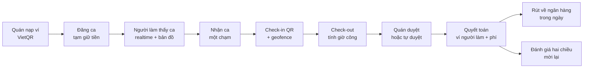
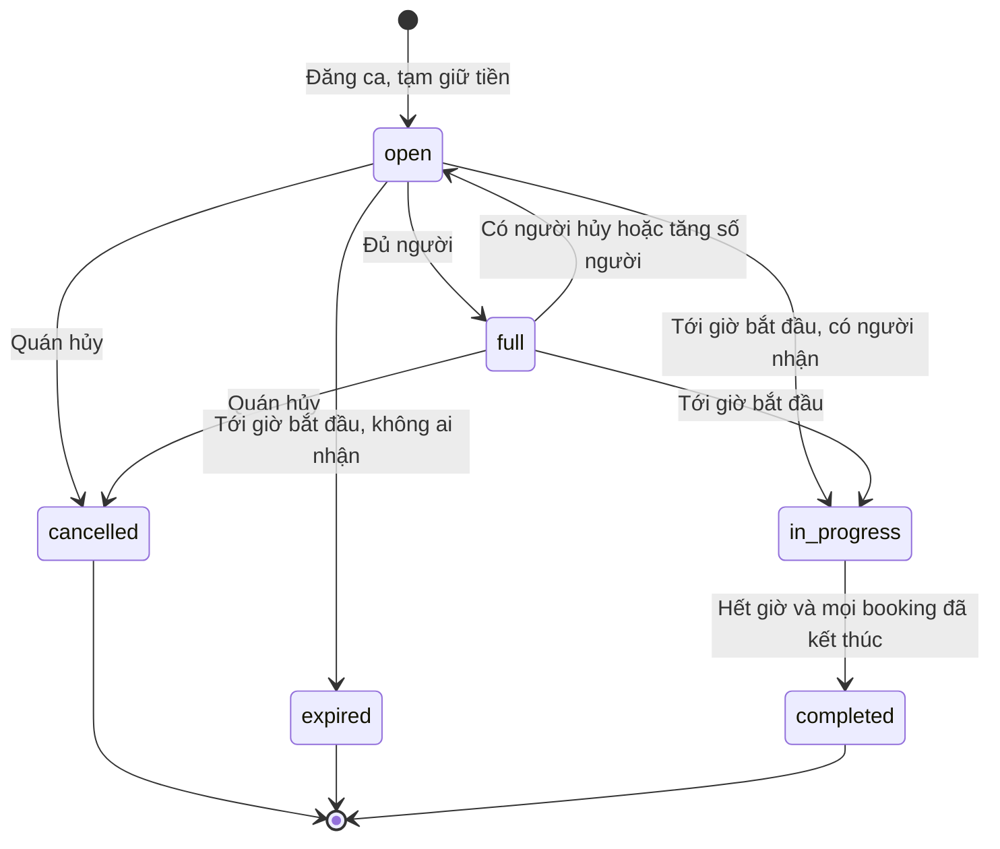
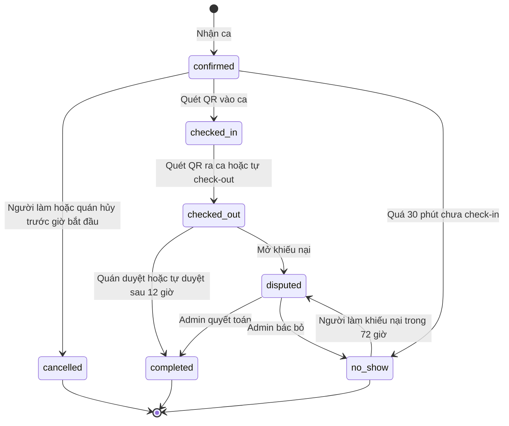
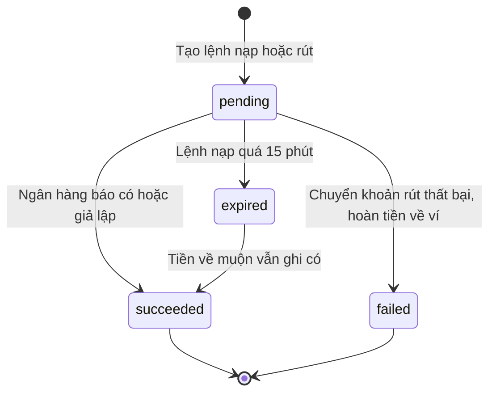

# Đặc tả yêu cầu phần mềm (SRS) — Ca Nhanh

> **Ca Nhanh — chợ ca làm theo giờ giữa quán và người làm.**
> "Đăng ca lúc 2 giờ chiều, 5 giờ có người đến làm, tối nhận lương."

| Mục | Nội dung |
|---|---|
| Phiên bản | 1.0 (bản để review) |
| Ngày | 04/11/2026 |
| Nhóm thực hiện | [Tên nhóm] · [Lớp học phần] |
| Phạm vi | Bản demo/MVP chạy trên PaaS miễn phí (Vercel + Supabase) |
| Tài liệu liên quan | [02 Use Case & User Stories](02-Use-Cases-User-Stories.md) · [03 Kiến trúc HLD](03-System-Architecture-HLD.md) · [04 ERD & CSDL](04-ERD-Database-Schema.md) · [05 API](05-API-Specification.md) |

---

## 1. Giới thiệu

### 1.1 Mục đích tài liệu
Tài liệu mô tả **cái gì** hệ thống Ca Nhanh phải làm: chức năng, quy tắc nghiệp vụ, ràng buộc và yêu cầu chất lượng của bản demo. Đây là nguồn gốc của mọi mã yêu cầu (`FR-…`, `BR-…`, `NFR-…`) được tham chiếu trong các tài liệu 02–05. Người đọc chính: nhóm phát triển, giảng viên hướng dẫn, người kiểm thử.

### 1.2 Phạm vi sản phẩm
Ca Nhanh là **sàn hai phía** (two-sided marketplace) ghép **ca làm ngắn theo giờ** giữa quán F&B vừa và nhỏ (bên trả tiền) với sinh viên/người cần thu nhập linh hoạt (bên cung), theo mô hình Timee (Nhật Bản): không phỏng vấn, nhận ca một chạm, chấm công bằng QR, nhận lương trong ngày. Nền tảng thu **phí dịch vụ % trên tiền công** mà quán trả thêm.

**Trong phạm vi demo**

| Nhóm | Nội dung |
|---|---|
| Ba màn hình cốt lõi (theo slide) | Quán đăng ca · Người làm nhận ca · Check-in QR và nhận lương |
| Niềm tin và tiền | Ví quán có **ký quỹ (tạm giữ)** khi đăng ca, quyết toán tự động khi duyệt giờ công, ví người làm, rút tiền (giả lập), nạp tiền qua **VietQR** (giả lập xác nhận) |
| Uy tín | Đánh giá hai chiều, điểm phạt và tạm khóa khi bỏ ca, người quen và mời lại, đẩy ca gấp |
| Vận hành | Dashboard KPI cho admin, duyệt xác minh, xử lý khiếu nại, cấu hình tham số, công cụ demo |
| Tự động hóa | Bộ hẹn giờ mỗi phút: nhắc ca, bắt đầu ca, đánh dấu vắng mặt, tự check-out, tự duyệt |

**Ngoài phạm vi demo** (ghi nhận cho giai đoạn sau)

- Dòng tiền thật, giấy phép trung gian thanh toán, hóa đơn điện tử, khấu trừ thuế TNCN, bảo hiểm theo ca.
- eKYC tự động (OCR CCCD, so khớp khuôn mặt). Demo dùng duyệt tay hoặc tự xác minh.
- Ứng dụng native iOS/Android (dùng PWA thay thế), chat trong app, hợp đồng lao động điện tử.
- Phí khi quán tuyển chính thức người làm (ghi nhận thủ công), đa ngôn ngữ, đa thành phố (mặc định Hà Nội, cấu hình được).

### 1.3 Thuật ngữ và viết tắt

| Thuật ngữ | Giải thích |
|---|---|
| Ca (shift) | Một khung giờ làm việc quán đăng, gồm vị trí, giờ, lương/giờ, số người cần |
| Chỗ / ghế (seat) | Một suất trong ca. Ca cần 3 người có 3 chỗ |
| Booking (phiếu nhận ca) | Bản ghi một người làm đã nhận một chỗ trong ca, mang toàn bộ vòng đời: nhận → check-in → check-out → duyệt → quyết toán |
| Ký quỹ / tạm giữ (hold) | Tiền trong ví quán bị khóa cho ca đã đăng, đảm bảo người làm chắc chắn được trả |
| Quyết toán (settlement) | Chuyển tiền công vào ví người làm, thu phí nền tảng, hoàn phần tạm giữ thừa |
| Giờ công (timesheet) | Số phút làm được tính từ giờ check-in/check-out, giới hạn trong khung ca |
| Geofence | Vòng bán kính quanh quán, người làm phải ở trong vòng này khi quét QR |
| Vắng mặt (no-show) | Đã nhận ca nhưng quá 30 phút sau giờ bắt đầu chưa check-in |
| Người quen (favorite) | Người làm được quán đánh dấu muốn mời lại |
| Ca gấp (urgent boost) | Ca được trả phí để nổi bật và báo cho người làm gần quán |
| KYC | Xác minh danh tính (ảnh CCCD 2 mặt + ảnh chân dung) |
| VietQR | Chuẩn mã QR chuyển khoản liên ngân hàng tại Việt Nam (NAPAS) |
| GMV | Tổng giá trị giao dịch = tiền công + phí của các ca hoàn tất |
| Fill rate | Tỉ lệ lấp chỗ = số chỗ có người nhận / tổng số chỗ đăng |
| Time-to-fill | Thời gian từ lúc đăng ca đến khi đủ người |
| PaaS | Platform-as-a-Service: dùng nền tảng có sẵn (Vercel, Supabase), không tự quản lý máy chủ |
| RLS | Row Level Security: phân quyền theo từng dòng dữ liệu trong PostgreSQL |
| PWA | Progressive Web App: web cài được lên màn hình chính điện thoại |
| MoSCoW | Mức ưu tiên: **M**ust (bắt buộc), **S**hould (nên có), **C**ould (có thì tốt), **W**on't (không làm đợt này) |

### 1.4 Tài liệu tham chiếu
1. Bộ slide "3 ý tưởng TMĐT – Business Model Canvas" của nhóm, phần Ý tưởng 1 – Ca Nhanh (vấn đề, thị trường, BMC, demo, rủi ro).
2. ISO/IEC/IEEE 29148:2018, cấu trúc đặc tả yêu cầu (tham khảo).
3. Nghị định 293/2025/NĐ-CP về lương tối thiểu, hiệu lực 01/01/2026: Vùng I **25.500 đ/giờ**, Vùng II 22.700 đ/giờ.
4. Luật Bảo vệ dữ liệu cá nhân 2025 (hiệu lực 01/01/2026), áp dụng tinh thần thu thập tối thiểu.
5. Đặc tả VietQR Quick Link (`img.vietqr.io`).

### 1.5 Cấu trúc bộ tài liệu
Xem [README](README.md). Mỗi yêu cầu chức năng trong §3 được truy vết tới use case, user story, endpoint API và bảng CSDL ở **Phụ lục A**.

---

## 2. Mô tả tổng quan

### 2.1 Bối cảnh và vấn đề
Hai phía đều đang gặp vấn đề (theo slide của nhóm):

- **Chủ quán**: nhân viên nghỉ đột xuất, cuối tuần và lễ Tết thiếu người. Tuyển part-time mất cả tuần, đào tạo xong người ta lại nghỉ.
- **Sinh viên**: lịch học đổi theo kỳ nên không cam kết được cả tháng. Lương thường trả cuối tháng, có khi bị quỵt.

Quy mô: khoảng **329.000** cửa hàng ăn uống tại Việt Nam năm 2025, doanh thu ngành **726.500 tỷ đồng** (iPOS–Nestlé, 4/2026). Hình mẫu Timee có **11,9 triệu** người đăng ký và khoảng **200.000** doanh nghiệp (Nikkei BP, 10/2025), niêm yết tại Tokyo năm 2024. Tại Việt Nam, các nền tảng hiện có (TopCV, Timviec365…) vẫn theo kiểu đăng tin rồi phỏng vấn.

### 2.2 Mục tiêu sản phẩm và tiêu chí thành công của demo

| Mục tiêu | Chỉ số đo trong buổi demo |
|---|---|
| Chứng minh "có người trong vài giờ" | Ca mới xuất hiện trên điện thoại người làm **≤ 2 giây** sau khi đăng |
| Chứng minh "không lo bị quỵt" | Mọi ca hiển thị nhãn *Đã ký quỹ*; tiền vào ví người làm ngay khi duyệt |
| Chứng minh độ tin cậy kỹ thuật | Hai người tranh chỗ cuối cùng thì **đúng 1** người nhận được; QR quán khác hoặc ngoài vùng bị từ chối |
| Chứng minh mô hình doanh thu (BMC) | Dashboard hiển thị GMV, doanh thu phí 20%, fill rate, time-to-fill trên ≥ 30 ngày dữ liệu |
| Ràng buộc của nhóm | Chi phí hạ tầng **0đ/tháng**, chỉ dùng PaaS, URL công khai HTTPS |

### 2.3 Chức năng chính (tóm tắt)

### 2.4 Người dùng và đặc điểm

| Vai trò | Persona | Thiết bị, bối cảnh | Nhu cầu chính |
|---|---|---|---|
| Người làm (`worker`) | **Minh**, 20 tuổi, sinh viên năm 3, lịch học thay đổi, cần 2–3 triệu/tháng | Điện thoại Android tầm trung, 4G, dùng một tay | Tìm ca gần, đúng lịch rảnh; chắc chắn được trả; tiền về nhanh |
| Chủ quán (`shop_owner`) | **Chị Lan**, 34 tuổi, chủ 2 quán cà phê ở Cầu Giấy | iPad ở quầy (kiosk QR), điện thoại, laptop | Có người trong vài giờ; không tốn công tuyển; chỉ trả theo giờ thực làm |
| Quản trị viên (`admin`) | **Huy**, nhân viên vận hành Ca Nhanh | Laptop | Duyệt hồ sơ, xử lý khiếu nại, theo dõi KPI, cấu hình phí |
| Hệ thống hẹn giờ | pg_cron trong Postgres | Chạy mỗi phút | Chuyển trạng thái theo thời gian |

### 2.5 Môi trường vận hành
- Web app responsive + PWA. Trình duyệt mới nhất: Chrome, Safari, Edge, Firefox; iOS 16+, Android 10+.
- Camera (quét QR) và GPS (geofence) cần ngữ cảnh bảo mật HTTPS. Vercel cấp HTTPS mặc định.
- Máy chủ: Vercel (Next.js) và Supabase (Postgres, Auth, Realtime, Storage, pg_cron). Đặt region **Singapore** để gần Việt Nam nhất.
- Múi giờ hiển thị `Asia/Ho_Chi_Minh`; CSDL lưu `timestamptz` (UTC).

### 2.6 Ràng buộc thiết kế và triển khai

| Mã | Ràng buộc |
|---|---|
| C-01 | Chỉ dùng dịch vụ PaaS/BaaS có gói miễn phí. Không dùng IaaS (VM, VPS, Kubernetes) |
| C-02 | Thời gian làm demo 2–3 tuần, nhóm 3–5 sinh viên |
| C-03 | Không phụ thuộc phần cứng (không NFC/beacon); chấm công bằng QR + GPS của điện thoại |
| C-04 | Không xử lý tiền thật. Ví là sổ cái nội bộ, thanh toán là giả lập có thể thay bằng cổng thật qua webhook |
| C-05 | Supabase Free: 500 MB CSDL, 50.000 MAU, 5 GB egress, **tạm dừng sau 7 ngày không hoạt động**. Vercel Hobby: chỉ dùng phi thương mại, cron rất hạn chế (nên lập lịch bằng pg_cron) |
| C-06 | Giao diện tiếng Việt; tiền tệ VND số nguyên (không có phần lẻ) |

### 2.7 Giả định và phụ thuộc
- Người làm có smartphone có camera, GPS và Internet; quán có một màn hình (tablet, điện thoại hoặc laptop) để hiển thị QR.
- Chính sách free tier của Vercel/Supabase không đổi trong thời gian demo (cần kiểm tra lại trước khi demo).
- Dữ liệu demo là dữ liệu giả (tên, quán, CCCD). Không thu thập dữ liệu cá nhân thật.
- Ảnh QR chuyển khoản sinh từ dịch vụ công khai `img.vietqr.io`; bản đồ dùng OpenStreetMap.

---

## 3. Yêu cầu chức năng

Ký hiệu ưu tiên: **M** / **S** / **C** theo MoSCoW. Phạm vi demo tối thiểu = tất cả mục **M**.

### 3.1 Tài khoản và xác thực (AUTH)

| Mã | Yêu cầu | Ưu tiên |
|---|---|---|
| FR-AUTH-01 | Đăng ký và đăng nhập bằng email + mật khẩu | M |
| FR-AUTH-02 | Đăng nhập bằng Google (OAuth) | S |
| FR-AUTH-03 | Onboarding chọn vai trò *Người làm* hoặc *Chủ quán*. Vai trò bị khóa sau khi hoàn tất onboarding; không ai tự cấp được quyền admin | M |
| FR-AUTH-04 | Nút "Đăng nhập nhanh" bằng tài khoản demo (chỉ hiện khi bật chế độ demo) | M |
| FR-AUTH-05 | Phân quyền theo vai trò cho mọi trang và API; người chưa đăng nhập chỉ xem trang giới thiệu | M |
| FR-AUTH-06 | Đăng xuất; quên mật khẩu qua email (cần SMTP riêng, ví dụ Resend) | S |

### 3.2 Hồ sơ người làm và xác minh (PRF)

| Mã | Yêu cầu | Ưu tiên |
|---|---|---|
| FR-PRF-01 | Người làm khai báo họ tên, SĐT, ngày sinh, trường, kỹ năng (các vị trí làm được), giới thiệu ngắn, vị trí nhà (tùy chọn, dùng để báo ca gấp) | M |
| FR-PRF-02 | Gửi hồ sơ xác minh: ảnh CCCD 2 mặt + ảnh chân dung (lưu kho riêng tư), 4 số cuối CCCD | S |
| FR-PRF-03 | Chỉ người làm đã xác minh mới nhận được ca. Chế độ demo có thể bật tự xác minh | M |
| FR-PRF-04 | Khai báo tài khoản ngân hàng nhận tiền: mã ngân hàng (BIN), số tài khoản, tên chủ tài khoản | M |
| FR-PRF-05 | Hồ sơ năng lực công khai cho quán ("CV tự động"): số ca hoàn thành, điểm đánh giá, số lần vắng mặt, kỹ năng, đánh giá gần đây | S |

### 3.3 Quán (SHP)

| Mã | Yêu cầu | Ưu tiên |
|---|---|---|
| FR-SHP-01 | Tạo quán: tên, loại hình, địa chỉ, **ghim vị trí trên bản đồ**, SĐT, ảnh bìa, bán kính chấm công (30–1000 m, mặc định 150 m) | M |
| FR-SHP-02 | Một chủ quán quản lý nhiều quán (chi nhánh) dùng chung một ví | M |
| FR-SHP-03 | Quán phải được duyệt mới đăng ca; chế độ demo tự duyệt | M |
| FR-SHP-04 | Màn hình **kiosk** hiển thị mã QR chấm công đổi mỗi 30 giây, kèm đồng hồ và danh sách người đến hôm nay | M |
| FR-SHP-05 | Danh sách người từng làm ở quán; đánh dấu *người quen* hoặc *chặn* | S |
| FR-SHP-06 | Nút "Đặt vị trí quán tại đây" dùng GPS thiết bị (phục vụ demo trên lớp) | M |

### 3.4 Đăng và quản lý ca (SFT)

| Mã | Yêu cầu | Ưu tiên |
|---|---|---|
| FR-SFT-01 | Đăng ca: vị trí, tiêu đề, mô tả, yêu cầu, ngày giờ bắt đầu và kết thúc, phút nghỉ, lương/giờ, số người cần (1–20) | M |
| FR-SFT-02 | Hiển thị **chi phí dự kiến** trước khi đăng: tiền công mỗi người, phí nền tảng, tổng tạm giữ, so với số dư khả dụng | M |
| FR-SFT-03 | Khi đăng, hệ thống **tạm giữ toàn bộ chi phí dự kiến** từ ví quán. Ca hiển thị nhãn *Đã ký quỹ* | M |
| FR-SFT-04 | Kiểm tra ràng buộc khi đăng: lương tối thiểu, thời lượng, thời gian đăng trước, trong 30 ngày tới (BR-02…BR-04) | M |
| FR-SFT-05 | Quán xem danh sách ca theo trạng thái; chi tiết ca hiển thị từng chỗ (trống, đã nhận, đã check-in) **theo thời gian thực** | M |
| FR-SFT-06 | Sửa mô tả và yêu cầu; tăng/giảm số người (tạm giữ được điều chỉnh). Không sửa giờ và lương sau khi đăng (BR-05) | S |
| FR-SFT-07 | Hủy ca: hoàn tiền tạm giữ; bồi thường người đã nhận nếu hủy trong vòng 24 giờ (BR-12) | M |
| FR-SFT-08 | **Đẩy ca gấp** (trả phí): ca nổi bật và báo người làm trong bán kính 3 km có kỹ năng phù hợp (BR-26) | S |
| FR-SFT-09 | **Ưu tiên người quen**: N phút đầu chỉ người quen được nhận | S |
| FR-SFT-10 | **Mời** người quen hoặc người từng làm nhận một ca cụ thể (BR-25) | S |
| FR-SFT-11 | Đăng lại (nhân bản) một ca cũ sang ngày mới | S |
| FR-SFT-12 | Đặt điểm đánh giá tối thiểu cho người nhận ca | M |

### 3.5 Khám phá ca (SRC)

| Mã | Yêu cầu | Ưu tiên |
|---|---|---|
| FR-SRC-01 | Danh sách ca đang mở quanh vị trí hiện tại (GPS) hoặc khu vực chọn; lọc theo ngày, vị trí, lương tối thiểu, bán kính (1–20 km) | M |
| FR-SRC-02 | Bản đồ ca: marker theo quán, nhấn mạnh ca gấp, nhấn vào xem tóm tắt | M |
| FR-SRC-03 | Sắp xếp: *Phù hợp nhất* (điểm phù hợp, BR-20), gần nhất, sớm nhất, lương cao nhất | S |
| FR-SRC-04 | Chi tiết ca: thông tin quán, điểm, bản đồ, **thu nhập dự kiến**, yêu cầu, số chỗ còn lại, nhãn *Đã ký quỹ*, thời gian ưu tiên người quen | M |
| FR-SRC-05 | Ca mới đăng, ca vừa đủ người hoặc vừa mở lại chỗ tự cập nhật trên danh sách/bản đồ **≤ 2 giây**, không cần tải lại | M |

### 3.6 Nhận ca (BKG)

| Mã | Yêu cầu | Ưu tiên |
|---|---|---|
| FR-BKG-01 | Nhận ca **một chạm**: chốt ngay nếu còn chỗ và đủ điều kiện, không phỏng vấn | M |
| FR-BKG-02 | Không bao giờ vượt số chỗ, kể cả khi nhiều người nhận cùng lúc (BR-08) | M |
| FR-BKG-03 | Chặn một người nhận hai ca trùng giờ | M |
| FR-BKG-04 | Kiểm tra điều kiện nhận ca (BR-07) và trả thông báo lý do cụ thể khi bị từ chối | M |
| FR-BKG-05 | "Ca của tôi": sắp tới, đang làm, chờ duyệt, đã xong, đã hủy; đếm ngược tới giờ vào ca | M |
| FR-BKG-06 | Người làm hủy ca: báo trước điểm phạt sẽ bị cộng (BR-09); chỗ mở lại và người quen của quán được báo ngay | M |
| FR-BKG-07 | Quán hủy một người làm: chỗ mở lại; bồi thường nếu trong 24 giờ (BR-12) | M |
| FR-BKG-08 | Nhắc ca 2 giờ trước giờ bắt đầu | M |
| FR-BKG-09 | Người làm nhận hoặc từ chối lời mời | S |
| FR-BKG-10 | SĐT người làm chỉ hiện với quán khi đã có booking (BR-28) | S |

### 3.7 Chấm công (ATT)

| Mã | Yêu cầu | Ưu tiên |
|---|---|---|
| FR-ATT-01 | Check-in và check-out bằng quét QR của quán (camera trong app; hoặc camera điện thoại mở đường link trong QR) | M |
| FR-ATT-02 | Xác thực QR: chữ ký HMAC hợp lệ, còn hạn (≤ 60 giây), đúng quán của booking (BR-14) | M |
| FR-ATT-03 | Xác thực vị trí: trong bán kính geofence cộng sai số GPS tối đa 100 m (BR-15) | M |
| FR-ATT-04 | Khung giờ check-in: từ 30 phút trước giờ bắt đầu đến trước giờ kết thúc; đánh dấu *đi muộn* sau 5 phút (BR-13) | M |
| FR-ATT-05 | Ghi log **mọi** lần quét, kể cả bị từ chối, kèm mã lý do và khoảng cách (chống gian lận) | M |
| FR-ATT-06 | Quán thấy trạng thái check-in của từng người theo thời gian thực | M |
| FR-ATT-07 | Tự đánh dấu vắng mặt sau 30 phút; tự check-out tại giờ kết thúc nếu quên quá 2 giờ (BR-10, BR-19) | M |

### 3.8 Ví, giờ công và thanh toán (PAY)

| Mã | Yêu cầu | Ưu tiên |
|---|---|---|
| FR-PAY-01 | Ví quán: số dư khả dụng, số tiền đang tạm giữ, lịch sử giao dịch | M |
| FR-PAY-02 | Nạp ví bằng VietQR: tạo lệnh, hiển thị QR có sẵn số tiền và nội dung chuyển khoản; xác nhận qua webhook hoặc nút **Giả lập đã chuyển khoản** (demo). Số dư cập nhật realtime | M |
| FR-PAY-03 | Tự tính giờ công và tiền công khi check-out (BR-16, BR-17) | M |
| FR-PAY-04 | Quán duyệt giờ công, có thể điều chỉnh kèm lý do (BR-18); tự duyệt sau 12 giờ (BR-19) | M |
| FR-PAY-05 | Duyệt xong là **quyết toán ngay**: tiền công vào ví người làm, phí vào ví nền tảng, hoàn phần tạm giữ thừa | M |
| FR-PAY-06 | Ví người làm và **rút về ngân hàng trong ngày** (giả lập chuyển khoản tức thì; admin có thể xác nhận tay) | M |
| FR-PAY-07 | Mọi biến động số dư ghi vào **sổ cái chỉ-thêm** (append-only), có số dư sau giao dịch | M |
| FR-PAY-08 | Chống ghi có trùng: webhook idempotent; header `Idempotency-Key` cho lệnh nạp và rút | M |
| FR-PAY-09 | Khiếu nại giờ công hoặc vắng mặt; quyết toán tạm dừng tới khi admin xử lý (BR-22) | S |

### 3.9 Uy tín (RAT)

| Mã | Yêu cầu | Ưu tiên |
|---|---|---|
| FR-RAT-01 | Đánh giá hai chiều 1–5 sao, thẻ nhanh, bình luận ≤ 500 ký tự, trong 7 ngày sau khi hoàn tất (BR-21) | M |
| FR-RAT-02 | Điểm trung bình và số lượt đánh giá của quán và người làm hiển thị công khai | M |
| FR-RAT-03 | Thẻ "Muốn mời lại" tự thêm người làm vào danh sách người quen của quán | S |
| FR-RAT-04 | Điểm phạt và tạm khóa nhận ca khi vượt ngưỡng (BR-09…BR-11) | M |

### 3.10 Thông báo (NTF)

| Mã | Yêu cầu | Ưu tiên |
|---|---|---|
| FR-NTF-01 | Thông báo trong app theo thời gian thực (chuông + toast) cho các sự kiện ở bảng §3.13 | M |
| FR-NTF-02 | Đánh dấu đã đọc từng thông báo hoặc tất cả | M |
| FR-NTF-03 | Web Push khi đóng app (PWA) | C |
| FR-NTF-04 | Email cho sự kiện quan trọng (Resend gói miễn phí) | C |

### 3.11 Quản trị (ADM)

| Mã | Yêu cầu | Ưu tiên |
|---|---|---|
| FR-ADM-01 | Dashboard KPI theo khoảng ngày: GMV, doanh thu phí, doanh thu đẩy ca, số ca, fill rate, time-to-fill trung vị, tỉ lệ vắng mặt, người làm và quán hoạt động, tỉ lệ mời lại; biểu đồ theo ngày | M |
| FR-ADM-02 | Hàng chờ xác minh người làm: xem ảnh qua URL ký hạn ngắn, duyệt/từ chối kèm lý do | S |
| FR-ADM-03 | Duyệt quán | M |
| FR-ADM-04 | Quản lý người dùng: tìm kiếm, khóa/mở khóa tài khoản, gỡ tạm khóa nhận ca | M |
| FR-ADM-05 | Xử lý khiếu nại: chấp nhận (điều chỉnh số phút) hoặc bác bỏ | S |
| FR-ADM-06 | Quản lý lệnh thanh toán: lọc theo loại/trạng thái, xác nhận thành công/thất bại lệnh rút | M |
| FR-ADM-07 | Cấu hình tham số nền tảng (phí, lương tối thiểu, ngưỡng phạt, khung giờ, cờ demo) | M |
| FR-ADM-08 | Công cụ demo: reset dữ liệu + sinh lịch sử N ngày, **tua thời gian** của một ca, chạy bộ hẹn giờ ngay | M |

### 3.12 Tự động hóa hệ thống (SYS)

| Mã | Yêu cầu | Ưu tiên |
|---|---|---|
| FR-SYS-01 | Bộ hẹn giờ mỗi phút: nhắc ca (2 giờ trước) → bắt đầu ca (hoàn tạm giữ chỗ trống; ca 0 người → hết hạn) → đánh dấu vắng mặt → tự check-out → tự duyệt → hoàn tất ca → hết hạn lệnh nạp | M |
| FR-SYS-02 | Endpoint kiểm tra sức khỏe (health check) có truy vấn CSDL, dùng cho giám sát và giữ dự án không bị tạm dừng | M |

### 3.13 Danh mục sự kiện thông báo

| Sự kiện | Người nhận | Ví dụ nội dung |
|---|---|---|
| `booking.created` | Quán | "Nguyễn Minh đã nhận ca · 2/2 người" |
| `booking.cancelled_by_worker` / `shift.seat_reopened` | Quán / người quen của quán | "Ca đã mở lại 1 chỗ trống" |
| `booking.cancelled_by_shop`, `shift.cancelled` | Người làm | "Quán đã hủy ca. Bạn được bồi thường 60.000đ" |
| `booking.reminder` | Người làm | "Ca bắt đầu lúc 17:00. Nhớ quét QR khi đến quán" |
| `attendance.checked_in`, `timesheet.pending` | Quán | "Minh đã check-in lúc 16:58, cách quán 23 m" |
| `earning.credited` | Người làm | "+150.000đ đã vào ví" |
| `booking.no_show`, `account.penalty`, `account.suspended` | Quán, người làm | "Bạn có 4 điểm phạt nên bị tạm khóa nhận ca 7 ngày" |
| `invite.received`, `shift.priority_invite`, `shift.urgent_nearby` | Người làm | "Cà phê Góc Phố mời bạn làm ca" |
| `wallet.topup_succeeded`, `wallet.withdrawal_*` | Chủ ví | "Nạp tiền thành công +2.000.000đ" |
| `kyc.reviewed`, `review.received`, `dispute.*`, `shift.expired` | Theo ngữ cảnh | |
| `shop.reviewed`, `account.locked`, `account.unlocked`, `account.unsuspended` | Chủ quán, người dùng bị admin xử lý | "Đã gỡ tạm khóa nhận ca" |

---

## 4. Quy tắc nghiệp vụ

Các giá trị in đậm là **tham số cấu hình** trong bảng `platform_settings` (admin đổi được, không cần sửa mã).

| Mã | Quy tắc |
|---|---|
| BR-01 | **Phí nền tảng 20%** trên tiền công, **quán trả thêm**; người làm nhận đủ tiền công. (Timee thu 30%; chọn 20% để thâm nhập thị trường, là giả định cần kiểm chứng) |
| BR-02 | Lương/giờ ≥ **25.500đ** (lương tối thiểu giờ Vùng I, NĐ 293/2025/NĐ-CP). Quán ở vùng khác chỉnh tham số |
| BR-03 | Thời lượng ca > 0 và ≤ 12 giờ; phút nghỉ 0–120 và nhỏ hơn thời lượng; giờ bắt đầu trong 30 ngày tới |
| BR-04 | Giờ bắt đầu ≥ thời điểm đăng + **30 phút** (demo có thể giảm còn 2 phút) |
| BR-05 | Không sửa giờ và lương sau khi đăng, để bảo vệ người đã nhận theo điều kiện cũ. Muốn đổi thì hủy và đăng lại (có nút nhân bản) |
| BR-06 | **Ký quỹ**: tạm giữ = (tiền công dự kiến + phí) × số người. Không đủ số dư khả dụng thì không đăng được |
| BR-07 | Điều kiện nhận ca: tài khoản hoạt động; đã xác minh; ≥ 18 tuổi; không đang bị tạm khóa; không bị quán chặn; điểm ≥ điểm tối thiểu của ca (chỉ áp dụng khi đã có đánh giá); ngoài thời gian ưu tiên người quen (trừ khi là người quen hoặc được mời); ca đang mở, chưa tới giờ bắt đầu, còn chỗ; chưa nhận ca này; không trùng giờ ca khác |
| BR-08 | Ai nhận trước được trước. Hệ thống khóa dòng ca khi xử lý nên không bao giờ vượt số chỗ |
| BR-09 | Người làm hủy: ≥ 24 giờ trước giờ bắt đầu: **0 điểm**; 6–24 giờ: **1 điểm**; < 6 giờ: **2 điểm**. Không hủy được sau giờ bắt đầu |
| BR-10 | Vắng mặt: quá **30 phút** sau giờ bắt đầu chưa check-in → **4 điểm**; tạm giữ của chỗ đó hoàn về ví quán |
| BR-11 | Tổng điểm phạt trong **30 ngày** ≥ **4** → tạm khóa nhận ca **7 ngày** |
| BR-12 | Quán hủy (cả ca hoặc một người) **trong vòng 24 giờ** trước giờ bắt đầu: mỗi người đã nhận được bồi thường **50%** tiền công dự kiến, không tính phí nền tảng. Hủy sớm hơn: miễn phí |
| BR-13 | Check-in được từ **30 phút** trước giờ bắt đầu đến trước giờ kết thúc; *đi muộn* nếu check-in sau giờ bắt đầu + **5 phút**. Check-out chỉ sau check-in |
| BR-14 | Mã QR = `v1.<shop_id>.<window>.<HMAC-SHA256>`, window = ⌊epoch / **30 s**⌋. Chấp nhận cửa sổ hiện tại và liền trước (tuổi tối đa 60 giây) |
| BR-15 | Geofence: khoảng cách tới quán ≤ bán kính quán + min(sai số GPS báo cáo, **100 m**). Bắt buộc có GPS, trừ khi bật cờ demo `skip_geofence` |
| BR-16 | Giờ công = max(0, số phút giữa max(check-in, giờ bắt đầu) và min(check-out, giờ kết thúc) − phút nghỉ). Đến sớm hay về muộn không được tính thêm, trừ khi quán điều chỉnh |
| BR-17 | Tiền công = làm tròn(phút × lương/giờ ÷ 60) đồng; phí = làm tròn(tiền công × tỉ lệ phí). Tiền là số nguyên VND |
| BR-18 | Quán điều chỉnh giờ công phải ghi lý do ≥ 5 ký tự; tối đa 960 phút |
| BR-19 | Tự check-out tại giờ kết thúc nếu quên quá **120 phút**; tự duyệt giờ công sau **12 giờ** kể từ check-out |
| BR-20 | Điểm phù hợp = 0,40 × gần (1 − khoảng cách/bán kính) + 0,25 × lương (lương/50.000, tối đa 1) + 0,20 × uy tín quán (điểm/5; quán mới = 0,8) + 0,15 × đúng kỹ năng (1 hoặc 0,3) + 0,10 nếu ca gấp |
| BR-21 | Chỉ đánh giá booking đã hoàn tất, trong 7 ngày, mỗi chiều đúng một lần |
| BR-22 | Khiếu nại được mở với booking đã check-out chưa duyệt (cả hai bên) hoặc bị đánh dấu vắng mặt (người làm, trong 72 giờ). Khi đang khiếu nại, không duyệt và không quyết toán |
| BR-23 | Nạp tiền: **50.000đ** – 50.000.000đ/lệnh; lệnh hết hạn sau **15 phút**; nội dung chuyển khoản là mã tham chiếu duy nhất `CNxxxxxxxx`. Tiền đến sau khi hết hạn vẫn được ghi có (tiền đã về là sự thật) |
| BR-24 | Rút tiền: tối thiểu **10.000đ**, tối đa bằng số dư; phải có tài khoản ngân hàng; rút thất bại thì tiền hoàn về ví |
| BR-25 | Chỉ mời được người quen hoặc người từng hoàn thành ca tại quán (và không bị chặn). Lời mời được bỏ qua thời gian ưu tiên và điểm tối thiểu |
| BR-26 | Đẩy ca gấp: **20.000đ/ca**, chỉ khi ca đang mở; báo người làm đã xác minh trong bán kính 3 km có kỹ năng phù hợp |
| BR-27 | Người làm phải đủ 18 tuổi (đơn giản hóa pháp lý về lao động chưa thành niên) |
| BR-28 | Quyền riêng tư: SĐT người làm chỉ hiện với quán có booking với người đó; ngày sinh, tài khoản ngân hàng, vị trí nhà, ảnh CCCD chỉ chủ sở hữu và admin thấy |

### 4.1 Ví dụ tính tiền (dùng xuyên suốt tài liệu và kiểm thử)

Ca *Pha chế ca tối* 17:00–22:00, nghỉ 0 phút, 30.000đ/giờ, cần 2 người, phí 20%.

| Bước | Tính toán | Ví quán (khả dụng / tạm giữ) | Ví người làm | Ví nền tảng |
|---|---|---|---|---|
| Nạp tiền | +2.000.000 | 2.000.000 / 0 | | |
| Đăng ca | mỗi chỗ 300 phút × 30.000 / 60 = 150.000 + phí 30.000 = 180.000; × 2 = **360.000** | 1.640.000 / 360.000 | | |
| Minh check-in 16:52, check-out 22:05 | giờ công tính 17:00–22:00 = 300 phút → 150.000đ (BR-16) | | | |
| Quán duyệt | hoàn tạm giữ 180.000, trả 150.000 + 30.000 | 1.640.000 / 180.000 | **+150.000** | **+30.000** |
| Người thứ hai vắng mặt | hoàn tạm giữ chỗ đó 180.000 (BR-10) | 1.820.000 / 0 | | |

Tổng tiền được bảo toàn: 1.820.000 + 150.000 + 30.000 = 2.000.000đ. Bất biến này được kiểm thử tự động (xem [04 §11](04-ERD-Database-Schema.md)).

---

## 5. Vòng đời trạng thái

### 5.1 Ca (`shift_status`)

### 5.2 Booking (`booking_status`)

### 5.3 Lệnh thanh toán (`payment_status`)

---

## 6. Yêu cầu dữ liệu

- 17 bảng nghiệp vụ trong schema `public` của PostgreSQL. Chi tiết ERD, từ điển dữ liệu, ràng buộc và DDL xem [04-ERD-Database-Schema.md](04-ERD-Database-Schema.md).
- Tiền: `bigint` VND. Thời gian: `timestamptz` (UTC). Tọa độ: `geography(Point, 4326)` (PostGIS).
- Sổ cái ví (`wallet_transactions`) và log chấm công (`attendance_events`) là **chỉ-thêm**, không sửa, không xóa.
- Lưu trữ: dữ liệu demo có thể reset bất kỳ lúc nào (FR-ADM-08). Ảnh CCCD ở kho riêng tư; khi vận hành thật cần chính sách xóa sau khi duyệt (đề xuất 30 ngày).

---

## 7. Yêu cầu giao diện ngoài

### 7.1 Giao diện người dùng (danh sách màn hình)

| Mã | Màn hình | Vai trò | Thiết bị chính | FR chính |
|---|---|---|---|---|
| W1 | Đăng nhập / đăng ký / đăng nhập nhanh demo | Tất cả | Mọi thiết bị | AUTH-01…04 |
| W2 | Onboarding: vai trò → hồ sơ → xác minh → ngân hàng | Người làm | Điện thoại | AUTH-03, PRF-01…04 |
| W3 | **Khám phá ca**: danh sách + bản đồ + bộ lọc | Người làm | Điện thoại | SRC-01…05 |
| W4 | Chi tiết ca + nút "Nhận ca" | Người làm | Điện thoại | SRC-04, BKG-01, BKG-04 |
| W5 | Ca của tôi (tab: sắp tới / đang làm / chờ duyệt / lịch sử) | Người làm | Điện thoại | BKG-05, BKG-06 |
| W6 | **Quét QR** check-in/check-out | Người làm | Điện thoại | ATT-01…04 |
| W7 | Ví và rút tiền | Người làm | Điện thoại | PAY-06 |
| W8 | Đánh giá sau ca | Người làm, quán | Mọi thiết bị | RAT-01, RAT-03 |
| W9 | Hồ sơ và CV tự động; lời mời | Người làm | Điện thoại | PRF-05, BKG-09 |
| S1 | **Dashboard hôm nay**: ca hôm nay, chỗ đã lấp, ai đã check-in, chờ duyệt | Chủ quán | Tablet, laptop | SFT-05, ATT-06 |
| S2 | Đăng ca (form + ước tính chi phí + tùy chọn gấp/ưu tiên) | Chủ quán | Laptop | SFT-01…04, 08, 09, 12 |
| S3 | Chi tiết ca: các chỗ realtime, mời người quen, hủy | Chủ quán | Mọi thiết bị | SFT-05…07, 10 |
| S4 | **Kiosk QR** toàn màn hình | Chủ quán | Tablet | SHP-04 |
| S5 | Duyệt giờ công | Chủ quán | Mọi thiết bị | PAY-04, PAY-05 |
| S6 | Người làm quen / đã chặn | Chủ quán | Laptop | SHP-05 |
| S7 | Ví quán và nạp tiền VietQR | Chủ quán | Mọi thiết bị | PAY-01, PAY-02 |
| S8 | Hồ sơ quán (ghim bản đồ, bán kính) | Chủ quán | Laptop | SHP-01…03, SHP-06 |
| A1 | **Dashboard KPI** | Admin | Laptop | ADM-01 |
| A2…A7 | Xác minh · Quán · Người dùng · Khiếu nại · Thanh toán · Cấu hình và công cụ demo | Admin | Laptop | ADM-02…08 |

Yêu cầu chung: thanh thông báo (chuông) trên mọi màn hình (FR-NTF-01); trạng thái rỗng, đang tải và lỗi có thông điệp tiếng Việt; số tiền dạng `150.000đ`.

### 7.2 Giao diện phần mềm

| Hệ thống ngoài | Mục đích | Cách tích hợp |
|---|---|---|
| Supabase Auth | Đăng nhập email/mật khẩu, Google OAuth, phát JWT | SDK `@supabase/ssr` |
| Supabase Postgres + PostGIS + pg_cron | Dữ liệu, hàm nghiệp vụ, truy vấn địa lý, lập lịch | supabase-js (PostgREST/RPC) phía server |
| Supabase Realtime | Đẩy thay đổi dữ liệu tới trình duyệt | WebSocket `postgres_changes` (tôn trọng RLS) |
| Supabase Storage | Ảnh đại diện, ảnh quán (công khai); ảnh CCCD (riêng tư) | Upload trực tiếp từ client theo chính sách thư mục |
| VietQR Quick Link | Ảnh QR chuyển khoản có sẵn số tiền và nội dung | URL `img.vietqr.io/image/<BIN>-<STK>-compact2.png?amount=…&addInfo=…` |
| OpenStreetMap / Nominatim | Nền bản đồ; tìm địa chỉ khi tạo quán | Leaflet; Nominatim tối đa 1 yêu cầu/giây, không autocomplete |
| Cổng thanh toán (tùy chọn, sau demo) | Báo có tự động khi khách chuyển khoản | Webhook `POST /api/v1/webhooks/payments` có chữ ký HMAC |

### 7.3 Giao diện phần cứng
Camera điện thoại (quét QR qua `getUserMedia`/BarcodeDetector), GPS (Geolocation API, độ chính xác cao), màn hình tablet cho kiosk (giữ màn hình sáng bằng Wake Lock API nếu có).

### 7.4 Giao tiếp
HTTPS (TLS) cho mọi lời gọi; WebSocket bảo mật (WSS) cho Realtime; JSON UTF-8.

---

## 8. Yêu cầu phi chức năng

| Mã | Nhóm | Yêu cầu | Cách kiểm chứng |
|---|---|---|---|
| NFR-PERF-01 | Hiệu năng | API p95 < 500 ms (đọc) và < 800 ms (ghi) ở tải demo (≤ 50 người dùng đồng thời, region Singapore) | Log thời gian của Vercel |
| NFR-PERF-02 | Hiệu năng | Tìm ca trong bán kính 5 km < 300 ms tại CSDL với 10.000 ca (chỉ mục GiST) | `EXPLAIN ANALYZE` trên dữ liệu sinh |
| NFR-PERF-03 | Hiệu năng | Độ trễ Realtime từ lúc ghi tới lúc hiển thị < 2 giây | Bấm giờ khi demo trên 2 thiết bị |
| NFR-PERF-04 | Hiệu năng | Trang khám phá ca trên 4G: LCP < 2,5 s | Lighthouse (mobile) |
| NFR-SEC-01 | Bảo mật | HTTPS toàn bộ; khóa bí mật (secret key của Supabase, `QR_SIGNING_SECRET`, `PAYMENT_WEBHOOK_SECRET`) chỉ nằm ở server | Rà biến môi trường; không có tiền tố `NEXT_PUBLIC_` |
| NFR-SEC-02 | Bảo mật | Bật RLS cho 100% bảng; client không ghi trực tiếp vào bảng nghiệp vụ | Kiểm thử SQL (vai trò `authenticated`) |
| NFR-SEC-03 | Bảo mật | Hàm nghiệp vụ `fn_*` chỉ `service_role` được gọi; client gọi trực tiếp sẽ bị từ chối | Kiểm thử SQL |
| NFR-SEC-04 | Bảo mật | Kiểm tra đầu vào bằng Zod ở mọi API; upload ảnh ≤ 5 MB, định dạng jpg/png/webp | Unit test |
| NFR-SEC-05 | Bảo mật | Webhook kiểm tra chữ ký HMAC và timestamp (±5 phút) để chống phát lại | Unit test |
| NFR-SEC-06 | Bảo mật | Giới hạn tần suất API ghi (≈ 30 yêu cầu/phút/người dùng) | Should, xem HLD |
| NFR-PRIV-01 | Riêng tư | Thu thập tối thiểu; chỉ lưu 4 số cuối CCCD; ảnh CCCD ở kho riêng tư; phân quyền cột ẩn SĐT, ngày sinh, ngân hàng; demo chỉ dùng dữ liệu giả | Kiểm thử SQL + review |
| NFR-REL-01 | Toàn vẹn | Mọi thao tác tiền nằm trong một transaction CSDL; bất biến bảo toàn tiền đúng 100% | Kiểm thử SQL tự động |
| NFR-REL-02 | Toàn vẹn | Idempotent cho webhook, lệnh nạp và lệnh rút | Kiểm thử SQL |
| NFR-REL-03 | Toàn vẹn | Tác vụ định kỳ chạy lại an toàn (idempotent, `SKIP LOCKED`) | Review mã |
| NFR-AVL-01 | Sẵn sàng | Ổn định trong buổi demo; free tier không có SLA nên phải có checklist trước demo | Checklist ở HLD §11 |
| NFR-USA-01 | Khả dụng | Mobile-first cho người làm (từ 360 px); nhận ca ≤ 3 chạm từ danh sách | Thử trên điện thoại |
| NFR-USA-02 | Khả dụng | Tiếng Việt; tiền `150.000đ`; giờ 24h; múi giờ Việt Nam | Review UI |
| NFR-USA-03 | Khả dụng | Tương phản màu đạt WCAG 2.1 AA; form có nhãn; điều khiển được bằng bàn phím | Lighthouse Accessibility |
| NFR-USA-04 | Khả dụng | Cài được như PWA (manifest, icon, service worker) | Chrome Android "Thêm vào màn hình chính" |
| NFR-MNT-01 | Bảo trì | TypeScript strict; kiểu CSDL sinh tự động; migration đánh số phiên bản; ESLint/Prettier | CI |
| NFR-MNT-02 | Bảo trì | Kiểm thử: unit (tính tiền, token QR), kịch bản SQL (đã có, 103 kiểm tra), E2E luồng chính (Playwright) | CI |
| NFR-PORT-01 | Tương thích | Chrome/Safari/Edge/Firefox mới nhất; iOS 16+, Android 10+ | Thử thủ công |
| NFR-COST-01 | Chi phí | Chi phí vận hành demo **0đ/tháng**; không dùng IaaS | Hóa đơn Vercel/Supabase |
| NFR-SCL-01 | Mở rộng | Nâng lên gói trả phí không phải viết lại mã (xem HLD §12) | Review kiến trúc |
| NFR-OBS-01 | Quan sát | Log lỗi server (Vercel), log CSDL (Supabase), audit qua sổ cái và log chấm công | Review |

---

## 9. Tiêu chí nghiệm thu demo (Definition of Done)

1. Chạy trọn vòng đời trên URL công khai trong ≤ 5 phút: nạp ví → đăng ca → nhận ca → check-in → check-out → duyệt → tiền vào ví → rút → đánh giá.
2. Hai thiết bị: ca mới xuất hiện trên thiết bị người làm ≤ 2 giây; thiết bị quán thấy người nhận và check-in ngay lập tức.
3. Hai người bấm nhận chỗ cuối cùng cùng lúc: đúng 1 người thành công, người kia thấy "Ca vừa đủ người".
4. QR của quán khác, QR hết hạn hoặc quét từ xa đều bị từ chối với thông điệp rõ ràng, và được ghi log.
5. Hủy sát giờ thì thấy điểm phạt; vắng mặt thì bị tạm khóa nhận ca.
6. Dashboard admin có ≥ 30 ngày dữ liệu, hiển thị đủ KPI ở FR-ADM-01.
7. Kịch bản kiểm thử SQL `docs/sql/test/run_tests.sh` đạt 100% (hiện tại: **103/103**).
8. Toàn bộ chạy trên gói miễn phí, chi phí 0đ.

---

## 10. Rủi ro và hướng giảm thiểu

| Rủi ro | Mức | Hướng giảm thiểu trong thiết kế |
|---|---|---|
| Người làm bỏ ca (câu hỏi hội đồng hay hỏi nhất) | Cao | Điểm phạt theo thời điểm hủy; vắng mặt 4 điểm → tạm khóa 7 ngày; chỗ mở lại tự động; báo ngay cho người quen của quán ("danh sách dự phòng"); đẩy ca gấp |
| Chất lượng người làm | Trung bình | Xác minh danh tính; quán đặt điểm tối thiểu; ưu tiên người quen; đánh giá hai chiều; quán chặn được người làm |
| Quán không trả tiền | Trung bình | Ký quỹ khi đăng ca; quyết toán tự động; tự duyệt sau 12 giờ; bồi thường khi quán hủy sát giờ |
| Gian lận chấm công (chụp QR gửi bạn) | Trung bình | QR đổi mỗi 30 giây + chữ ký HMAC + geofence; log mọi lần quét |
| GPS trong nhà kém chính xác | Trung bình | Cộng sai số GPS (tối đa 100 m) vào bán kính; quán tự chỉnh bán kính; có khiếu nại |
| Pháp lý lao động thời vụ, bảo hiểm, thuế | Cao (khi vận hành thật) | Ngoài phạm vi demo; cần tư vấn pháp lý trước khi mở rộng; chỉ nhận người ≥ 18 tuổi; lương ≥ mức tối thiểu |
| Giữ tiền hộ cần giấy phép trung gian thanh toán | Cao (khi vận hành thật) | Demo dùng sổ cái mô phỏng; khi chạy thật hợp tác ngân hàng/ví điện tử được cấp phép (đúng ô "Đối tác chính" trong BMC) |
| Supabase Free tạm dừng sau 7 ngày không hoạt động | Trung bình | Health check định kỳ (GitHub Actions); khôi phục dự án trước demo; checklist |
| Mạng lớp học yếu khi demo | Trung bình | Phát 4G dự phòng; quay sẵn video 1 phút (theo lộ trình trong slide) |
| Quyền camera/vị trí trên iOS | Thấp | Hướng dẫn cấp quyền; dự phòng mở link từ camera hệ thống; cờ `skip_geofence` khi demo trên lớp |

---

## Phụ lục A. Ma trận truy vết

Một dòng cho mỗi nhóm chức năng, theo thứ tự yêu cầu → use case → story → API → dữ liệu.

| Nhóm FR | Use case | User story | Endpoint API chính | Bảng / hàm CSDL |
|---|---|---|---|---|
| AUTH-01…06 | UC-01, UC-02 | US-01, US-02, US-03 | Supabase Auth SDK, `GET /me`, `POST /me/onboarding` | `profiles`, `wallets`, `tg_handle_new_user`, `fn_complete_onboarding` |
| PRF-01…05 | UC-03 | US-04, US-05, US-06, US-24 | `PATCH /me/worker-profile`, `POST /me/kyc`, `GET /workers/{id}` | `worker_profiles`, `kyc_submissions`, `fn_submit_kyc` |
| SHP-01…06 | UC-04, UC-13 | US-07, US-08, US-28 | `POST /shops`, `PATCH /shops/{id}`, `GET /shops/{id}/checkin-token`, `PUT /shops/{id}/workers/{wid}/list` | `shops`, `shop_worker_lists` |
| SFT-01…12 | UC-06, UC-07, UC-08, UC-09 | US-11…US-18 | `POST /shifts/estimate`, `POST /shifts`, `PATCH /shifts/{id}`, `POST /shifts/{id}/cancel`, `/boost`, `/duplicate`, `/invites` | `shifts`, `shift_invites`, `fn_publish_shift`, `fn_resize_shift`, `fn_cancel_shift`, `fn_boost_shift`, `fn_invite_workers` |
| SRC-01…05 | UC-10 | US-19, US-20, US-21 | `GET /shifts`, `GET /shifts/{id}`, Realtime `shifts` | `search_shifts`, chỉ mục GiST `shops_location_gix` |
| BKG-01…10 | UC-11, UC-12 | US-22…US-27 | `POST /shifts/{id}/bookings`, `GET /bookings`, `POST /bookings/{id}/cancel`, `POST /invites/{id}/accept` | `bookings` (exclusion constraint), `fn_book_shift`, `fn_cancel_booking`, `fn_respond_invite` |
| ATT-01…07 | UC-13, UC-14, UC-24 | US-28…US-31 | `GET /shops/{id}/checkin-token`, `POST /bookings/{id}/check-in`, `/check-out` | `attendance_events`, `fn_record_attendance`, `fn_cron_mark_no_shows`, `fn_cron_auto_checkout` |
| PAY-01…09 | UC-05, UC-15, UC-16, UC-18 | US-09, US-10, US-32…US-36 | `POST /wallet/topups`, `POST /webhooks/payments`, `POST /bookings/{id}/approve`, `POST /wallet/withdrawals`, `POST /bookings/{id}/dispute` | `wallets`, `wallet_transactions`, `payment_orders`, `disputes`, `fn_ledger`, `fn_settle_booking`, `fn_confirm_topup`, `fn_request_withdrawal` |
| RAT-01…04 | UC-17, UC-12, UC-24 | US-37, US-38, US-25, US-31 | `POST /bookings/{id}/reviews`, `GET /shops/{id}`, `GET /workers/{id}` | `reviews`, `fn_submit_review`, `fn_apply_penalty` |
| NTF-01…04 | UC-19 | US-39, US-47 | `GET /notifications`, `POST /notifications/read`, Realtime `notifications` | `notifications`, `fn_notify` |
| ADM-01…08 | UC-20…UC-23 | US-40…US-45 | `GET /admin/kpis`, `/admin/kyc`, `/admin/disputes`, `/admin/payment-orders`, `/admin/settings`, `/admin/demo/*` | `v_kpi_daily`, `fn_kpi_summary`, `fn_review_kyc`, `fn_resolve_dispute`, `fn_complete_withdrawal`, `fn_demo_reset`, `fn_demo_fast_forward` |
| SYS-01…02 | UC-24 | US-46 | `GET /health`, pg_cron `ca-nhanh-tick` | `fn_cron_tick` và 7 hàm `fn_cron_*` |
