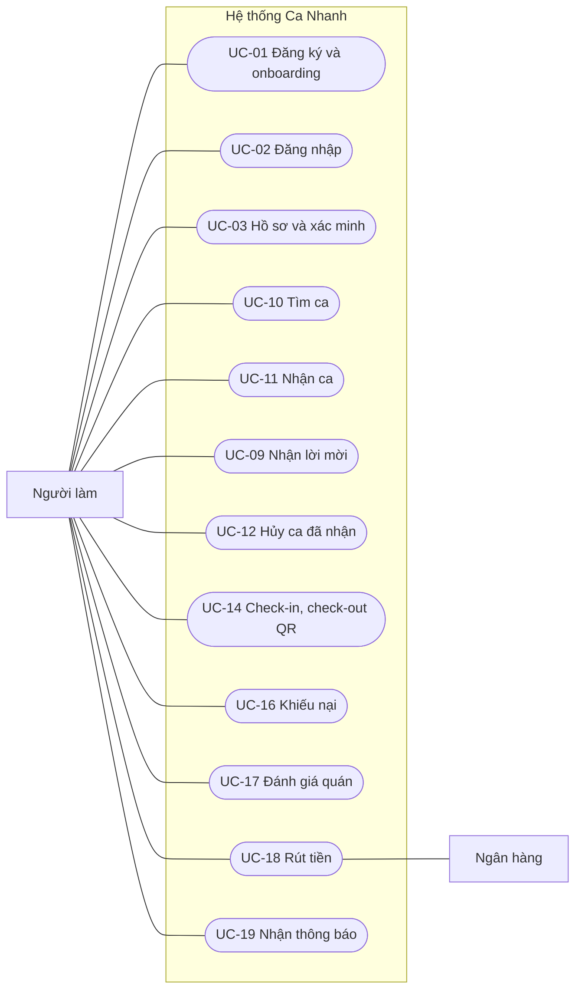
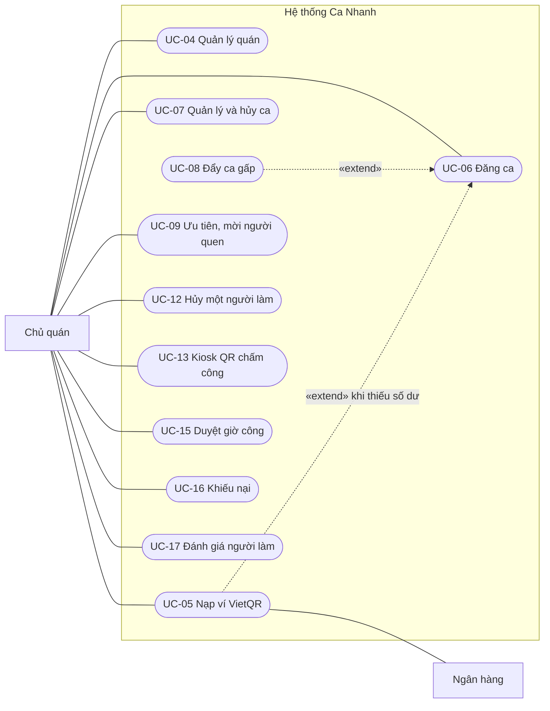
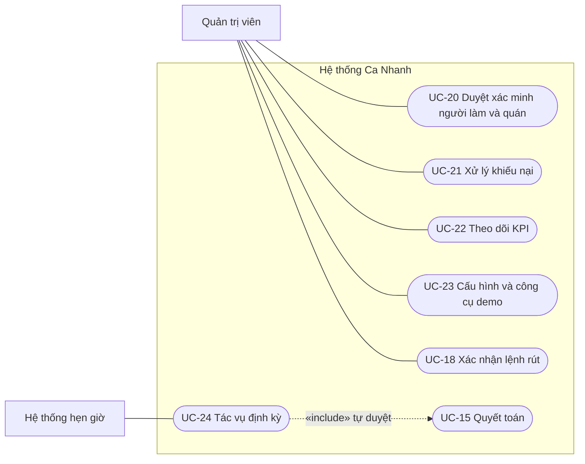

# Use Case & User Stories — Ca Nhanh

| Mục | Nội dung |
|---|---|
| Phiên bản | 1.0 (bản để review) · 04/11/2026 |
| Nhóm thực hiện | [Tên nhóm] |
| Dựa trên | [01-SRS.md](01-SRS.md): mã `FR-…`, `BR-…` dùng trong tài liệu này được định nghĩa ở SRS |
| Dùng cho | Chia việc, ước lượng sprint, viết test chấp nhận, chuẩn bị buổi demo |

---

## 1. Tác nhân

| Tác nhân | Loại | Mô tả | Mục tiêu chính |
|---|---|---|---|
| Người làm | Chính | Sinh viên, người cần thu nhập linh hoạt, đã đủ 18 tuổi | Tìm ca gần, đúng lịch; được trả chắc chắn và nhanh |
| Chủ quán | Chính | Chủ hoặc quản lý quán F&B, có thể sở hữu nhiều quán | Có người làm trong vài giờ; chỉ trả theo giờ thực làm |
| Quản trị viên | Chính | Nhân viên vận hành Ca Nhanh | Giữ chất lượng sàn, xử lý tranh chấp, theo dõi KPI |
| Hệ thống hẹn giờ | Hệ thống | pg_cron chạy `fn_cron_tick()` mỗi phút | Chuyển trạng thái theo thời gian |
| Ngân hàng / cổng thanh toán | Ngoài | Ở demo là bộ giả lập; khi chạy thật là cổng gửi webhook báo có | Xác nhận tiền vào và tiền ra |

---

## 2. Sơ đồ use case

**Hình 1. Người làm**



**Hình 2. Chủ quán**



**Hình 3. Quản trị viên và hệ thống**



---

## 3. Danh sách use case

| Mã | Tên | Tác nhân | Ưu tiên | Yêu cầu (SRS) | Đặc tả |
|---|---|---|---|---|---|
| UC-01 | Đăng ký và onboarding | Người làm, Chủ quán | M | AUTH-01…03, PRF-01 | Tóm tắt |
| UC-02 | Đăng nhập (kể cả đăng nhập nhanh demo) | Tất cả | M | AUTH-01, 02, 04 | Tóm tắt |
| UC-03 | Hoàn thiện hồ sơ và xác minh danh tính | Người làm | M/S | PRF-01…05 | Tóm tắt |
| UC-04 | Quản lý quán | Chủ quán | M | SHP-01…03, 05, 06 | Tóm tắt |
| UC-05 | Nạp ví bằng VietQR | Chủ quán, Ngân hàng | M | PAY-01, 02, 07, 08 | **§4.1** |
| UC-06 | Đăng ca | Chủ quán | M | SFT-01…04, 09, 12 | **§4.2** |
| UC-07 | Quản lý và hủy ca | Chủ quán | M | SFT-05…07, 11 | Tóm tắt |
| UC-08 | Đẩy ca gấp | Chủ quán | S | SFT-08 | Tóm tắt |
| UC-09 | Ưu tiên và mời người quen | Chủ quán, Người làm | S | SFT-09, 10, BKG-09 | Tóm tắt |
| UC-10 | Tìm ca | Người làm | M | SRC-01…05 | **§4.3** |
| UC-11 | Nhận ca | Người làm | M | BKG-01…04 | **§4.4** |
| UC-12 | Hủy booking | Người làm, Chủ quán | M | BKG-06, 07, RAT-04 | **§4.5** |
| UC-13 | Hiển thị QR chấm công (kiosk) | Chủ quán | M | SHP-04, ATT-06 | Tóm tắt |
| UC-14 | Check-in và check-out bằng QR | Người làm | M | ATT-01…05 | **§4.6** |
| UC-15 | Duyệt giờ công và quyết toán | Chủ quán, Hệ thống | M | PAY-03…05 | **§4.7** |
| UC-16 | Khiếu nại giờ công hoặc vắng mặt | Người làm, Chủ quán | S | PAY-09 | Tóm tắt |
| UC-17 | Đánh giá hai chiều | Người làm, Chủ quán | M | RAT-01…03 | Tóm tắt |
| UC-18 | Rút tiền về ngân hàng | Người làm, Ngân hàng, Admin | M | PAY-06, ADM-06 | **§4.8** |
| UC-19 | Nhận thông báo | Tất cả | M | NTF-01…04 | Tóm tắt |
| UC-20 | Duyệt xác minh người làm và quán | Admin | S/M | ADM-02, 03 | Tóm tắt |
| UC-21 | Xử lý khiếu nại | Admin | S | ADM-05 | **§4.9** |
| UC-22 | Theo dõi KPI | Admin | M | ADM-01 | Tóm tắt |
| UC-23 | Cấu hình tham số và công cụ demo | Admin | M | ADM-04, 06…08 | Tóm tắt |
| UC-24 | Tác vụ định kỳ | Hệ thống hẹn giờ | M | SYS-01, ATT-07 | **§4.10** |

**Tóm tắt các use case không đặc tả chi tiết**

- **UC-01**: đăng ký email/mật khẩu hoặc Google → hệ thống tạo hồ sơ và ví → người dùng chọn vai trò, nhập họ tên, SĐT (người làm thêm ngày sinh, kiểm tra ≥ 18 tuổi, BR-27) → vai trò bị khóa. Lỗi: `AGE_RESTRICTED`, `ROLE_LOCKED`.
- **UC-02**: đăng nhập; khi bật chế độ demo, màn hình có 4 nút *Chủ quán · Người làm A · Người làm B · Admin*.
- **UC-03**: khai báo trường, kỹ năng, giới thiệu, vị trí nhà, tài khoản ngân hàng; tải 3 ảnh lên thư mục riêng `kyc-private/<uid>/` → trạng thái *chờ duyệt* → UC-20.
- **UC-04**: tạo/sửa quán; ghim vị trí bằng bản đồ hoặc nút "Đặt vị trí quán tại đây"; đặt bán kính chấm công.
- **UC-07**: xem ca theo trạng thái; sửa mô tả; tăng/giảm số người (điều chỉnh tạm giữ); nhân bản ca; hủy ca (hệ thống tính bồi thường theo BR-12 và báo trước số tiền).
- **UC-08**: bấm "Đẩy ca gấp" → trừ 20.000đ → ca có nhãn *Gấp*, được cộng điểm phù hợp; người làm trong 3 km có kỹ năng phù hợp nhận thông báo.
- **UC-09**: khi đăng ca, chọn "Ưu tiên người quen N phút"; hoặc chọn người quen/người từng làm để mời → họ nhận thông báo → *Nhận* (tạo booking nguồn `invite`) hoặc *Từ chối*.
- **UC-13**: mở `/shop/kiosk/<shopId>` trên tablet → QR toàn màn hình đổi mỗi 30 giây, đồng hồ, danh sách người check-in hôm nay (realtime).
- **UC-16**: với booking đã check-out (chưa duyệt) hoặc bị đánh dấu vắng mặt (≤ 72 giờ), chọn lý do và mô tả ≥ 10 ký tự → booking chuyển *đang khiếu nại*, quyết toán tạm dừng → UC-21.
- **UC-17**: sau khi hoàn tất, mỗi bên chấm 1–5 sao, chọn thẻ, viết bình luận. Quán chọn "Muốn mời lại" thì người làm thành người quen.
- **UC-19**: thông báo được ghi vào bảng `notifications` và đẩy qua Realtime; chuông hiển thị số chưa đọc; bấm vào thì mở đúng màn hình.
- **UC-20**: admin xem hàng chờ, mở ảnh bằng URL ký hạn ngắn, duyệt hoặc từ chối kèm lý do; tương tự với quán.
- **UC-22**: chọn khoảng ngày → thẻ KPI + biểu đồ GMV, doanh thu, fill rate, vắng mặt theo ngày.
- **UC-23**: sửa tham số (phí, lương tối thiểu…), khóa/mở khóa người dùng, gỡ tạm khóa; công cụ demo: reset + sinh lịch sử, tua thời gian ca, chạy bộ hẹn giờ ngay.

---

## 4. Đặc tả use case chi tiết

### 4.1 UC-05 · Nạp ví bằng VietQR

| Mục | Nội dung |
|---|---|
| Tác nhân | Chủ quán (chính), Ngân hàng hoặc bộ giả lập (phụ) |
| Tiền điều kiện | Đã đăng nhập vai trò chủ quán |
| Hậu điều kiện | Lệnh `payment_orders` ở trạng thái `succeeded`; ví quán +số tiền; sổ cái có dòng `topup` |
| Quy tắc | BR-23; FR-PAY-02, 07, 08 |

**Luồng chính**
1. Chủ quán mở *Ví* → *Nạp tiền*, nhập số tiền (gợi ý 500.000 / 1.000.000 / 2.000.000đ).
2. Hệ thống tạo lệnh nạp có mã tham chiếu duy nhất (ví dụ `CN7F3A9C21`), hạn 15 phút, và hiển thị **ảnh VietQR** đã điền sẵn số tiền, nội dung chuyển khoản, tài khoản nhận.
3. Chủ quán quét QR bằng app ngân hàng và chuyển khoản.
4. Ngân hàng/cổng thanh toán gọi webhook báo có kèm nội dung chuyển khoản.
5. Hệ thống khớp mã tham chiếu, ghi có ví, đổi trạng thái lệnh thành *thành công*.
6. Màn hình ví cập nhật số dư realtime và hiện thông báo "Nạp tiền thành công +2.000.000đ".

**Luồng thay thế**
- 3a. *Chế độ demo*: chủ quán bấm **Giả lập đã chuyển khoản** → hệ thống thực hiện bước 5 như webhook thật.
- 4a. Webhook bị gửi lặp lại → hệ thống trả kết quả cũ, không ghi có lần hai (idempotent).
- 4b. Tiền về sau khi lệnh hết hạn → vẫn ghi có (BR-23).

**Ngoại lệ**: số tiền ngoài 50.000–50.000.000đ → `AMOUNT_OUT_OF_RANGE`; chữ ký webhook sai → `401 INVALID_SIGNATURE`; mã tham chiếu không tồn tại → `PAYMENT_NOT_FOUND`.

### 4.2 UC-06 · Đăng ca

| Mục | Nội dung |
|---|---|
| Tác nhân | Chủ quán |
| Tiền điều kiện | Quán đã duyệt và đang hoạt động |
| Kích hoạt | Bấm "Đăng ca mới" hoặc "Đăng lại" từ một ca cũ |
| Hậu điều kiện | Ca `open`; ví quán: khả dụng − X, tạm giữ + X; sổ cái có dòng `hold`; ca xuất hiện realtime với người làm |
| Quy tắc | BR-01…BR-06, BR-26; FR-SFT-01…04, 08, 09, 12 |

**Luồng chính**
1. Chủ quán chọn quán, vị trí (pha chế, phục vụ…), nhập tiêu đề, mô tả, yêu cầu.
2. Chọn ngày, giờ bắt đầu và kết thúc, phút nghỉ, lương/giờ, số người. Tùy chọn: điểm tối thiểu, ưu tiên người quen N phút, đẩy ca gấp.
3. Hệ thống hiển thị **ước tính chi phí** ngay khi nhập: tiền công mỗi người, phí 20%, tổng tạm giữ, số dư khả dụng.
4. Chủ quán bấm **Đăng ca**.
5. Hệ thống kiểm tra quy tắc, tạm giữ tiền, tạo ca `open`.
6. Nếu bật ưu tiên người quen: báo cho người quen. Nếu bật ca gấp: trừ phí và báo người làm gần quán.
7. Hệ thống mở trang chi tiết ca với 0/N chỗ đã lấp.

**Luồng thay thế**
- 2a. *Đăng lại*: form điền sẵn từ ca cũ, chỉ cần chọn ngày mới.
- 3a. Số dư không đủ → hiển thị số tiền còn thiếu và nút **Nạp ngay** (UC-05), rồi quay lại bước 4.

**Ngoại lệ**: `RATE_BELOW_MINIMUM` (lương < 25.500đ/giờ), `INVALID_TIME_RANGE`, `LEAD_TIME_TOO_SHORT`, `INVALID_HEADCOUNT`, `INSUFFICIENT_BALANCE`, `SHOP_NOT_VERIFIED`. Mọi lỗi đều rollback toàn bộ, không có tiền nào bị giữ.

### 4.3 UC-10 · Tìm ca

| Mục | Nội dung |
|---|---|
| Tác nhân | Người làm |
| Tiền điều kiện | Đã đăng nhập (chưa xác minh vẫn xem được, nhưng không nhận được ca) |
| Hậu điều kiện | Không đổi dữ liệu |
| Quy tắc | BR-20; FR-SRC-01…05 |

**Luồng chính**
1. Người làm mở *Khám phá ca*; ứng dụng xin quyền vị trí.
2. Hệ thống trả danh sách ca `open` trong bán kính mặc định 5 km, 7 ngày tới, sắp xếp theo **Phù hợp nhất**.
3. Mỗi thẻ ca hiển thị: quán, điểm, khoảng cách, giờ, lương/giờ, **thu nhập dự kiến**, chỗ còn lại, nhãn *Gấp* / *Ưu tiên người quen đến HH:MM* / *Đã ký quỹ*.
4. Người làm chuyển sang **Bản đồ** để xem marker theo quán.
5. Người làm lọc theo ngày, vị trí, lương tối thiểu, bán kính; đổi cách sắp xếp.
6. Khi có ca mới gần đó, thẻ ca xuất hiện với nhãn *Mới* trong ≤ 2 giây mà không cần tải lại.

**Luồng thay thế**: 1a. Từ chối quyền vị trí → chọn quận/khu vực có sẵn (tọa độ trung tâm quận).

### 4.4 UC-11 · Nhận ca

| Mục | Nội dung |
|---|---|
| Tác nhân | Người làm |
| Tiền điều kiện | Đã xác minh; ca đang mở |
| Hậu điều kiện | Booking `confirmed`; `filled_count + 1`; ca `full` nếu đủ người; quán được báo |
| Quy tắc | BR-07, BR-08; FR-BKG-01…04 |

**Luồng chính**
1. Ở chi tiết ca, người làm bấm **Nhận ca**.
2. Hệ thống khóa dòng ca, kiểm tra điều kiện BR-07 theo thứ tự (đã nhận chưa → còn chỗ → còn mở → bị chặn → ưu tiên người quen → điểm tối thiểu → trùng giờ).
3. Hệ thống tạo booking, tăng số chỗ đã lấp, chuyển ca sang `full` nếu đủ.
4. Người làm thấy "Đã nhận ca", ca xuất hiện trong *Ca của tôi* với đếm ngược.
5. Quán nhận thông báo, các chỗ trên dashboard cập nhật realtime.

**Ngoại lệ** (mỗi lỗi có thông điệp riêng, xem [05 §9](05-API-Specification.md)): `SHIFT_FULL`, `SHIFT_NOT_OPEN`, `ALREADY_BOOKED`, `BOOKING_OVERLAP`, `KYC_REQUIRED`, `ACCOUNT_SUSPENDED`, `BLOCKED_BY_SHOP`, `FAVORITES_ONLY`, `RATING_TOO_LOW`.

> **Tranh chỗ cuối cùng**: hai yêu cầu đồng thời được CSDL xếp hàng nhờ `SELECT … FOR UPDATE`. Người đến sau phải chờ người đến trước commit, rồi nhận `SHIFT_FULL`. Đã kiểm thử bằng 2 phiên song song: phiên B chờ 1,52 giây rồi bị từ chối (xem [04 §11](04-ERD-Database-Schema.md)).

### 4.5 UC-12 · Hủy booking

| Mục | Nội dung |
|---|---|
| Tác nhân | Người làm (hủy ca của mình) hoặc Chủ quán (hủy một người làm) |
| Tiền điều kiện | Booking `confirmed`; chưa tới giờ bắt đầu |
| Hậu điều kiện | Booking `cancelled`; chỗ mở lại (ca `full` → `open`); điểm phạt hoặc bồi thường được ghi nhận |
| Quy tắc | BR-09, BR-11, BR-12; FR-BKG-06, 07 |

**Luồng chính (người làm hủy)**
1. Người làm bấm **Hủy ca**; hệ thống hiển thị trước hậu quả: "Còn 3 giờ nữa là tới ca. Hủy bây giờ bạn sẽ bị cộng 2 điểm phạt (hiện có 0/4)."
2. Người làm chọn lý do và xác nhận.
3. Hệ thống hủy booking, cộng điểm phạt, mở lại chỗ (tiền tạm giữ của chỗ vẫn giữ cho người nhận sau).
4. Quán nhận thông báo; **người quen của quán nhận thông báo có chỗ trống** (danh sách dự phòng).
5. Nếu tổng điểm trong 30 ngày ≥ 4 → người làm bị tạm khóa nhận ca 7 ngày và được thông báo.

**Luồng thay thế (quán hủy một người làm)**
- 1a. Quán bấm **Hủy người này**; nếu còn < 24 giờ, hệ thống báo trước khoản bồi thường (50% tiền công dự kiến).
- 3a. Hệ thống trừ bồi thường từ ví quán và ghi có ví người làm; chỗ mở lại.

**Ngoại lệ**: đã quá giờ bắt đầu → `TOO_LATE_TO_CANCEL`; không phải người trong cuộc → `FORBIDDEN`; số dư không đủ trả bồi thường → `INSUFFICIENT_BALANCE`.

### 4.6 UC-14 · Check-in và check-out bằng QR

| Mục | Nội dung |
|---|---|
| Tác nhân | Người làm (chính); kiosk của quán (hiển thị QR) |
| Tiền điều kiện | Booking `confirmed` (check-in) hoặc `checked_in` (check-out); đã cấp quyền camera và vị trí |
| Hậu điều kiện | Booking `checked_in` / `checked_out`; một dòng `attendance_events` cho **mỗi** lần quét; check-out thì giờ công và tiền công được tính |
| Quy tắc | BR-13…BR-16; FR-ATT-01…06, PAY-03 |

**Luồng chính**
1. Tới quán, người làm mở booking → **Quét QR** (hoặc dùng camera hệ thống mở link trong QR).
2. Ứng dụng đọc token QR, lấy GPS (lat, lng, sai số) và gửi lên server.
3. Server kiểm tra chữ ký HMAC và tuổi token (≤ 60 giây).
4. CSDL kiểm tra: đúng quán của booking → đúng trạng thái → trong khung giờ check-in → có GPS → trong geofence.
5. Ghi log lần quét; cập nhật booking `checked_in` (đánh dấu *đi muộn* nếu quá 5 phút).
6. Người làm thấy "Check-in lúc 16:58 · cách quán 23 m"; kiosk và dashboard quán cập nhật ngay.
7. Hết ca, người làm quét lại QR → `checked_out`; hệ thống tính giờ công (BR-16) và hiển thị "300 phút · 150.000đ · chờ quán duyệt".

**Ngoại lệ** (lần quét vẫn được ghi log): `QR_INVALID`, `QR_EXPIRED`, `WRONG_SHOP`, `OUTSIDE_CHECKIN_WINDOW`, `LOCATION_REQUIRED`, `OUT_OF_GEOFENCE`, `INVALID_STATE`.

### 4.7 UC-15 · Duyệt giờ công và quyết toán

| Mục | Nội dung |
|---|---|
| Tác nhân | Chủ quán; Hệ thống (tự duyệt) |
| Tiền điều kiện | Booking `checked_out`, không đang khiếu nại |
| Hậu điều kiện | Booking `completed`; ví người làm + tiền công; ví nền tảng + phí; ví quán: hoàn tạm giữ của chỗ, trừ tiền công + phí |
| Quy tắc | BR-16…BR-19; FR-PAY-04, 05 |

**Luồng chính**
1. Quán mở *Chờ duyệt*: mỗi dòng có giờ vào, giờ ra, khoảng cách lúc quét, số phút, tiền công, phí.
2. Quán bấm **Duyệt**.
3. Hệ thống quyết toán trong **một transaction**: (a) hoàn tạm giữ của chỗ → (b) trừ tiền công + phí từ ví quán → (c) ghi có ví người làm → (d) ghi có phí vào ví nền tảng → (e) booking `completed`.
4. Người làm nhận thông báo "+150.000đ đã vào ví".
5. Cả hai bên được mời đánh giá (UC-17).

**Luồng thay thế**
- 2a. Quán **điều chỉnh số phút** (ví dụ người làm ở lại thêm) và nhập lý do ≥ 5 ký tự.
- 2b. Quán không duyệt trong 12 giờ → hệ thống tự duyệt với số phút đã ghi nhận (UC-24).

**Ngoại lệ**: thiếu lý do điều chỉnh → `ADJUSTMENT_NOTE_REQUIRED`; điều chỉnh vượt tạm giữ mà số dư không đủ → `INSUFFICIENT_BALANCE`; đã quyết toán → `ALREADY_SETTLED`.

### 4.8 UC-18 · Rút tiền về ngân hàng

| Mục | Nội dung |
|---|---|
| Tác nhân | Người làm; Ngân hàng (phụ); Admin (xác nhận tay khi cần) |
| Tiền điều kiện | Đã khai báo tài khoản ngân hàng; số dư ≥ 10.000đ |
| Hậu điều kiện | Lệnh rút `succeeded` (hoặc `failed` + tiền hoàn về ví) |
| Quy tắc | BR-24; FR-PAY-06, 08 |

**Luồng chính**
1. Người làm mở *Ví* → **Rút về ngân hàng**, nhập số tiền (mặc định toàn bộ số dư).
2. Hệ thống trừ ví ngay, tạo lệnh rút (lưu ảnh chụp thông tin ngân hàng tại thời điểm rút).
3. *Demo*: hệ thống giả lập chuyển khoản tức thì → lệnh `succeeded` sau khoảng 2 giây, hiện biên nhận.
4. Người làm nhận thông báo "Đã chuyển 150.000đ về tài khoản …4567".

**Luồng thay thế**: 3a. Khi tắt giả lập, admin thấy lệnh ở *Thanh toán*, chuyển khoản bằng VietQR của người làm rồi bấm *Xác nhận*; nếu thất bại bấm *Thất bại* → tiền hoàn về ví.

**Ngoại lệ**: `BANK_ACCOUNT_MISSING`, `AMOUNT_OUT_OF_RANGE`, `INSUFFICIENT_BALANCE`.

### 4.9 UC-21 · Xử lý khiếu nại

| Mục | Nội dung |
|---|---|
| Tác nhân | Admin |
| Tiền điều kiện | Có khiếu nại `open` (từ UC-16) |
| Hậu điều kiện | Khiếu nại `resolved` hoặc `rejected`; booking được quyết toán hoặc giữ `no_show` |
| Quy tắc | BR-22; FR-ADM-05 |

**Luồng chính**
1. Admin mở hàng chờ khiếu nại: xem booking, log quét QR (khoảng cách, giờ), giờ công, mô tả của hai bên.
2. Admin chọn **Chấp nhận** (nhập số phút được công nhận) hoặc **Bác bỏ**, và ghi kết luận.
3. Hệ thống xử lý theo trạng thái trước khiếu nại:
   - Từ `checked_out`: luôn quyết toán; chấp nhận thì dùng số phút admin nhập.
   - Từ `no_show`: chấp nhận thì gỡ điểm phạt và quyết toán; bác bỏ thì giữ `no_show`.
4. Hai bên nhận thông báo kết luận.

### 4.10 UC-24 · Tác vụ định kỳ

| Mục | Nội dung |
|---|---|
| Tác nhân | Hệ thống hẹn giờ (pg_cron, job `ca-nhanh-tick`, mỗi phút) |
| Hậu điều kiện | Trạng thái ca, booking, lệnh thanh toán khớp với thời gian thực; tiền tạm giữ thừa được hoàn |
| Quy tắc | BR-10, BR-19; FR-SYS-01, ATT-07 |

**Luồng chính** (`fn_cron_tick()` gọi lần lượt; mỗi bước dùng `FOR UPDATE SKIP LOCKED` nên chạy lại an toàn)
1. **Nhắc ca**: booking `confirmed` bắt đầu trong 2 giờ, chưa nhắc → gửi thông báo.
2. **Bắt đầu ca**: ca `open`/`full` đã tới giờ → hoàn tạm giữ của chỗ trống; ca có người → `in_progress`; ca 0 người → `expired` và báo quán.
3. **Vắng mặt**: booking `confirmed` quá giờ bắt đầu 30 phút → `no_show`, 4 điểm phạt, hoàn tạm giữ chỗ, xét tạm khóa.
4. **Tự check-out**: booking `checked_in` quá giờ kết thúc 120 phút → check-out tại giờ kết thúc.
5. **Tự duyệt**: booking `checked_out` quá 12 giờ → quyết toán.
6. **Hoàn tất ca**: ca `in_progress` đã hết giờ và không còn booking dở dang → `completed`.
7. **Hết hạn lệnh nạp**: lệnh nạp `pending` quá 15 phút → `expired`.

---

## 5. User stories

Ước lượng bằng story point (SP, thang Fibonacci) cho phần **giao diện + API**. Phần CSDL và hàm nghiệp vụ đã viết và kiểm thử sẵn trong `docs/sql/`, nên không tính vào SP. Tổng **166 SP**, trong đó **Must = 122 SP**.

### EP-01 · Tài khoản và hồ sơ

| Mã | User story | Ưu tiên | SP | Tiêu chí chấp nhận tóm tắt | FR |
|---|---|---|---|---|---|
| US-01 | Là **người dùng mới**, tôi muốn đăng ký bằng email hoặc Google rồi chọn vai trò, để dùng đúng chức năng của mình | M | 3 | Tạo hồ sơ + ví tự động; người dưới 18 tuổi bị chặn; không đổi vai trò sau onboarding; metadata `role=admin` bị bỏ qua | AUTH-01…03 |
| US-02 | Là **người thuyết trình**, tôi muốn đăng nhập nhanh tài khoản demo theo vai trò, để chuyển vai trong 1 giây | M | 1 | 4 nút chỉ hiện khi `demo_mode.enabled` | AUTH-04 |
| US-03 | Là **người dùng**, tôi muốn chỉ thấy menu và trang của vai trò mình | M | 2 | Truy cập trang của vai trò khác → chuyển hướng; API trả 403 | AUTH-05 |
| US-04 | Là **người làm**, tôi muốn khai báo ngày sinh, trường, kỹ năng, giới thiệu và vị trí nhà | M | 3 | Kỹ năng chọn từ danh mục vị trí; vị trí nhà tùy chọn | PRF-01 |
| US-05 | Là **người làm**, tôi muốn gửi ảnh CCCD và ảnh chân dung để được xác minh | S | 5 | Ảnh ≤ 5 MB lưu kho riêng tư; trạng thái *chờ duyệt*; không gửi lại khi đang chờ | PRF-02, 03 |
| US-06 | Là **người làm**, tôi muốn lưu tài khoản ngân hàng để rút tiền | M | 2 | Chọn ngân hàng từ danh sách BIN; số TK 4–19 ký tự; tên in hoa không dấu | PRF-04 |

### EP-02 · Quán và ví quán

| Mã | User story | Ưu tiên | SP | Tiêu chí chấp nhận tóm tắt | FR |
|---|---|---|---|---|---|
| US-07 | Là **chủ quán**, tôi muốn tạo quán và ghim vị trí trên bản đồ, để người làm tìm thấy và chấm công đúng chỗ | M | 5 | Kéo ghim trên bản đồ Leaflet; nút "Đặt vị trí quán tại đây"; bán kính 30–1000 m | SHP-01…03, 06 |
| US-08 | Là **chủ quán**, tôi muốn đánh dấu người quen hoặc chặn người làm | S | 3 | Người bị chặn không thấy ca của quán khi tìm và không nhận được ca | SHP-05 |
| US-09 | Là **chủ quán**, tôi muốn nạp ví bằng VietQR | M | 5 | Xem §6.1 | PAY-02 |
| US-10 | Là **chủ quán**, tôi muốn xem số dư khả dụng, đang tạm giữ và lịch sử giao dịch | M | 3 | Mỗi giao dịch có loại, số tiền, số dư sau, liên kết tới ca/booking | PAY-01, 07 |

### EP-03 · Đăng và quản lý ca

| Mã | User story | Ưu tiên | SP | Tiêu chí chấp nhận tóm tắt | FR |
|---|---|---|---|---|---|
| US-11 | Là **chủ quán**, tôi muốn thấy chi phí dự kiến trước khi đăng | M | 2 | Cập nhật khi đổi giờ/lương/số người; báo thiếu bao nhiêu nếu không đủ số dư | SFT-02 |
| US-12 | Là **chủ quán**, tôi muốn đăng ca và được hệ thống tạm giữ tiền | M | 5 | Xem §6.2 | SFT-01, 03, 04, 12 |
| US-13 | Là **chủ quán**, tôi muốn thấy các chỗ trong ca được lấp theo thời gian thực | M | 5 | Avatar người nhận hiện trong ≤ 2 giây, không cần tải lại | SFT-05 |
| US-14 | Là **chủ quán**, tôi muốn tăng/giảm số người và sửa mô tả | S | 3 | Không giảm dưới số đã nhận; tạm giữ được điều chỉnh tương ứng | SFT-06 |
| US-15 | Là **chủ quán**, tôi muốn hủy ca và biết trước khoản bồi thường | M | 3 | Hộp xác nhận ghi rõ số tiền bồi thường; hoàn toàn bộ tạm giữ còn lại | SFT-07 |
| US-16 | Là **chủ quán**, tôi muốn đẩy ca gấp khi cần người ngay | S | 3 | Trừ 20.000đ; nhãn *Gấp*; người làm trong 3 km phù hợp được báo | SFT-08 |
| US-17 | Là **chủ quán**, tôi muốn ưu tiên và mời người quen | S | 5 | Người không phải người quen bị chặn trong thời gian ưu tiên; chỉ mời được người quen hoặc người từng làm | SFT-09, 10 |
| US-18 | Là **chủ quán**, tôi muốn đăng lại một ca cũ sang ngày mới | S | 2 | Form điền sẵn, chỉ chọn ngày | SFT-11 |

### EP-04 · Khám phá và nhận ca

| Mã | User story | Ưu tiên | SP | Tiêu chí chấp nhận tóm tắt | FR |
|---|---|---|---|---|---|
| US-19 | Là **người làm**, tôi muốn xem danh sách ca gần tôi và lọc theo ngày, vị trí, lương | M | 5 | Mặc định 5 km, 7 ngày, sắp theo phù hợp; phân trang 20 | SRC-01, 03 |
| US-20 | Là **người làm**, tôi muốn xem ca trên bản đồ | M | 5 | Marker theo quán; ca gấp nổi bật; nhấn marker thì hiện thẻ ca | SRC-02 |
| US-21 | Là **người làm**, tôi muốn xem chi tiết ca và thấy ca mới tự hiện | M | 5 | Hiển thị thu nhập dự kiến, nhãn *Đã ký quỹ*; ca mới có nhãn *Mới* ≤ 2 giây | SRC-04, 05 |
| US-22 | Là **người làm**, tôi muốn nhận ca một chạm | M | 5 | Xem §6.3 | BKG-01…04 |
| US-23 | Là **người làm**, tôi muốn xem *Ca của tôi* và được nhắc trước giờ làm | M | 3 | Tab sắp tới/đang làm/chờ duyệt/lịch sử; nhắc trước 2 giờ | BKG-05, 08 |
| US-24 | Là **chủ quán**, tôi muốn xem hồ sơ năng lực và SĐT của người đã nhận ca | S | 2 | SĐT chỉ hiện khi có booking; hồ sơ có số ca, điểm, số lần vắng | BKG-10, PRF-05 |
| US-25 | Là **người làm**, tôi muốn hủy ca và biết trước điểm phạt | M | 3 | Xem §6.4 | BKG-06, RAT-04 |
| US-26 | Là **chủ quán**, tôi muốn hủy một người làm khi cần | M | 2 | Chỗ mở lại; bồi thường 50% nếu < 24 giờ | BKG-07 |
| US-27 | Là **người làm**, tôi muốn nhận hoặc từ chối lời mời | S | 2 | Nhận lời mời bỏ qua thời gian ưu tiên và điểm tối thiểu | BKG-09 |

### EP-05 · Chấm công

| Mã | User story | Ưu tiên | SP | Tiêu chí chấp nhận tóm tắt | FR |
|---|---|---|---|---|---|
| US-28 | Là **chủ quán**, tôi muốn mở màn hình kiosk QR xoay vòng trên tablet | M | 3 | QR đổi mỗi 30 giây; giữ màn hình sáng; danh sách người đã check-in hôm nay | SHP-04, ATT-06 |
| US-29 | Là **người làm**, tôi muốn check-in bằng cách quét QR tại quán | M | 8 | Xem §6.5 | ATT-01…05 |
| US-30 | Là **người làm**, tôi muốn check-out bằng QR và thấy ngay giờ công | M | 3 | Hiển thị số phút, tiền công, trạng thái *chờ duyệt* | ATT-01, PAY-03 |
| US-31 | Là **chủ quán**, tôi muốn hệ thống tự xử lý người vắng mặt và người quên check-out | M | 2 | Xem §6.6 | ATT-07, RAT-04 |

### EP-06 · Giờ công và tiền

| Mã | User story | Ưu tiên | SP | Tiêu chí chấp nhận tóm tắt | FR |
|---|---|---|---|---|---|
| US-32 | Là **chủ quán**, tôi muốn duyệt hoặc điều chỉnh giờ công | M | 3 | Điều chỉnh bắt buộc có lý do; tự duyệt sau 12 giờ | PAY-04 |
| US-33 | Là **người làm**, tôi muốn tiền vào ví ngay khi quán duyệt | M | 2 | Xem §6.7 | PAY-05 |
| US-34 | Là **người làm**, tôi muốn rút tiền về ngân hàng trong ngày | M | 3 | Xem §6.8 | PAY-06 |
| US-35 | Là **người làm hoặc chủ quán**, tôi muốn khiếu nại giờ công hoặc vắng mặt | S | 5 | Khi đang khiếu nại, nút duyệt bị khóa | PAY-09 |
| US-36 | Là **nhóm phát triển**, chúng tôi muốn mọi biến động tiền được ghi sổ cái và không bị ghi có trùng | M | 2 | Số dư ví = tổng sổ cái; webhook gửi lại không ghi có lần hai | PAY-07, 08 |

### EP-07 đến EP-10 · Uy tín, thông báo, quản trị, hệ thống

| Mã | User story | Ưu tiên | SP | Tiêu chí chấp nhận tóm tắt | FR |
|---|---|---|---|---|---|
| US-37 | Là **người làm hoặc chủ quán**, tôi muốn đánh giá đối phương sau ca | M | 3 | Xem §6.9 | RAT-01, 02 |
| US-38 | Là **chủ quán**, tôi muốn gắn thẻ "Muốn mời lại" để người làm thành người quen | S | 1 | Người làm xuất hiện trong danh sách người quen | RAT-03 |
| US-39 | Là **người dùng**, tôi muốn nhận thông báo tức thì và đánh dấu đã đọc | M | 5 | Toast + chuông; bấm vào thì mở đúng màn hình | NTF-01, 02 |
| US-40 | Là **admin**, tôi muốn xem dashboard KPI | M | 8 | Xem §6.10 | ADM-01 |
| US-41 | Là **admin**, tôi muốn duyệt hồ sơ xác minh người làm | S | 5 | Xem ảnh qua URL ký 60 giây; từ chối phải có lý do | ADM-02 |
| US-42 | Là **admin**, tôi muốn duyệt quán mới, khóa/mở khóa tài khoản và gỡ tạm khóa | M | 5 | Tài khoản bị khóa không gọi được API ghi | ADM-03, 04 |
| US-43 | Là **admin**, tôi muốn xử lý khiếu nại | S | 3 | Theo UC-21 | ADM-05 |
| US-44 | Là **admin**, tôi muốn quản lý lệnh thanh toán và tham số nền tảng | M | 3 | Đổi phí thì chỉ áp dụng cho ca đăng sau đó (ca cũ giữ `fee_rate` lúc đăng) | ADM-06, 07 |
| US-45 | Là **người thuyết trình**, tôi muốn reset dữ liệu demo, tua thời gian một ca và chạy bộ hẹn giờ ngay | M | 3 | Xem §6.11 | ADM-08 |
| US-46 | Là **nhóm vận hành**, chúng tôi muốn tác vụ định kỳ tự chạy và có health check | M | 2 | `GET /api/v1/health` trả 200 khi CSDL phản hồi | SYS-01, 02 |
| US-47 | Là **người làm**, tôi muốn nhận Web Push khi đã đóng app | C | 5 | Chỉ khi đã cài PWA và cho phép thông báo | NTF-03 |

---

## 6. Tiêu chí chấp nhận chi tiết (Gherkin)

### 6.1 US-09 · Nạp ví VietQR
```gherkin
Tính năng: Nạp ví bằng VietQR
  Kịch bản: Nạp thành công trong chế độ demo
    Cho chị Lan có ví quán với số dư 0đ
    Khi chị nhập 2.000.000đ và bấm "Tạo mã nạp"
    Thì chị thấy ảnh VietQR có số tiền 2.000.000 và nội dung bắt đầu bằng "CN"
    Khi chị bấm "Giả lập đã chuyển khoản"
    Thì số dư khả dụng thành 2.000.000đ mà không cần tải lại trang
    Và lịch sử giao dịch có dòng "Nạp tiền qua VietQR"

  Kịch bản: Webhook báo có hai lần
    Cho lệnh nạp "CN7F3A9C21" đã thành công
    Khi webhook với cùng mã được gửi lại
    Thì hệ thống trả 200 và số dư không đổi
```

### 6.2 US-12 · Đăng ca có ký quỹ
```gherkin
Tính năng: Đăng ca
  Kịch bản: Đăng ca hợp lệ
    Cho ví quán có 2.000.000đ khả dụng
    Khi chị Lan đăng ca "Pha chế ca tối" 17:00–22:00, 30.000đ/giờ, 2 người
    Thì ca ở trạng thái "Đang mở" và có nhãn "Đã ký quỹ"
    Và ví quán còn 1.640.000đ khả dụng, 360.000đ tạm giữ

  Kịch bản: Lương thấp hơn mức tối thiểu
    Khi chị Lan nhập lương 20.000đ/giờ
    Thì nút "Đăng ca" bị khóa và hiển thị "Lương tối thiểu là 25.500đ/giờ"
    Và API trả 422 RATE_BELOW_MINIMUM nếu bị gọi trực tiếp

  Kịch bản: Không đủ số dư
    Cho ví quán có 100.000đ khả dụng
    Khi chị Lan đăng ca có tổng chi phí 360.000đ
    Thì hệ thống báo "Còn thiếu 260.000đ" và hiện nút "Nạp ngay"
    Và không có ca nào được tạo, không có tiền nào bị giữ
```

### 6.3 US-22 · Nhận ca một chạm
```gherkin
Tính năng: Nhận ca
  Kịch bản: Nhận chỗ cuối cùng
    Cho ca cần 2 người và đã có 1 người nhận
    Và Minh đã xác minh và không bị tạm khóa
    Khi Minh bấm "Nhận ca"
    Thì Minh thấy "Đã nhận ca" và ca chuyển sang "Đủ người"
    Và chủ quán nhận thông báo "Nguyễn Minh đã nhận ca · 2/2 người"

  Kịch bản: Hai người tranh chỗ cuối cùng
    Cho ca còn đúng 1 chỗ
    Khi Minh và An bấm "Nhận ca" gần như cùng lúc
    Thì đúng một người nhận được ca
    Và người còn lại thấy "Ca vừa đủ người"

  Kịch bản: Trùng giờ với ca đã nhận
    Cho Minh đã nhận ca 17:00–22:00
    Khi Minh nhận một ca khác 19:00–21:00 cùng ngày
    Thì hệ thống từ chối với "Bạn đã có ca trùng giờ"
```

### 6.4 US-25 · Hủy ca và điểm phạt
```gherkin
Tính năng: Người làm hủy ca
  Kịch bản: Hủy sát giờ
    Cho An đã nhận ca bắt đầu sau 3 giờ nữa và đang có 0 điểm phạt
    Khi An bấm "Hủy ca"
    Thì An thấy cảnh báo "Hủy bây giờ sẽ bị cộng 2 điểm phạt"
    Khi An xác nhận
    Thì booking bị hủy, An có 2 điểm phạt
    Và ca mở lại 1 chỗ, tiền tạm giữ của ca không đổi
    Và người quen của quán nhận thông báo "vừa có chỗ trống"

  Kịch bản: Hủy sớm
    Cho An đã nhận ca bắt đầu sau 2 ngày
    Khi An hủy ca
    Thì An không bị cộng điểm phạt
```

### 6.5 US-29 · Check-in bằng QR
```gherkin
Tính năng: Check-in bằng QR xoay vòng
  Kịch bản: Check-in hợp lệ
    Cho Minh có booking ca bắt đầu lúc 17:00 tại "Cà phê Góc Phố"
    Và Minh đang đứng cách quán 23 m lúc 16:58
    Khi Minh quét QR đang hiển thị trên kiosk của quán
    Thì Minh thấy "Check-in lúc 16:58 · cách quán 23 m"
    Và dashboard của quán hiện Minh "Đã đến" ngay lập tức

  Kịch bản: Dùng ảnh chụp QR ở xa
    Cho bạn của Minh gửi ảnh QR qua Zalo
    Khi Minh quét ảnh đó lúc đang cách quán 1,5 km
    Thì hệ thống từ chối với "Bạn đang ở ngoài khu vực quán"
    Và lần quét được ghi log với mã OUT_OF_GEOFENCE và khoảng cách

  Kịch bản: QR cũ
    Khi Minh quét một QR đã hiển thị cách đây 2 phút
    Thì hệ thống từ chối với "Mã QR đã hết hạn, hãy quét mã mới trên màn hình quán"

  Kịch bản: QR của quán khác
    Khi Minh quét QR của một quán không phải quán của ca
    Thì hệ thống từ chối với "Mã QR không thuộc quán của ca này"
```

### 6.6 US-31 · Vắng mặt và tự check-out
```gherkin
Tính năng: Tự động xử lý theo thời gian
  Kịch bản: Vắng mặt
    Cho Bình đã nhận ca bắt đầu lúc 17:00 và có 0 điểm phạt
    Khi tới 17:31 Bình vẫn chưa check-in
    Thì booking của Bình chuyển "Vắng mặt" với 4 điểm phạt
    Và Bình bị tạm khóa nhận ca 7 ngày
    Và 180.000đ tạm giữ của chỗ đó được hoàn về ví quán

  Kịch bản: Quên check-out
    Cho Minh đã check-in ca kết thúc lúc 22:00
    Khi tới 00:01 Minh vẫn chưa check-out
    Thì hệ thống check-out tại 22:00 và gửi giờ công cho quán duyệt
```

### 6.7 US-33 · Quyết toán ngay khi duyệt
```gherkin
Tính năng: Duyệt giờ công
  Kịch bản: Duyệt đúng giờ
    Cho Minh đã check-out, giờ công 300 phút, tiền công 150.000đ
    Khi chị Lan bấm "Duyệt"
    Thì ví Minh tăng 150.000đ và Minh nhận thông báo "+150.000đ đã vào ví"
    Và ví nền tảng tăng 30.000đ
    Và tạm giữ của ví quán giảm 180.000đ, khả dụng không đổi

  Kịch bản: Điều chỉnh không có lý do
    Khi chị Lan sửa giờ công thành 320 phút mà không nhập lý do
    Thì hệ thống yêu cầu "Nhập lý do điều chỉnh (tối thiểu 5 ký tự)"
```

### 6.8 US-34 · Rút tiền
```gherkin
Tính năng: Rút tiền về ngân hàng
  Kịch bản: Rút thành công
    Cho ví Minh có 150.000đ và đã lưu tài khoản Vietcombank ...4567
    Khi Minh bấm "Rút về ngân hàng" với 150.000đ
    Thì ví Minh còn 0đ và có lệnh rút "Đang xử lý"
    Và trong khoảng 2 giây lệnh chuyển "Thành công" kèm biên nhận

  Kịch bản: Chưa có tài khoản ngân hàng
    Cho An chưa lưu tài khoản ngân hàng
    Khi An bấm "Rút về ngân hàng"
    Thì hệ thống mở form thêm tài khoản ngân hàng
```

### 6.9 US-37 · Đánh giá hai chiều
```gherkin
Tính năng: Đánh giá sau ca
  Kịch bản: Đánh giá và mời lại
    Cho booking của Minh đã hoàn tất hôm nay
    Khi chị Lan chấm 5 sao với thẻ "Đúng giờ" và "Muốn mời lại"
    Thì điểm của Minh được cập nhật
    Và Minh xuất hiện trong danh sách người quen của quán

  Kịch bản: Đánh giá hai lần
    Khi chị Lan đánh giá lại booking đó
    Thì hệ thống báo "Bạn đã đánh giá ca này"
```

### 6.10 US-40 · Dashboard KPI
```gherkin
Tính năng: Dashboard KPI
  Kịch bản: Xem 30 ngày gần nhất
    Cho dữ liệu demo đã sinh 60 ngày lịch sử
    Khi admin chọn khoảng "30 ngày qua"
    Thì thấy các thẻ GMV, doanh thu phí, số ca, fill rate, time-to-fill trung vị, tỉ lệ vắng mặt, người làm hoạt động, tỉ lệ mời lại
    Và biểu đồ theo ngày có 30 điểm dữ liệu
```

### 6.11 US-45 · Công cụ demo
```gherkin
Tính năng: Công cụ cho buổi thuyết trình
  Kịch bản: Tua tới giờ kết thúc ca
    Cho người thuyết trình đã bấm "Tua tới giờ bắt đầu" cho ca 4 giờ của Minh
    Và Minh đã check-in ngay sau đó, đúng giờ
    Khi người thuyết trình bấm "Tua tới giờ kết thúc"
    Và Minh quét QR check-out
    Thì giờ công là 240 phút và tiền công là 120.000đ khi lương 30.000đ/giờ

  Kịch bản: Reset
    Khi admin bấm "Reset dữ liệu demo" với 60 ngày lịch sử
    Thì mọi ca, booking và giao dịch cũ bị xóa, lịch sử mới được sinh
    Và mỗi ví quán có sẵn 2.000.000đ, không ai bị tạm khóa
```

---

## 7. Kế hoạch phát hành

Giả định nhóm 4 người (2 frontend, 1 full-stack, 1 full-stack/QA), mỗi sprint 1 tuần, vận tốc khoảng 45 SP/sprint. Lịch chi tiết theo task và theo ngày nằm ở [07 Kế hoạch lập trình](07-Implementation-Plan.md), trong đó Phase 0–3 tương ứng Sprint 0–3 dưới đây.

| Sprint | Mục tiêu | Story | SP |
|---|---|---|---|
| Sprint 0 (2 ngày) | Dựng nền: repo Next.js + Tailwind + shadcn/ui, dự án Supabase, chạy migration `docs/sql/`, Vercel, biến môi trường, layout theo vai trò | (kỹ thuật) | — |
| Sprint 1 | **Vòng chợ**: đăng nhập, onboarding, quán, nạp VietQR, đăng ca có ước tính, tìm ca (danh sách), chi tiết ca, nhận ca, realtime | US-01, 02, 03, 04, 07, 09, 11, 12, 13, 19, 21, 22 | 46 |
| Sprint 2 | **Chấm công và tiền**: kiosk QR, check-in/out, duyệt giờ công, quyết toán, ví người làm, rút tiền, hủy ca và điểm phạt, thông báo, tác vụ định kỳ | US-06, 15, 23, 25, 26, 28, 29, 30, 31, 32, 33, 34, 36, 39, 46 | 46 |
| Sprint 3 | **Quản trị và chuẩn bị demo**: bản đồ ca, lịch sử ví, KPI dashboard, quản lý người dùng/quán, thanh toán, cấu hình, công cụ demo, đánh giá, PWA, E2E, tập dượt | US-10, 20, 37, 40, 42, 44, 45 + Should: US-16, 17, 24, 38 | 30 + 11 |
| Dự phòng | Should/Could còn lại | US-05, 08, 14, 18, 27, 35, 41, 43, 47 | 33 |

> **Lộ trình rút gọn 2 tuần** (khớp mốc "Tuần 2 · Dựng demo" trong slide): US-01, 02, 03, 07, 09, 12, 19, 21, 22, 28, 29, 30, 32, 33, 39, 40, 45 ≈ **71 SP**. Bỏ bản đồ (chỉ danh sách), bỏ rút tiền (chỉ hiện số dư), dashboard chỉ có thẻ KPI.

---

## 8. Kịch bản demo 5 phút

**Chuẩn bị (trước giờ thuyết trình 15 phút)**
1. Mở dự án Supabase để chắc chắn dự án không bị tạm dừng; gọi `GET /api/v1/health`.
2. Admin → *Công cụ demo* → **Reset dữ liệu demo** (60 ngày lịch sử). Trong *Cấu hình*, đặt `min_lead_minutes = 2`.
3. Trên tablet của "quán", đăng nhập chị Lan → bấm **Đặt vị trí quán tại đây** (để geofence khớp phòng học) → mở **Kiosk QR**.
4. Hai điện thoại đăng nhập *Người làm A* (Minh) và *Người làm B* (An), đã cấp quyền camera và vị trí. Laptop mở tab chị Lan và tab admin, chiếu lên màn hình.
5. Trên điện thoại An, chụp sẵn màn hình QR của kiosk (để demo QR hết hạn ở bước 1:40).

| Thời điểm | Thiết bị | Hành động | Điểm nhấn nói với hội đồng | UC |
|---|---|---|---|---|
| 0:00 | Slide | "Nhân viên báo nghỉ lúc 3 giờ chiều, tối nay ai làm?" | Nỗi đau hai phía | — |
| 0:20 | Laptop (chị Lan) | Đăng ca *Pha chế ca tối*, bắt đầu sau 10 phút, 4 giờ, 30.000đ/giờ, 1 người | Ước tính chi phí; **tạm giữ** 144.000đ → "không lo bị quỵt" | UC-06 |
| 0:50 | 2 điện thoại | Ca hiện trên bản đồ của cả Minh và An với nhãn *Mới · Đã ký quỹ* | Realtime ≤ 2 giây, không tải lại | UC-10 |
| 1:10 | 2 điện thoại | Minh và An **cùng bấm "Nhận ca"** | Đúng 1 người thắng: khóa dòng trong CSDL. Người thắng (ở đây giả sử là Minh) làm tiếp các bước sau | UC-11 |
| 1:40 | Laptop, điện thoại | Bấm **Tua tới giờ bắt đầu**. Minh quét **ảnh chụp** QR từ 2 phút trước (đang mở trên điện thoại An) | Bị từ chối: QR hết hạn; lần quét vẫn được ghi log chống gian lận | UC-14 |
| 2:10 | Điện thoại Minh | Minh quét QR trực tiếp trên tablet | "Check-in · cách quán 8 m"; dashboard quán đổi ngay | UC-14 |
| 2:30 | Laptop → điện thoại | **Tua tới giờ kết thúc**; Minh check-out; chị Lan bấm **Duyệt** | 240 phút = 120.000đ vào ví Minh; nền tảng thu 24.000đ phí | UC-15 |
| 3:10 | Điện thoại Minh | **Rút về ngân hàng** → biên nhận | "Tối nhận lương" | UC-18 |
| 3:30 | Hai bên | Đánh giá 5 sao, thẻ "Muốn mời lại" | Lịch sử và điểm thành CV | UC-17 |
| 3:50 | Laptop (admin) | Dashboard KPI 30 ngày | GMV, doanh thu phí 20%, fill rate, time-to-fill: khớp ô *Dòng doanh thu* của BMC | UC-22 |
| 4:20 | Laptop | Mở hồ sơ một người làm bị tạm khóa vì vắng mặt | Trả lời trước câu "người làm bỏ ca thì sao?" | UC-24 |
| 4:45 | Slide | Kiến trúc 0đ: Vercel + Supabase; 103 kiểm thử CSDL đạt | Khả thi kỹ thuật | — |

Phương án dự phòng: video quay sẵn 1 phút (theo slide), và chạy trước kịch bản một lần ngay sau khi reset, để luôn có sẵn một booking ở trạng thái *chờ duyệt*. Nhờ vậy vẫn trình diễn được phần tiền nếu mạng chập chờn.
