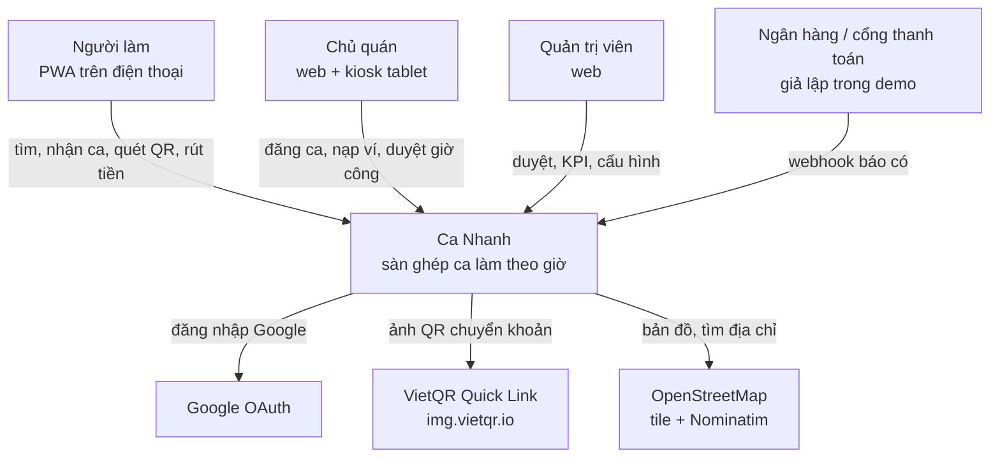
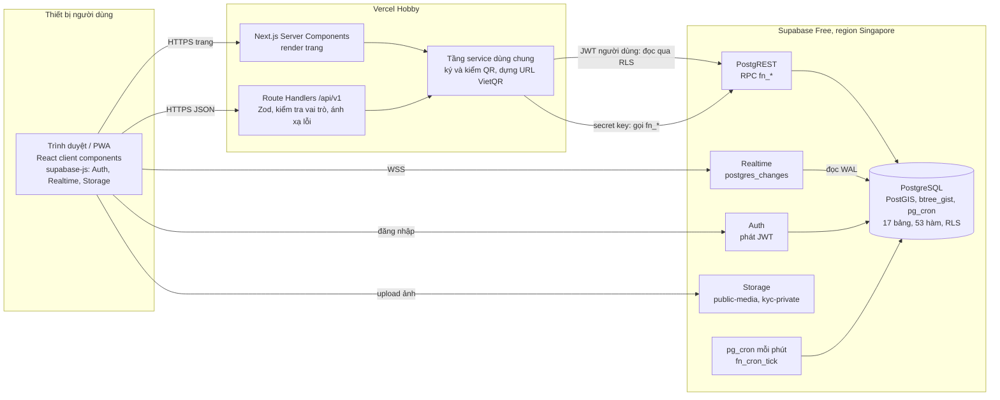
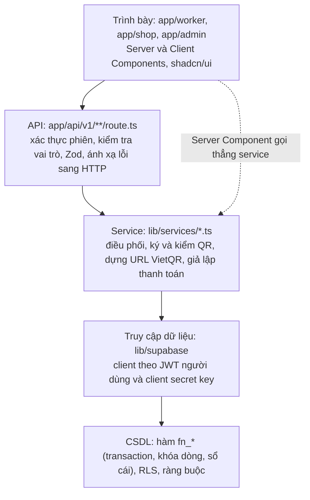
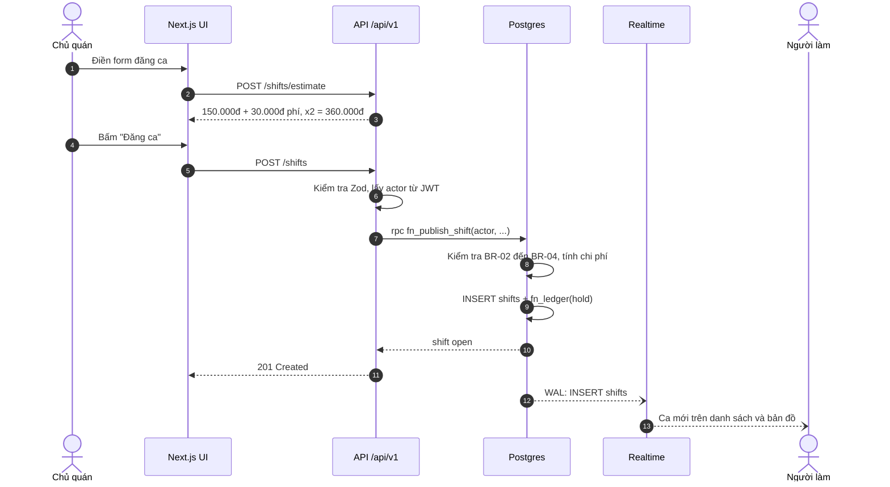
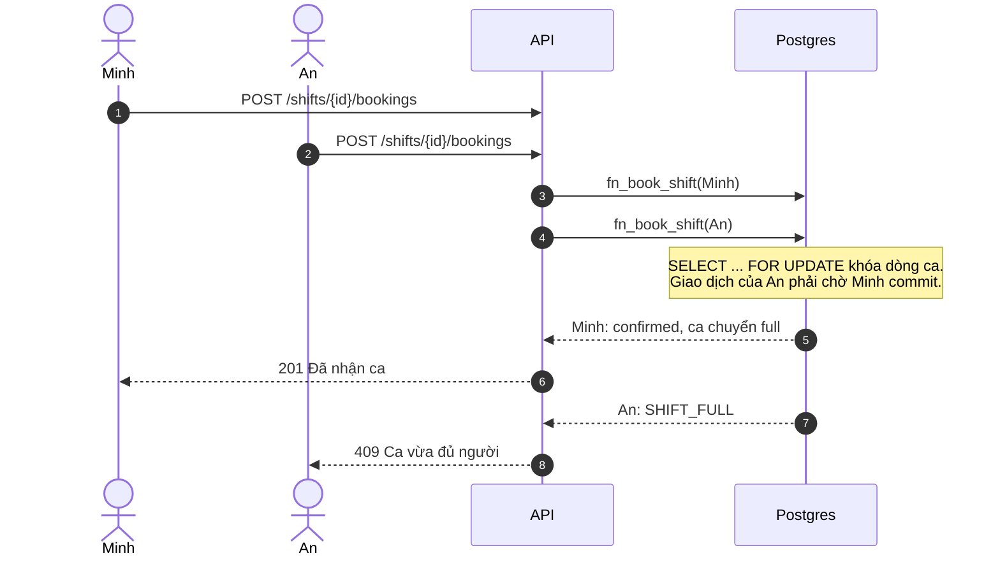
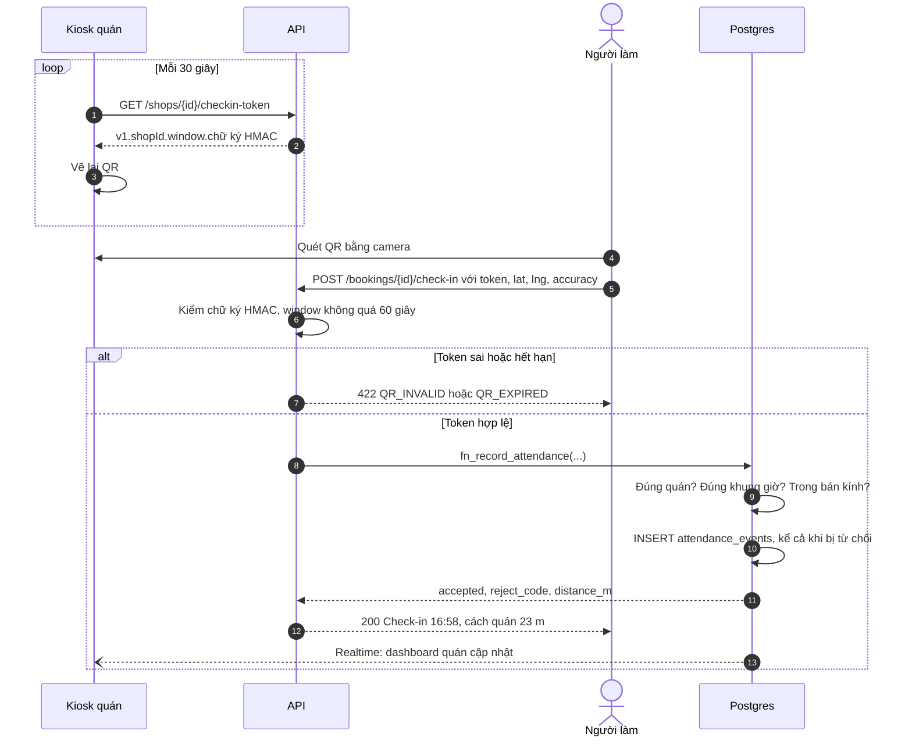
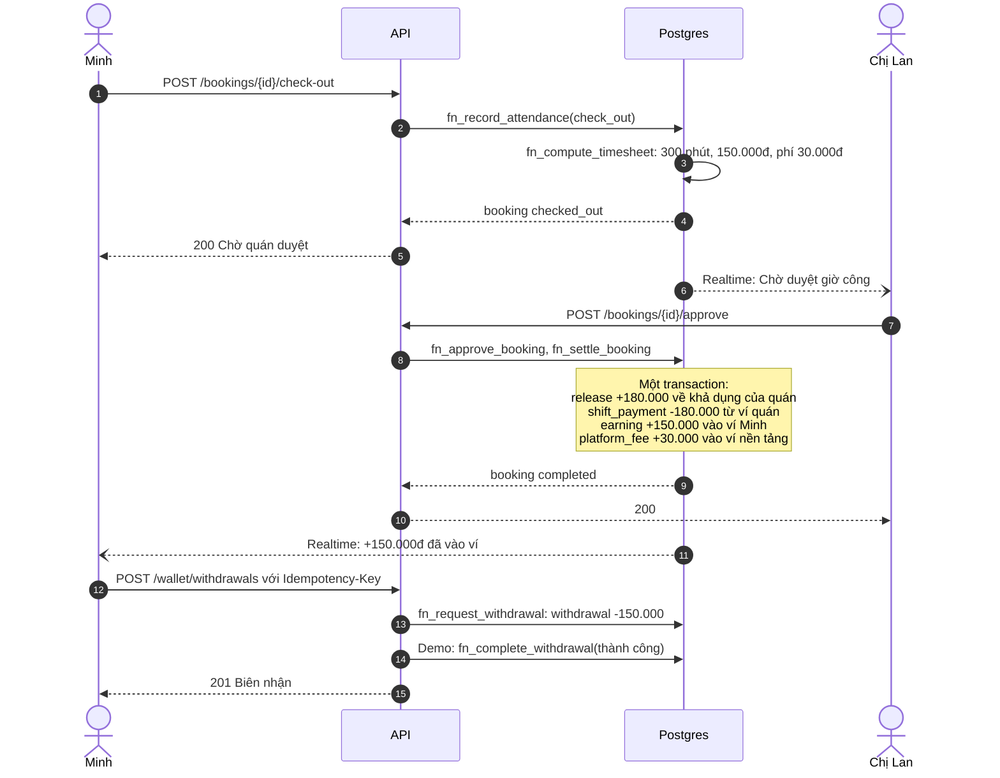
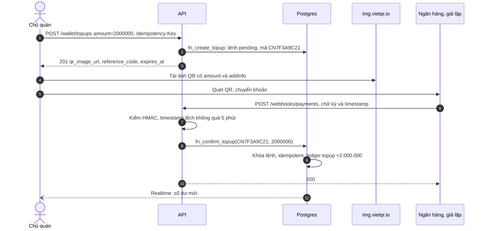

# Kiến trúc hệ thống & Thiết kế mức cao (HLD) — Ca Nhanh

| Mục | Nội dung |
|---|---|
| Phiên bản | 1.0 (bản để review) · 04/11/2026 |
| Nhóm thực hiện | [Tên nhóm] |
| Dựa trên | [01-SRS.md](01-SRS.md) (yêu cầu) · [04-ERD-Database-Schema.md](04-ERD-Database-Schema.md) (dữ liệu) · [05-API-Specification.md](05-API-Specification.md) (API) |

---

## 1. Mục tiêu và nguyên tắc kiến trúc

| Động lực | Hệ quả thiết kế |
|---|---|
| **0đ, chỉ dùng PaaS** (C-01) | Vercel Hobby cho ứng dụng web, Supabase Free cho CSDL/Auth/Realtime/Storage/lập lịch. Không có máy chủ tự quản |
| **Nhanh**: 2–3 tuần, 3–5 sinh viên (C-02) | Một ứng dụng Next.js duy nhất (monolith có module) cho cả 3 vai trò. Dùng dịch vụ có sẵn cho đăng nhập, realtime, lưu ảnh. Logic nghiệp vụ khó đã viết sẵn bằng SQL và kiểm thử (`docs/sql/`) |
| **Ấn tượng khi demo** | Realtime trên 2 thiết bị; tranh chỗ cuối cùng luôn đúng; QR xoay vòng + geofence; tiền ký quỹ và quyết toán tức thì; dashboard KPI có dữ liệu thật |
| **Đúng tiền tuyệt đối** | Mọi thao tác tiền là **một transaction ACID** trong PostgreSQL, đi qua một hàm sổ cái duy nhất, có bất biến kiểm thử tự động |
| **An toàn mặc định** | RLS trên mọi bảng; client chỉ đọc; ghi đi qua API + hàm nghiệp vụ; khóa bí mật chỉ ở server |

**Nguyên tắc**

1. **CSDL là nơi giữ bất biến.** Những gì phải luôn đúng (không vượt chỗ, không trùng giờ, không âm tiền, ghi có không trùng) được đảm bảo bằng ràng buộc và hàm trong Postgres, không dựa vào việc code phía trên "nhớ kiểm tra".
2. **API mỏng, hợp đồng rõ.** Route Handler chỉ xác thực, kiểm tra đầu vào, gọi một hàm nghiệp vụ, ánh xạ lỗi sang HTTP.
3. **Đọc qua RLS, ghi qua lệnh.** Client đọc dữ liệu của chính mình (và realtime) với JWT người dùng; mọi lệnh làm thay đổi trạng thái đi qua `/api/v1` → hàm `fn_*`.
4. **Thời gian do server quyết định.** Không tin đồng hồ thiết bị; khung giờ chấm công và token QR tính theo `now()` của server.

---

## 2. Lựa chọn công nghệ

### 2.1 Ngăn xếp công nghệ

| Lớp | Công nghệ | Vì sao chọn | Chi phí demo |
|---|---|---|---|
| Ứng dụng web + API | **Next.js** (App Router, TypeScript), Route Handlers làm REST `/api/v1` | Một repo, SSR cho trang, API cùng chỗ; Vercel triển khai bằng `git push` | Vercel Hobby: 0đ |
| Giao diện | Tailwind CSS, shadcn/ui, lucide-react, sonner (toast) | Đẹp, nhất quán, làm nhanh | 0đ |
| Form và kiểm tra dữ liệu | react-hook-form + **Zod** (dùng chung schema client/server) | Một nguồn sự thật cho validate | 0đ |
| Lấy dữ liệu phía client | TanStack Query + supabase-js Realtime | Cache, tự làm mới khi có sự kiện realtime | 0đ |
| Bản đồ | Leaflet + react-leaflet + tile OpenStreetMap; Nominatim để tìm địa chỉ | Không cần API key; Nominatim tối đa 1 yêu cầu/giây, không autocomplete | 0đ |
| QR | `qrcode` (vẽ QR trên kiosk); `@zxing/browser` hoặc BarcodeDetector API (quét) | Chạy hoàn toàn trên trình duyệt | 0đ |
| Biểu đồ | SVG tự vẽ (`components/charts/daily-chart.tsx`, thay Recharts ở Phase 3 để gói JS nhỏ và kiểm soát được chi tiết theo skill dataviz) | Dashboard KPI | 0đ |
| Đăng nhập | **Supabase Auth**: email/mật khẩu, Google OAuth, JWT | Tích hợp sẵn với RLS | Free: 50.000 MAU |
| CSDL | **Supabase Postgres** + PostGIS + btree_gist + **pg_cron** | Quan hệ, địa lý, ràng buộc loại trừ, lập lịch trong CSDL | Free: 500 MB |
| Realtime | **Supabase Realtime** (`postgres_changes`, tôn trọng RLS) | Đẩy thay đổi không cần tự dựng WebSocket | Free (giới hạn kết nối đồng thời, đủ cho demo) |
| Lưu ảnh | Supabase Storage: bucket `public-media` (công khai), `kyc-private` (riêng tư) | Chính sách theo thư mục người dùng | Free: 1 GB |
| Thanh toán | **VietQR Quick Link** (`img.vietqr.io`) + webhook adapter, bộ giả lập trong demo | Không cần giấy phép cho demo; thay bằng cổng thật chỉ cần viết adapter | 0đ |
| Email (tùy chọn) | Resend làm SMTP cho Supabase Auth | SMTP mặc định của Supabase bị giới hạn rất thấp | Gói miễn phí |
| Kiểm thử | Vitest, Playwright, kịch bản SQL chạy bằng Docker (`docs/sql/test/run_tests.sh`) | | 0đ |
| CI | GitHub Actions: lint, test, giữ dự án Supabase hoạt động | | 0đ (trong hạn mức) |

> Giới hạn free tier tham khảo tại thời điểm viết (11/2026): Supabase Free 500 MB CSDL, 50.000 MAU, 5 GB egress, 2 dự án, **tạm dừng sau 7 ngày không hoạt động**; Vercel Hobby chỉ cho mục đích **phi thương mại**, số lượng và tần suất cron rất hạn chế, hàm serverless mặc định 10 giây. Kiểm tra lại trang giá trước khi demo.

### 2.2 So sánh phương án nền tảng (ADR-02)

| Tiêu chí | **Supabase (chọn)** | Firebase (gợi ý ban đầu trong slide) | Tự dựng trên Render/Railway |
|---|---|---|---|
| Mô hình dữ liệu | Postgres quan hệ: ERD, khóa ngoại, ràng buộc | NoSQL dạng document: ERD và báo cáo kém tự nhiên | Postgres |
| Chống tranh chỗ, trùng giờ | `SELECT … FOR UPDATE`, exclusion constraint | Transaction Firestore, không có ràng buộc loại trừ | Có, nhưng tự viết |
| Tìm theo khoảng cách | PostGIS `ST_DWithin` + chỉ mục GiST | Geohash tự cài đặt | PostGIS nếu tự cài |
| Logic phía server | Hàm SQL + Next.js Route Handler (0đ) | Cloud Functions cần gói Blaze (phải gắn thẻ thanh toán) | Tự viết server |
| Realtime | Có sẵn, theo RLS | Có sẵn, rất mạnh | Tự dựng WebSocket |
| Lập lịch | pg_cron trong CSDL | Cloud Scheduler (gói trả phí) | Cron của nền tảng |
| Chi phí và độ ổn định khi demo | 0đ; nhớ chống tạm dừng | 0đ nếu không dùng Functions | Gói free thường ngủ khi không có truy cập và khởi động lại chậm; Postgres free có thời hạn |
| Hợp với tài liệu ERD/API của môn học | Rất tốt | Trung bình | Tốt |

**Kết luận**: chọn Supabase + Next.js trên Vercel. Nếu nhóm vẫn muốn Firebase, giữ nguyên SRS, Use Case và API; chỉ thay tầng dữ liệu (mất PostGIS và exclusion constraint, phải tự đảm bảo bằng transaction).

---

## 3. Kiến trúc tổng thể

### 3.1 Sơ đồ ngữ cảnh (C4 mức 1)



### 3.2 Sơ đồ container (C4 mức 2) và triển khai



| Container | Trách nhiệm | Không làm |
|---|---|---|
| Trình duyệt / PWA | Hiển thị, quét QR, lấy GPS, nghe realtime, upload ảnh trực tiếp vào thư mục của mình | Không ghi trực tiếp vào bảng nghiệp vụ; không giữ khóa bí mật |
| Next.js Server Components | Render trang theo vai trò, gọi thẳng tầng service (không tự gọi HTTP tới chính mình) | |
| Route Handlers `/api/v1` | Hợp đồng REST công khai (cho client, Postman, app mobile sau này): xác thực, Zod, gọi `fn_*`, ánh xạ lỗi | Không chứa quy tắc nghiệp vụ về tiền/chỗ |
| PostgreSQL | Toàn bộ quy tắc giao dịch: khóa dòng, sổ cái, ràng buộc, RLS, lập lịch, KPI | |
| Realtime | Đẩy thay đổi của các bảng `notifications`, `bookings`, `shifts`, `wallets`, `payment_orders` | |

### 3.3 Kiến trúc logic trong ứng dụng



**Cấu trúc thư mục đề xuất**

```text
ca-nhanh/
├── app/
│   ├── (marketing)/page.tsx            # Trang giới thiệu
│   ├── (auth)/login · signup · onboarding
│   ├── worker/                         # Mobile-first, cài được như PWA
│   │   ├── page.tsx                    # Khám phá ca: danh sách + bản đồ
│   │   ├── shifts/[id]/page.tsx        # Chi tiết ca, nút "Nhận ca"
│   │   ├── bookings/page.tsx           # Ca của tôi
│   │   ├── scan/page.tsx               # Quét QR check-in/out
│   │   ├── wallet/page.tsx · profile/page.tsx · invites/page.tsx
│   ├── shop/
│   │   ├── page.tsx                    # Dashboard hôm nay
│   │   ├── shifts/new · shifts/[id]
│   │   ├── kiosk/[shopId]/page.tsx     # QR xoay vòng toàn màn hình
│   │   └── timesheets · workers · wallet · settings
│   ├── admin/                          # kpi · kyc · shops · users · disputes · payments · settings · demo
│   ├── c/[token]/page.tsx              # Deep link khi quét QR bằng camera hệ thống
│   └── api/v1/**/route.ts              # REST API (tài liệu 05)
├── components/                         # ui/ · map/ · qr/ · charts/ · shift-card.tsx …
├── lib/
│   ├── supabase/ client.ts · server.ts · admin.ts
│   ├── services/ shifts.ts · bookings.ts · attendance.ts · wallet.ts · admin.ts
│   ├── qr-token.ts · vietqr.ts · errors.ts · money.ts · geo.ts
│   ├── validators/*.ts                 # Zod schema dùng chung
│   └── realtime/use-realtime.ts
├── supabase/migrations/                # chép từ docs/sql/0001…0005
├── public/ manifest.webmanifest · icons · sw.js
└── tests/ unit · e2e
```

---

## 4. Thiết kế các module

| Module | Trách nhiệm | Thành phần chính | Quyết định thiết kế |
|---|---|---|---|
| Danh tính và quyền | Đăng ký, đăng nhập, vai trò, onboarding | Supabase Auth; trigger `tg_handle_new_user`; `fn_complete_onboarding`; middleware Next.js chặn route theo vai trò | Trigger tạo hồ sơ + ví ngay khi có tài khoản; vai trò lấy từ metadata nhưng **không bao giờ nhận `admin`**; vai trò khóa sau onboarding |
| Chợ ca | Quán, ca, tìm kiếm, nhận ca, mời | `fn_publish_shift`, `search_shifts`, `fn_book_shift`, `fn_invite_workers` | Tìm theo PostGIS; nhận ca khóa dòng `shifts`; exclusion constraint chống trùng giờ ở mức CSDL |
| Chấm công | QR xoay vòng, check-in/out, geofence, chống gian lận | `lib/qr-token.ts` (HMAC), `fn_record_attendance`, `attendance_events` | Token ký ở server và đổi mỗi 30 giây; CSDL kiểm geofence bằng `ST_Distance`; **lần quét bị từ chối vẫn được lưu** (hàm trả JSON thay vì raise) |
| Ví và thanh toán | Ký quỹ, quyết toán, nạp, rút, sổ cái | `fn_ledger` (điểm duy nhất đổi số dư), `fn_settle_booking`, `fn_create_topup`, `fn_confirm_topup`, `fn_request_withdrawal`, `PaymentProvider` adapter | Tách *khả dụng* và *tạm giữ*; tạm giữ theo từng chỗ (`bookings.seat_hold`); sổ cái chỉ-thêm có `balance_after` |
| Uy tín | Đánh giá, điểm phạt, tạm khóa, người quen/chặn | `fn_submit_review`, `fn_apply_penalty`, `shop_worker_lists` | Điểm phạt tính theo cửa sổ 30 ngày từ chính bảng `bookings` (không cần bảng riêng) |
| Thông báo | Sự kiện trong app, toast, chuông | `fn_notify` → bảng `notifications` → Realtime | Thông báo được ghi **trong cùng transaction** với sự kiện, nên không có trường hợp tiền đã chuyển mà không có thông báo |
| Lập lịch | Chuyển trạng thái theo thời gian | pg_cron job `ca-nhanh-tick` → `fn_cron_tick()` → 7 bước | Mỗi bước dựa trên trạng thái + `FOR UPDATE SKIP LOCKED`, chạy lại an toàn; không phụ thuộc cron của Vercel |
| Quản trị và phân tích | KPI, duyệt, khiếu nại, cấu hình | View `v_kpi_daily`, `fn_kpi_summary`, `fn_review_kyc`, `fn_resolve_dispute`, `platform_settings` | KPI tính trực tiếp từ dữ liệu giao dịch, không cần kho dữ liệu riêng |
| Công cụ demo | Reset, sinh lịch sử, tua thời gian, đăng nhập nhanh | `fn_demo_reset`, `fn_demo_seed_history`, `fn_demo_fast_forward`, cờ `demo_mode` | Mọi công cụ bị chặn khi `demo_mode.enabled = false` |

### 4.1 Adapter thanh toán

```ts
// lib/payments/provider.ts — đổi cổng thanh toán chỉ cần thêm một adapter
export interface PaymentProvider {
  name: 'vietqr_sim' | 'payos' | 'sepay';
  buildTopupInstruction(order: { amount: number; reference_code: string }): { qr_image_url: string };
  verifyWebhook(req: Request, rawBody: string): Promise<{ reference_code: string; amount: number; txn_id: string }>;
}
```

Bộ giả lập `vietqr_sim` dựng URL `img.vietqr.io` từ biến môi trường tài khoản nền tảng, và xác nhận bằng nút *Giả lập đã chuyển khoản*. Khi thương mại hóa, viết adapter cho cổng thật (ví dụ payOS, SePay; kiểm tra điều khoản từng cổng) gọi cùng `fn_confirm_topup`.

---

## 5. Luồng nghiệp vụ chính

### 5.1 Đăng ca và ký quỹ



### 5.2 Hai người tranh chỗ cuối cùng



Kết quả đo khi kiểm thử với hai phiên Postgres song song: phiên A giữ khóa 2 giây; phiên B bắt đầu sau 0,5 giây, **chờ 1,52 giây**, rồi nhận `SHIFT_FULL`. Ca có đúng 1 booking.

### 5.3 Check-in bằng QR xoay vòng và geofence



### 5.4 Check-out, duyệt, quyết toán và rút tiền



### 5.5 Nạp ví qua VietQR và webhook



Trong demo, nút *Giả lập đã chuyển khoản* gọi `POST /payment-orders/{id}/simulate-paid`, đi đúng đường xử lý như webhook thật (bước 9–11).

---

## 6. Thiết kế Realtime

| Kênh (tên gợi ý) | Bảng, sự kiện | Bộ lọc | Người đăng ký | Phản ứng ở client |
|---|---|---|---|---|
| `notifications:{uid}` | `notifications` INSERT | `user_id=eq.{uid}` | Mọi người dùng | Toast + tăng số trên chuông |
| `shop-bookings:{shopId}` | `bookings` * | `shop_id=eq.{shopId}` | Chủ quán (dashboard, kiosk) | Cập nhật chỗ, trạng thái check-in |
| `my-bookings:{uid}` | `bookings` UPDATE | `worker_id=eq.{uid}` | Người làm | Trạng thái *Ca của tôi* |
| `shift-feed` | `shifts` INSERT, UPDATE | không lọc (RLS chỉ cho thấy ca `open`/`full` và ca của mình) | Người làm ở trang khám phá | Lọc theo khoảng cách ở client, làm mới query, gắn nhãn *Mới* |
| `wallet:{uid}` | `wallets` UPDATE | `owner_id=eq.{uid}` | Chủ ví | Số dư thay đổi kèm hiệu ứng |
| `payment-order:{id}` | `payment_orders` UPDATE | `id=eq.{orderId}` | Màn hình nạp tiền | Đóng QR khi lệnh thành công |

```ts
// Ví dụ: nghe thông báo của chính mình
supabase
  .channel(`notifications:${uid}`)
  .on('postgres_changes',
      { event: 'INSERT', schema: 'public', table: 'notifications', filter: `user_id=eq.${uid}` },
      (p) => toast(p.new.title, { description: p.new.body }))
  .subscribe();
```

Ghi chú: `postgres_changes` kiểm tra RLS cho từng người đăng ký nên phù hợp quy mô demo. Khi mở rộng, chuyển sang Broadcast phát từ trigger, kênh theo khu vực (§12).

**Phải nạp JWT trước khi join kênh.** supabase-js lấy token cho Realtime qua callback bất đồng bộ, nên kênh đầu tiên mở trên một kết nối mới có thể join bằng khóa publishable (vai trò anon): kênh vẫn báo `SUBSCRIBED` nhưng RLS chặn mọi sự kiện. Lỗi chỉ lộ ở bản production (React StrictMode ở dev đăng ký kênh hai lần nên che mất). `lib/realtime/use-realtime.ts` gọi `client.auth.getSession()` rồi `client.realtime.setAuth()` một lần cho cả trang trước khi `subscribe()`.

---

## 7. Bảo mật và quyền riêng tư

### 7.1 Ba lớp phân quyền

| Lớp | Cơ chế | Ví dụ |
|---|---|---|
| Trang | Middleware Next.js (từ Next.js 16 là file `proxy.ts`) đọc phiên, chuyển hướng theo vai trò | Người làm mở `/shop/...` → về `/worker` |
| API | `requireUser({ role })` + kiểm tra quyền sở hữu trong hàm `fn_*` (tham số `p_actor`) | Chủ quán khác gọi `POST /shifts/{id}/cancel` → `403 FORBIDDEN` |
| CSDL | RLS cho đọc; **không có chính sách ghi** cho client; `EXECUTE` hàm `fn_*` chỉ cấp cho `service_role`; phân quyền cột ẩn SĐT, ngày sinh, ngân hàng | Client gọi thẳng RPC `fn_book_shift` → `permission denied` (đã kiểm thử) |

### 7.2 Quản lý khóa bí mật

| Biến | Phạm vi | Ghi chú |
|---|---|---|
| `NEXT_PUBLIC_SUPABASE_URL`, `NEXT_PUBLIC_SUPABASE_PUBLISHABLE_KEY` | Công khai | Khóa publishable (tên cũ: *anon key*) an toàn để lộ vì đã có RLS |
| `SUPABASE_SECRET_KEY` | **Chỉ server** | Khóa secret (tên cũ: *service_role key*), bỏ qua RLS. Không bao giờ có tiền tố `NEXT_PUBLIC_` |
| `QR_SIGNING_SECRET` | **Chỉ server** | 32 byte ngẫu nhiên; đổi khóa thì mọi QR cũ mất hiệu lực sau ≤ 60 giây |
| `PAYMENT_WEBHOOK_SECRET` | **Chỉ server** | Ký và kiểm webhook |

### 7.3 Mô hình đe dọa rút gọn

| Đe dọa | Kiểm soát |
|---|---|
| Tự nâng quyền thành admin khi đăng ký | Trigger chỉ nhận `worker`/`shop_owner`; admin được gán thủ công bằng SQL (đã kiểm thử) |
| Gọi thẳng PostgREST để nhận ca bỏ qua API | `EXECUTE` bị thu hồi khỏi `anon`, `authenticated` |
| Sửa số dư ví từ client | Không có chính sách UPDATE nên RLS chặn (0 dòng bị ảnh hưởng, đã kiểm thử); số dư chỉ đổi qua `fn_ledger` |
| Chấm công hộ bằng ảnh chụp QR | Token đổi mỗi 30 giây, hạn 60 giây, ký HMAC, kèm geofence, log mọi lần quét |
| Giả mạo webhook báo có | HMAC-SHA256 trên `timestamp.body`, lệch tối đa 5 phút, so sánh hằng thời gian; xử lý idempotent theo mã tham chiếu |
| Lộ dữ liệu cá nhân | Phân quyền cột; ảnh CCCD ở bucket riêng tư theo thư mục `<uid>/`; admin xem qua URL ký 60 giây; chỉ lưu 4 số cuối CCCD |
| Injection, XSS, CSRF | Gọi RPC tham số hóa (không ghép chuỗi SQL); React tự escape, không dùng `dangerouslySetInnerHTML`; cookie SameSite, API chỉ nhận `application/json`, kiểm `Origin` với lệnh ghi |
| Spam API | Giới hạn tần suất lệnh ghi (Should): token bucket trong Postgres hoặc Upstash gói miễn phí |

---

## 8. Đồng thời và nhất quán dữ liệu

| Rủi ro | Giải pháp | Nơi cài đặt |
|---|---|---|
| Vượt số chỗ khi nhận đồng thời | Khóa dòng `SELECT … FOR UPDATE` trên ca trước khi đếm chỗ | `fn_book_shift` |
| Một người nhận hai ca trùng giờ | Exclusion constraint `EXCLUDE USING gist (worker_id WITH =, period WITH &&)` | bảng `bookings` |
| Nhận một ca hai lần | Partial unique index `(shift_id, worker_id) WHERE status <> 'cancelled'` | bảng `bookings` |
| Số dư âm | `CHECK (balance >= 0)` → bắt lỗi thành `INSUFFICIENT_BALANCE` | `wallets`, `fn_ledger` |
| Tiền lệch giữa các ví | Mọi biến động qua `fn_ledger` trong **một** transaction; 3 bất biến được kiểm thử | xem [04 §6](04-ERD-Database-Schema.md) |
| Webhook hoặc người dùng bấm hai lần | `UNIQUE (wallet_id, idempotency_key)`; `fn_confirm_topup` trả kết quả cũ nếu đã thành công | `payment_orders` |
| Tác vụ định kỳ chạy chồng | `FOR UPDATE SKIP LOCKED` + điều kiện theo trạng thái | các hàm `fn_cron_*` |
| Đồng hồ thiết bị sai | Mọi mốc thời gian lấy `now()` ở CSDL; token QR dựa trên giờ server | toàn hệ thống |

---

## 9. Triển khai

### 9.1 Môi trường

| Môi trường | Ứng dụng | CSDL | Mục đích |
|---|---|---|---|
| Local | `next dev` | Supabase local (`npx supabase start`, cần Docker) hoặc dự án *dev* trên cloud | Phát triển |
| Kiểm thử CSDL | — | Docker PostGIS + `docs/sql/test/run_tests.sh` | Chạy 103 kiểm tra nghiệp vụ, không cần Supabase |
| Preview | Vercel Preview (mỗi pull request) | Dự án Supabase *dev* | Review |
| Demo | Vercel Production `*.vercel.app` | Dự án Supabase *demo* (gói Free cho phép 2 dự án) | Thuyết trình |

### 9.2 Các bước triển khai

1. **Supabase**: tạo dự án, region *Southeast Asia (Singapore)*.
2. *Database → Extensions*: bật `postgis` (schema `extensions`), `btree_gist`, `pg_cron`.
3. *SQL Editor*: chạy lần lượt `docs/sql/0001_schema.sql` → `0002_functions.sql` → `0003_security.sql` → `0004_cron_realtime.sql` → `0005_phase2_fixes.sql`. Hoặc chép vào `supabase/migrations/` rồi chạy `supabase link` + `supabase db push`.
4. *Authentication*: bật Email; với demo, tắt *Confirm email* (hoặc cấu hình SMTP Resend). Bật Google với Client ID/Secret từ Google Cloud Console, redirect `https://<project-ref>.supabase.co/auth/v1/callback`. Ở *URL Configuration*, đặt Site URL là URL Vercel và thêm URL preview.
5. **Tài khoản demo**: `npm run seed` (`scripts/seed.ts`, đặt `SEED_ENV_FILE` để trỏ sang dự án khác) dùng Admin API `auth.admin.createUser({ email, password, email_confirm: true, user_metadata: { role, full_name } })` cho 2 chủ quán và khoảng 30 người làm; gọi `fn_complete_onboarding` cho từng tài khoản; tạo quán; gán admin bằng `update profiles set role = 'admin' where id = '<uuid>'`.
6. Sinh dữ liệu: `select fn_demo_reset(60, 2000000);` (60 ngày lịch sử, mỗi quán có sẵn 2.000.000đ).
7. **Vercel**: *Import* repo GitHub → khai báo biến môi trường ở bảng dưới → *Deploy*.
8. Kiểm tra nhanh: `GET /api/v1/health`, đăng nhập nhanh, đăng ca trên laptop và thấy ca hiện trên điện thoại.

| Biến môi trường | Bí mật | Ví dụ |
|---|---|---|
| `NEXT_PUBLIC_SUPABASE_URL` | Không | `https://abcd.supabase.co` |
| `NEXT_PUBLIC_SUPABASE_PUBLISHABLE_KEY` | Không | `sb_publishable_…` |
| `SUPABASE_SECRET_KEY` | **Có** | `sb_secret_…` |
| `QR_SIGNING_SECRET` | **Có** | `openssl rand -base64 32` |
| `PAYMENT_WEBHOOK_SECRET` | **Có** | `openssl rand -base64 32` |
| `PLATFORM_BANK_BIN` · `PLATFORM_BANK_ACCOUNT` · `PLATFORM_BANK_NAME` | Không | `970436` · `0011000000000` · `CA NHANH DEMO` |
| `NEXT_PUBLIC_APP_URL` | Không | `https://ca-nhanh.vercel.app` |
| `DEMO_MODE` | Không | `true` (đồng bộ với cờ `demo_mode` trong CSDL) |
| `RESEND_API_KEY`, `VAPID_*` | Có | Tùy chọn |

### 9.3 CI/CD

- **Vercel**: push nhánh → Preview; merge `main` → Production.
- **GitHub Actions `ci.yml`**: job `web` chạy `npm run lint`, `typecheck`, `test`, `format:check`, `build`; job `db-test` kiểm `supabase/migrations` giống hệt `docs/sql`, rồi chạy `bash docs/sql/test/run_tests.sh` (runner Ubuntu có sẵn Docker) và yêu cầu đủ 92 kiểm tra.
- **GitHub Actions `keep-alive.yml`**: gọi health check hai lần mỗi tuần để dự án Supabase không bị coi là không hoạt động. Lưu ý: GitHub có thể tắt workflow lập lịch nếu repo lâu không có hoạt động.

```yaml
name: keep-alive
on:
  schedule: [{ cron: "0 1 * * 1,4" }]   # 08:00 thứ Hai và thứ Năm, giờ Việt Nam
  workflow_dispatch:
jobs:
  ping:
    runs-on: ubuntu-latest
    steps:
      - run: curl -fsS "${{ secrets.APP_URL }}/api/v1/health"
```

---

## 10. Kiểm thử

| Mức | Công cụ | Phạm vi | Trạng thái |
|---|---|---|---|
| CSDL (nghiệp vụ) | psql + Docker PostGIS | 103 kiểm tra: đăng ký, onboarding, nạp, đăng ca, nhận ca, tranh chỗ, hủy, điểm phạt, QR + geofence, quyết toán, bồi thường, rút, khiếu nại, KYC, RLS, bất biến tiền, reset demo, tua thời gian | **Đạt 92/92** |
| Đồng thời | 2 phiên psql song song | Tranh chỗ cuối cùng | **Đạt** (B chờ 1,52 giây rồi nhận `SHIFT_FULL`) |
| Unit | Vitest | Ký/kiểm token QR (cửa sổ ±1), dựng URL VietQR, ánh xạ lỗi, định dạng tiền, Zod schema | Cần viết |
| API | Vitest + Supabase local | Mỗi endpoint: mã thành công + 1–2 mã lỗi chính | Cần viết |
| E2E | Playwright, 2 browser context (quán + người làm), `setGeolocation`, deep link `/c/<token>` thay cho camera | Luồng vàng ở [02 §8](02-Use-Cases-User-Stories.md) | Cần viết |
| Thủ công | 3 thiết bị thật | Camera, GPS, PWA, realtime | Trước demo |

---

## 11. Vận hành và checklist ngày demo

**Giám sát**
- Vercel: *Logs* và *Analytics* (Hobby).
- Supabase: *Logs Explorer*, *Realtime Inspector*, *Database → Query performance*.
- Lịch chạy: `select jobname, status, start_time from cron.job_run_details order by start_time desc limit 10;`
- Sao lưu: gói Free không có sao lưu để tự khôi phục. Chạy `supabase db dump` (hoặc `pg_dump`) trước buổi demo.

**Checklist**

| Thời điểm | Việc cần làm |
|---|---|
| T − 1 ngày | Mở dashboard Supabase (khôi phục nếu dự án bị tạm dừng); *Admin → Demo → Reset dữ liệu demo* (gõ RESET); chạy thử toàn bộ kịch bản trên 3 thiết bị; sạc đầy máy; chuẩn bị 4G dự phòng; quay video dự phòng 1 phút. Lệnh `npx playwright test tests/e2e/demo.spec.ts` chạy đúng kịch bản 5 phút trên URL thật (`E2E_BASE_URL=…`) |
| T − 15 phút | `GET /api/v1/health`; *Admin → Demo → Đặt 2 phút cho demo* (`min_lead_minutes = 2`); trên tablet bấm *Đặt vị trí quán tại đây* rồi mở kiosk (bật Wake Lock); đăng nhập sẵn 2 điện thoại; cấp quyền camera và vị trí. Chuẩn bị mốc 4:20: cho Bình nhận một ca, *Tua tới giờ kết thúc* rồi *Chạy bộ hẹn giờ ngay* để Bình bị tạm khóa vì vắng mặt |
| Nếu GPS trong phòng kém | Bật cờ `demo_mode.skip_geofence = true` và nói rõ với hội đồng đây là cờ demo |
| Chạy tập rồi chạy thật | Không cần reset giữa hai lần: từ migration `0005`, *Tua tới giờ kết thúc* lần hai cho cùng người làm không vướng ca đã tua trước đó |
| Sau demo | *Đặt lại 30 phút*; tắt `demo_mode` nếu để công khai link; xoay `QR_SIGNING_SECRET` nếu đã chiếu màn hình có khóa |

---

## 12. Hiệu năng và lộ trình mở rộng

| Ngưỡng / tình huống | Điểm nghẽn | Hành động |
|---|---|---|
| Vượt 500 MB dữ liệu hoặc 5 GB egress | Hạn mức Free | Supabase Pro (khoảng 25 USD/tháng) |
| Thương mại hóa | Vercel Hobby chỉ cho phi thương mại | Vercel Pro hoặc nền tảng tương đương |
| Hàng trăm kết nối realtime | `postgres_changes` kiểm RLS cho từng người đăng ký | Broadcast từ trigger (`realtime.broadcast_changes`), kênh theo quận |
| Ca gấp báo cho hàng nghìn người | Ghi thông báo trong cùng transaction | Hàng đợi (`pgmq`) + worker (Supabase Edge Function) |
| `attendance_events`, `wallet_transactions` lớn | Bảng tăng nhanh | Phân vùng theo tháng, lưu trữ dữ liệu cũ |
| Tìm kiếm nặng | Truy vấn địa lý + sắp xếp điểm | Materialized view theo khu vực, read replica |
| Tiền thật | Giấy phép trung gian thanh toán | Đối tác ngân hàng/ví; thêm adapter `PaymentProvider` |
| Nhiều thành phố | Lương tối thiểu theo vùng | Bảng `regions` + lương tối thiểu theo vùng |

Ước lượng tải demo: khoảng 50 người dùng đồng thời, dưới 10 yêu cầu/giây. Hàm nặng nhất là `search_shifts` (chỉ mục GiST trên `shops.location`, lọc trước theo `status, start_at`).

---

## 13. Quyết định kiến trúc (ADR)

| Mã | Quyết định | Phương án đã cân nhắc | Lý do | Hệ quả |
|---|---|---|---|---|
| ADR-01 | Chỉ dùng PaaS: Vercel + Supabase | VPS, EC2, Kubernetes | 0đ, không phải vận hành máy chủ, HTTPS sẵn | Phụ thuộc giới hạn free tier; phải chống tạm dừng |
| ADR-02 | Supabase (Postgres) thay Firebase | Firebase, tự dựng | Xem §2.2 | ERD/SQL đúng tinh thần môn học; mất một số tiện ích của Firebase |
| ADR-03 | Quy tắc giao dịch nằm trong hàm Postgres | Viết hết ở Node | Khóa dòng, ràng buộc, transaction ở cùng một chỗ; kiểm thử được bằng SQL | Cần kỹ năng PL/pgSQL (đã viết sẵn) |
| ADR-04 | Một ứng dụng Next.js cho 3 vai trò | Ba frontend riêng, microservices | Nhanh, chung component và kiểu dữ liệu | Phải tách route và quyền cẩn thận |
| ADR-05 | QR xoay vòng + geofence | NFC, Bluetooth beacon, QR tĩnh | Không cần phần cứng; chống chụp QR | Cần GPS; trong nhà có sai số (bù bằng sai số cho phép) |
| ADR-06 | Ví nội bộ + VietQR giả lập | Tích hợp cổng thật ngay | Không cần giấy phép, demo ổn định | Phải nói rõ là mô phỏng; có sẵn adapter để chuyển |
| ADR-07 | pg_cron thay cron của Vercel | Vercel Cron, GitHub Actions | Chạy mỗi phút, ngay trong CSDL, miễn phí | Logic lập lịch nằm trong SQL |
| ADR-08 | Realtime bằng `postgres_changes` | Polling, WebSocket tự dựng | Có sẵn, tôn trọng RLS | Cần Broadcast khi tải lớn |
| ADR-09 | PWA thay app native; Android đóng gói bằng Trusted Web Activity (`npm run android:build`) | React Native, Flutter | Một mã nguồn; có file APK/AAB cho Android mà không viết lại; iPhone dùng *Thêm vào MH chính* | Web Push trên iOS cần cài PWA trước; bản iOS trên App Store cần máy Mac và tài khoản Apple |
| ADR-10 | Tạm giữ theo từng chỗ (`seat_hold`) | Chỉ giữ tổng theo ca | Hoàn tiền đúng khi có người hủy, vắng mặt hoặc khiếu nại | Thêm một cột, nhưng bất biến rõ ràng |

---

## 14. Điểm nhấn kỹ thuật khi thuyết trình

1. **Hai thiết bị, một giây**: ca đăng trên laptop hiện trên điện thoại gần như ngay lập tức (Realtime).
2. **Không bao giờ bán trùng chỗ**: hai người bấm cùng lúc, CSDL xếp hàng; exclusion constraint chặn trùng giờ.
3. **Chống chấm công hộ**: QR đổi mỗi 30 giây, chữ ký HMAC, geofence PostGIS, log mọi lần quét.
4. **Ký quỹ và sổ cái**: tiền được giữ khi đăng ca, chia đúng khi duyệt; tổng tiền luôn bảo toàn (bất biến có kiểm thử).
5. **Tự vận hành**: pg_cron nhắc ca, đánh dấu vắng mặt, tự duyệt, hoàn tiền thừa mỗi phút.
6. **Số liệu kinh doanh thật**: GMV, doanh thu phí, fill rate, time-to-fill tính từ dữ liệu giao dịch, khớp với BMC.
7. **0đ hạ tầng**: toàn bộ chạy trên gói miễn phí, URL HTTPS công khai.
