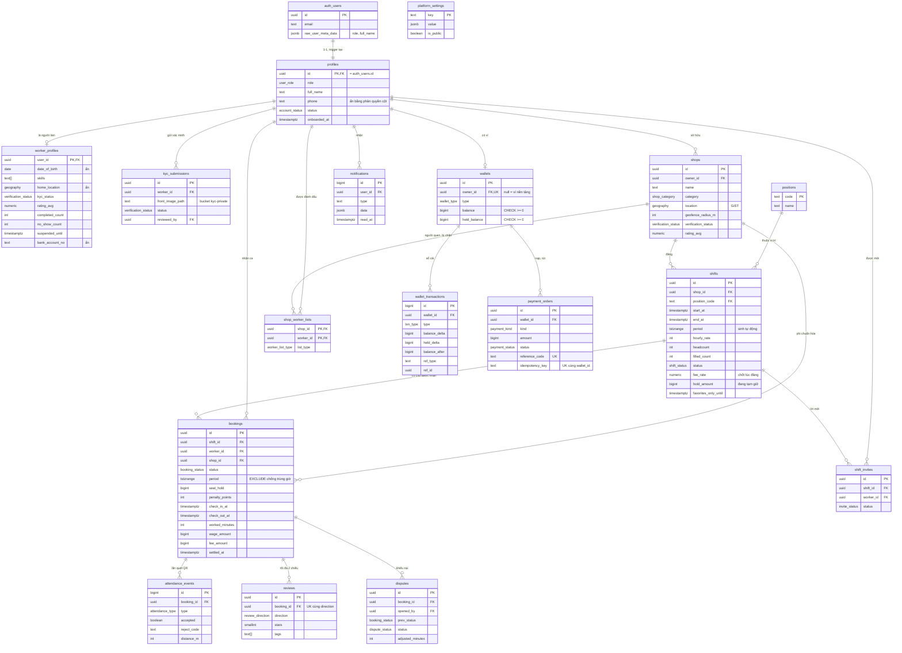

# ERD & Database Schema — Ca Nhanh

| Mục | Nội dung |
|---|---|
| Phiên bản | 1.0 (bản để review) · 04/11/2026 |
| CSDL | PostgreSQL 15+ trên Supabase (đã kiểm thử trên PostgreSQL 17 + PostGIS 3.5) |
| Mã nguồn SQL | [`docs/sql/`](sql/): `0001_schema.sql` · `0002_functions.sql` · `0003_security.sql` · `0004_cron_realtime.sql` · `test/` |
| Kết quả kiểm thử | **103/103** kiểm tra đạt; tranh chỗ đồng thời đạt (§11) |
| Dựa trên | [01-SRS.md](01-SRS.md) (quy tắc `BR-…`) · [03-HLD](03-System-Architecture-HLD.md) (kiến trúc) |

---

## 1. Nguyên tắc thiết kế dữ liệu

| Nguyên tắc | Cách áp dụng |
|---|---|
| Khóa chính | `uuid` (`gen_random_uuid()`) cho thực thể nghiệp vụ; `bigint identity` cho bảng log/sổ cái ghi nhiều |
| Thời gian | `timestamptz`, lưu UTC, hiển thị `Asia/Ho_Chi_Minh` |
| Tiền | `bigint` đơn vị **đồng**; không dùng số thực. Tỉ lệ phí `numeric(4,3)` |
| Địa lý | `extensions.geography(Point, 4326)` (PostGIS), đo khoảng cách bằng mét |
| Trạng thái | Kiểu `enum` của Postgres, nên sinh được kiểu TypeScript chính xác |
| Bất biến | Đặt trong CSDL: `CHECK`, `UNIQUE` một phần, `EXCLUDE` (ràng buộc loại trừ), khóa dòng trong hàm |
| Phi chuẩn hóa có chủ đích | `bookings.shop_id`, `bookings.period` (để lọc Realtime/RLS và chống trùng giờ); `rating_avg`, `rating_count`, `completed_count` (để đọc nhanh) |
| Chỉ-thêm | `wallet_transactions`, `attendance_events` không bao giờ sửa hoặc xóa (trừ reset demo) |
| Cấu hình | Mọi con số nghiệp vụ nằm trong `platform_settings`, không viết cứng trong mã |

---

## 2. Sơ đồ quan hệ thực thể (ERD)

Sơ đồ thể hiện **các cột khóa và cột quan trọng**; danh sách cột đầy đủ ở §4.



**Đọc nhanh các quan hệ chính**
- Một **ca** có nhiều **booking**; mỗi booking là một người làm giữ một chỗ. `filled_count` = số booking chưa hủy.
- Một **người làm** không thể có hai booking còn hiệu lực (đã nhận, đang làm) chồng giờ (ràng buộc `bookings_no_overlap`, migration `0005`).
- Mỗi người dùng có đúng **một ví**; thêm một ví nền tảng duy nhất (`owner_id` null) để nhận phí.
- Mọi thay đổi số dư sinh một dòng **sổ cái** trỏ về nguồn gốc (`ref_type`, `ref_id` = ca, booking, lệnh thanh toán).

---

## 3. Kiểu liệt kê

| Kiểu | Giá trị | Ghi chú |
|---|---|---|
| `user_role` | `worker`, `shop_owner`, `admin` | `admin` chỉ gán thủ công |
| `account_status` | `active`, `locked` | Admin khóa tài khoản |
| `verification_status` | `unverified`, `pending`, `verified`, `rejected` | Dùng cho KYC người làm và duyệt quán |
| `shop_category` | `cafe`, `milk_tea`, `restaurant`, `bakery`, `bar`, `fast_food`, `other` | |
| `shift_status` | `open`, `full`, `in_progress`, `completed`, `cancelled`, `expired` | Vòng đời: [SRS §5.1](01-SRS.md) |
| `booking_status` | `confirmed`, `checked_in`, `checked_out`, `disputed`, `completed`, `cancelled`, `no_show` | Vòng đời: [SRS §5.2](01-SRS.md) |
| `booking_source` | `marketplace`, `invite` | |
| `actor_type` | `worker`, `shop`, `system`, `admin` | Ai hủy, ai mở khiếu nại |
| `attendance_type` | `check_in`, `check_out` | |
| `invite_status` | `pending`, `accepted`, `declined`, `expired` | |
| `review_direction` | `worker_to_shop`, `shop_to_worker` | |
| `worker_list_type` | `favorite`, `blocked` | |
| `wallet_type` | `worker`, `shop`, `platform` | |
| `txn_type` | `topup`, `hold`, `release`, `shift_payment`, `earning`, `platform_fee`, `boost_fee`, `compensation`, `withdrawal`, `withdrawal_reversal`, `adjustment` | Ý nghĩa ở §6.1 |
| `payment_kind` | `topup`, `withdrawal` | |
| `payment_status` | `pending`, `succeeded`, `failed`, `expired` | Vòng đời: [SRS §5.3](01-SRS.md) |
| `dispute_status` | `open`, `resolved`, `rejected` | |

---

## 4. Từ điển dữ liệu

Ký hiệu: **PK** khóa chính · **FK** khóa ngoại · **UK** duy nhất · **NN** not null · 🔒 cột bị ẩn với client (phân quyền cột, §8).

### 4.1 `profiles`: hồ sơ chung của mọi tài khoản (1-1 với `auth.users`)

| Cột | Kiểu | Ràng buộc | Ý nghĩa |
|---|---|---|---|
| id | uuid | PK, FK → `auth.users` (xóa theo) | Trùng id đăng nhập |
| role | user_role | NN, mặc định `worker` | Vai trò |
| full_name | text | NN, 1–80 ký tự | Họ tên hiển thị |
| phone | text | regex `^(0\|\+84)[0-9]{9,10}$` | 🔒 SĐT |
| avatar_url | text | | Ảnh đại diện (bucket `public-media`) |
| status | account_status | NN, mặc định `active` | Admin khóa/mở |
| onboarded_at | timestamptz | | Đã xong onboarding thì vai trò bị khóa |
| created_at, updated_at | timestamptz | NN | `updated_at` tự cập nhật bằng trigger |

### 4.2 `worker_profiles`: thông tin riêng của người làm

| Cột | Kiểu | Ràng buộc | Ý nghĩa |
|---|---|---|---|
| user_id | uuid | PK, FK → `profiles` | |
| date_of_birth | date | NN | 🔒 Kiểm tra ≥ 18 tuổi (BR-27) |
| bio | text | ≤ 500 ký tự | Giới thiệu |
| school | text | | Trường |
| skills | text[] | NN, mặc định `{}`, chỉ mục GIN | Mã vị trí làm được |
| home_location | geography(Point) | chỉ mục GiST | 🔒 Dùng để báo ca gấp trong 3 km |
| kyc_status | verification_status | NN, mặc định `unverified` | Chỉ `verified` mới nhận ca |
| rating_avg, rating_count | numeric(3,2), int | NN | Tổng hợp từ `reviews` |
| completed_count, no_show_count | int | NN | Hồ sơ năng lực |
| suspended_until | timestamptz | | Tạm khóa nhận ca (BR-11) |
| bank_bin | text | 6 chữ số | 🔒 Mã BIN ngân hàng (ví dụ 970436) |
| bank_account_no | text | 4–19 ký tự chữ/số | 🔒 |
| bank_account_name | text | | 🔒 |

### 4.3 `kyc_submissions`: hồ sơ xác minh danh tính

| Cột | Kiểu | Ràng buộc | Ý nghĩa |
|---|---|---|---|
| id | uuid | PK | |
| worker_id | uuid | FK → `profiles`, NN | |
| id_last4 | text | 4 chữ số | Chỉ lưu 4 số cuối CCCD |
| front_image_path, back_image_path, selfie_path | text | NN, phải bắt đầu bằng `<worker_id>/` | Đường dẫn trong bucket riêng tư `kyc-private` |
| status | verification_status | NN, mặc định `pending` | |
| reject_reason | text | bắt buộc khi từ chối | |
| reviewed_by, reviewed_at | uuid, timestamptz | FK → `profiles` | Admin duyệt |

### 4.4 `positions`: danh mục vị trí

| Cột | Kiểu | Ràng buộc | Ý nghĩa |
|---|---|---|---|
| code | text | PK | `barista`, `server`, `cashier`, `kitchen_helper`, `dishwasher`, `event_staff` |
| name | text | NN | Pha chế, Phục vụ / chạy bàn, Thu ngân, Phụ bếp, Rửa bát / tạp vụ, Nhân viên sự kiện |
| icon, sort_order | text, int | | Biểu tượng lucide, thứ tự hiển thị |

### 4.5 `shops`: quán (chi nhánh)

| Cột | Kiểu | Ràng buộc | Ý nghĩa |
|---|---|---|---|
| id | uuid | PK | |
| owner_id | uuid | FK → `profiles`, NN, chỉ mục | Chủ quán (một chủ nhiều quán) |
| name | text | NN, 2–120 ký tự | |
| category | shop_category | NN | |
| description, phone, cover_url | text | | |
| address, district, city | text | `address` NN, `city` mặc định Hà Nội | |
| location | geography(Point, 4326) | NN, chỉ mục GiST | Vị trí ghim trên bản đồ |
| geofence_radius_m | int | NN, 30–1000, mặc định 150 | Bán kính chấm công |
| verification_status | verification_status | NN, mặc định `pending` | Chỉ `verified` mới đăng ca |
| rating_avg, rating_count | numeric(3,2), int | NN | |
| is_active | boolean | NN | Tạm ngưng quán |

### 4.6 `shifts`: ca làm

| Cột | Kiểu | Ràng buộc | Ý nghĩa |
|---|---|---|---|
| id | uuid | PK | |
| shop_id | uuid | FK → `shops`, NN | |
| position_code | text | FK → `positions`, NN | |
| title | text | NN, 5–120 ký tự | |
| description, requirements | text | | |
| start_at, end_at | timestamptz | NN; `end_at > start_at`; ≤ 12 giờ | BR-03 |
| period | tstzrange | **sinh tự động** `[start_at, end_at)` | Dùng cho chống trùng giờ |
| break_minutes | int | 0–120, nhỏ hơn thời lượng | Phút nghỉ không lương |
| hourly_rate | int | 10.000–500.000 (CSDL); ≥ lương tối thiểu (hàm) | Đồng/giờ |
| headcount | int | 1–20 | Số người cần |
| filled_count | int | 0 ≤ filled_count ≤ headcount | Số booking chưa hủy |
| status | shift_status | NN, mặc định `open` | |
| is_urgent | boolean | NN | Đã đẩy ca gấp |
| min_rating | numeric(2,1) | 0–5 | Điểm tối thiểu |
| favorites_only_until | timestamptz | | Hết thời gian ưu tiên người quen |
| fee_rate | numeric(4,3) | 0–0,5 | **Chốt tại lúc đăng**: đổi phí sau đó không ảnh hưởng ca cũ |
| est_wage_per_seat, est_fee_per_seat | bigint | ≥ 0 | Chi phí dự kiến mỗi chỗ |
| hold_amount | bigint | ≥ 0 | Số tiền ca này đang giữ trong ví quán |
| published_at, filled_at | timestamptz | | Tính time-to-fill |
| cancelled_at, cancel_reason | timestamptz, text | | |

### 4.7 `bookings`: phiếu nhận ca (mang cả giờ công và quyết toán)

| Cột | Kiểu | Ràng buộc | Ý nghĩa |
|---|---|---|---|
| id | uuid | PK | |
| shift_id | uuid | FK → `shifts`, NN | |
| shop_id | uuid | FK → `shops`, NN | Phi chuẩn hóa để lọc Realtime/RLS theo quán |
| worker_id | uuid | FK → `profiles`, NN | |
| source | booking_source | NN | `marketplace` hoặc `invite` |
| status | booking_status | NN, mặc định `confirmed` | |
| period | tstzrange | NN, sao chép từ ca | **EXCLUDE** trùng giờ |
| seat_hold | bigint | ≥ 0 | Phần tạm giữ đang gắn với chỗ của booking này |
| booked_at | timestamptz | NN | |
| cancelled_at, cancelled_by, cancel_reason | timestamptz, actor_type, text | | |
| penalty_points | int | ≥ 0 | Điểm phạt phát sinh từ booking này |
| compensation_amount | bigint | ≥ 0 | Bồi thường khi quán hủy sát giờ |
| check_in_at, check_in_distance_m, is_late | timestamptz, int, boolean | | |
| check_out_at, check_out_distance_m, auto_checked_out | timestamptz, int, boolean | check-out ≥ check-in | |
| worked_minutes, wage_amount, fee_amount | int, bigint, bigint | ≥ 0 | Giờ công và tiền (BR-16, BR-17) |
| approved_at, approved_by, adjustment_note | timestamptz, uuid, text | | `approved_by` null nghĩa là hệ thống tự duyệt |
| settled_at | timestamptz | | Đã quyết toán (chặn quyết toán hai lần) |
| reminder_sent_at | timestamptz | | Đã nhắc ca |

### 4.8 `attendance_events`: log mọi lần quét QR (chỉ-thêm)

| Cột | Kiểu | Ràng buộc | Ý nghĩa |
|---|---|---|---|
| id | bigint | PK identity | |
| booking_id, worker_id, shop_id | uuid | FK, NN | |
| type | attendance_type | NN | |
| accepted | boolean | NN | Lần quét có được chấp nhận |
| reject_code | text | | `WRONG_SHOP`, `INVALID_STATE`, `OUTSIDE_CHECKIN_WINDOW`, `LOCATION_REQUIRED`, `OUT_OF_GEOFENCE` |
| token_window | bigint | | Cửa sổ 30 giây của token đã quét |
| lat, lng, accuracy_m, distance_m | double, double, int, int | | GPS gửi lên và khoảng cách tới quán |
| scanned_at | timestamptz | NN | |

### 4.9 `shift_invites`, `shop_worker_lists`

| Bảng.Cột | Kiểu | Ràng buộc | Ý nghĩa |
|---|---|---|---|
| shift_invites.id | uuid | PK | |
| shift_invites.shift_id, shop_id, worker_id | uuid | FK; UK (shift_id, worker_id) | Mỗi người được mời một lần mỗi ca |
| shift_invites.status | invite_status | NN | |
| shift_invites.message | text | ≤ 300 ký tự | |
| shop_worker_lists.(shop_id, worker_id) | uuid | PK ghép | Một người hoặc là người quen, hoặc bị chặn |
| shop_worker_lists.list_type | worker_list_type | NN | |
| shop_worker_lists.note | text | | Ghi chú riêng của quán |

### 4.10 `reviews`, `disputes`

| Bảng.Cột | Kiểu | Ràng buộc | Ý nghĩa |
|---|---|---|---|
| reviews.booking_id + direction | uuid + review_direction | UK | Mỗi chiều đánh giá một lần |
| reviews.reviewer_id, shop_id, worker_id | uuid | FK | Lưu cả hai phía để truy vấn nhanh |
| reviews.stars | smallint | 1–5 | |
| reviews.tags | text[] | | Ví dụ `on_time`, `friendly`, `want_rebook` |
| reviews.comment | text | ≤ 500 | |
| disputes.booking_id | uuid | FK; UK khi `status = 'open'` | Mỗi booking tối đa một khiếu nại đang mở |
| disputes.opened_by, opener_role | uuid, actor_type | `opener_role` ∈ {worker, shop} | |
| disputes.reason_code | text | `wrong_hours`, `no_show_claim`, `payment`, `behavior`, `other` | |
| disputes.description | text | 10–1000 ký tự | |
| disputes.prev_status | booking_status | NN | Trạng thái booking trước khi khiếu nại (quyết định cách xử lý) |
| disputes.status, resolution, adjusted_minutes, resolved_by, resolved_at | | | Kết quả xử lý |

### 4.11 `wallets`, `wallet_transactions`, `payment_orders`

| Bảng.Cột | Kiểu | Ràng buộc | Ý nghĩa |
|---|---|---|---|
| wallets.owner_id | uuid | FK, UK; null chỉ khi `type = platform` | Một ví mỗi người |
| wallets.type | wallet_type | NN; chỉ một ví `platform` | |
| wallets.balance | bigint | NN, **≥ 0** | Số dư khả dụng |
| wallets.held_balance | bigint | NN, **≥ 0** | Đang tạm giữ |
| wallet_transactions.type | txn_type | NN | §6.1 |
| wallet_transactions.balance_delta, held_delta | bigint | NN; không đồng thời bằng 0 | Thay đổi của dòng này |
| wallet_transactions.balance_after, held_after | bigint | NN | Số dư sau giao dịch (đối soát) |
| wallet_transactions.ref_type, ref_id | text, uuid | `ref_type` ∈ {shift, booking, payment_order, admin} | Nguồn gốc |
| payment_orders.kind, amount, status | | `amount > 0` | |
| payment_orders.reference_code | text | UK | Nội dung chuyển khoản `CN…` (nạp) / `CNW…` (rút) |
| payment_orders.provider, provider_txn_id | text | | `vietqr_sim` hoặc cổng thật |
| payment_orders.bank_snapshot | jsonb | | Thông tin ngân hàng tại lúc rút |
| payment_orders.idempotency_key | text | UK (wallet_id, idempotency_key) | Chống bấm/gửi trùng |
| payment_orders.expires_at, completed_at, failure_reason | | | |

### 4.12 `notifications`, `platform_settings`

| Bảng.Cột | Kiểu | Ràng buộc | Ý nghĩa |
|---|---|---|---|
| notifications.user_id | uuid | FK, chỉ mục (user_id, created_at desc) và chỉ mục chưa đọc | |
| notifications.type | text | NN | Ví dụ `booking.created` (danh mục: [SRS §3.13](01-SRS.md)) |
| notifications.title, body | text | `title` NN | |
| notifications.data | jsonb | NN | Tham số deep-link: `shift_id`, `booking_id`… |
| notifications.read_at | timestamptz | | |
| platform_settings.key | text | PK | Danh sách khóa ở §4.13 |
| platform_settings.value | jsonb | NN | |
| platform_settings.is_public | boolean | NN | Client chỉ đọc được khóa công khai |

### 4.13 Tham số nền tảng mặc định

| Khóa | Giá trị | Quy tắc |
|---|---|---|
| `fee_rate` | 0.20 | BR-01 |
| `min_hourly_rate` | 25500 | BR-02 |
| `urgent_boost_fee` | 20000 | BR-26 |
| `min_lead_minutes` | 30 | BR-04 |
| `checkin_open_before_minutes` · `late_after_minutes` | 30 · 5 | BR-13 |
| `no_show_after_minutes` | 30 | BR-10 |
| `auto_checkout_after_minutes` · `auto_approve_after_hours` | 120 · 12 | BR-19 |
| `qr_rotation_seconds` · `gps_accuracy_cap_m` | 30 · 100 | BR-14, BR-15 |
| `penalty_points` | `{"cancel_lt_24h":1,"cancel_lt_6h":2,"no_show":4}` | BR-09, BR-10 |
| `penalty_window_days` · `suspension_threshold` · `suspension_days` | 30 · 4 · 7 | BR-11 |
| `shop_cancel_compensation_rate` | 0.5 | BR-12 |
| `topup_min` · `withdraw_min` · `topup_expire_minutes` | 50000 · 10000 · 15 | BR-23, BR-24 |
| `demo_mode` | `{"enabled":true,"auto_verify":true,"skip_geofence":false}` | FR-AUTH-04, FR-ADM-08 |

---

## 5. Ràng buộc toàn vẹn quan trọng

| Ràng buộc | Định nghĩa | Bảo vệ điều gì |
|---|---|---|
| `bookings_no_overlap` | `EXCLUDE USING gist (worker_id WITH =, period WITH &&) WHERE (status IN ('confirmed','checked_in'))` (từ `0005`) | Một người không giữ hai ca chồng giờ, kể cả khi hai yêu cầu đến cùng lúc (FR-BKG-03) |
| `bookings_one_active_per_shift` | `UNIQUE (shift_id, worker_id) WHERE status <> 'cancelled'` | Không nhận một ca hai lần |
| `shifts_filled_chk` | `filled_count BETWEEN 0 AND headcount` | Không bao giờ vượt số chỗ (lưới an toàn cuối cùng phía sau khóa dòng) |
| `shifts_time_chk`, `shifts_break_chk` | Thời lượng 0–12 giờ, nghỉ nhỏ hơn thời lượng | BR-03 |
| `wallets.balance >= 0`, `held_balance >= 0` | `CHECK` | Không âm tiền; `fn_ledger` đổi lỗi thành `INSUFFICIENT_BALANCE` |
| `wallets_owner_chk` + `wallets_single_platform` | Ví nền tảng là duy nhất và không có chủ | |
| `wallet_txn_nonzero` | Mỗi dòng sổ cái phải làm thay đổi gì đó | |
| `payment_orders` UK `(wallet_id, idempotency_key)`, UK `reference_code` | | Idempotency, khớp chuyển khoản |
| `disputes_one_open_per_booking` | `UNIQUE (booking_id) WHERE status = 'open'` | |
| `reviews` UK `(booking_id, direction)` | | Đánh giá một lần |

---

## 6. Mô hình tiền: tạm giữ, sổ cái và bất biến

### 6.1 Ý nghĩa từng loại giao dịch

Mọi thay đổi số dư đi qua **một hàm duy nhất** `fn_ledger(wallet, type, balance_delta, held_delta, ref…)`: hàm cập nhật ví và ghi một dòng sổ cái trong cùng transaction.

| `txn_type` | Ví | Δ khả dụng | Δ tạm giữ | Khi nào | Hàm |
|---|---|---|---|---|---|
| `topup` | quán | +A | 0 | Nạp thành công | `fn_confirm_topup` |
| `hold` | quán | −H | +H | Đăng ca, tăng số người | `fn_publish_shift`, `fn_resize_shift` |
| `release` | quán | +R | −R | Giảm người, hủy ca, chỗ trống lúc bắt đầu, vắng mặt, quyết toán | `fn_resize_shift`, `fn_cancel_shift`, `fn_cron_start_shifts`, `fn_cron_mark_no_shows`, `fn_settle_booking` |
| `shift_payment` | quán | −(W+F) | 0 | Quyết toán một booking | `fn_settle_booking` |
| `earning` | người làm | +W | 0 | Quyết toán | `fn_settle_booking` |
| `platform_fee` | nền tảng | +F | 0 | Quyết toán | `fn_settle_booking` |
| `boost_fee` | quán / nền tảng | −B / +B | 0 | Đẩy ca gấp | `fn_boost_shift` |
| `compensation` | quán / người làm | −X / +X | 0 | Quán hủy trong 24 giờ | `fn_cancel_booking`, `fn_cancel_shift` |
| `withdrawal` | người làm | −A | 0 | Yêu cầu rút | `fn_request_withdrawal` |
| `withdrawal_reversal` | người làm | +A | 0 | Rút thất bại | `fn_complete_withdrawal` |
| `adjustment` | bất kỳ | ± | 0 | Admin hoặc reset demo | `fn_demo_reset` |

**Tạm giữ theo chỗ**: khi nhận ca, booking được gán `seat_hold` = chi phí một chỗ. Người làm hủy thì `seat_hold` của booking về 0, nhưng tiền vẫn nằm trong `shifts.hold_amount` cho người nhận sau. Lúc bắt đầu ca, phần của các chỗ không ai nhận được hoàn. Quyết toán hoặc vắng mặt thì hoàn `seat_hold` của chính booking đó.

### 6.2 Ví dụ sổ cái của một ca (khớp kiểm thử)

Ca 5 giờ × 30.000đ × 2 người, phí 20% (ví dụ ở [SRS §4.1](01-SRS.md)):

| # | Ví | type | Δ khả dụng | Δ tạm giữ | Khả dụng sau | Tạm giữ sau |
|---|---|---|---|---|---|---|
| 1 | Quán | `topup` | +2.000.000 | 0 | 2.000.000 | 0 |
| 2 | Quán | `hold` | −360.000 | +360.000 | 1.640.000 | 360.000 |
| 3 | Quán | `release` (Bình vắng mặt) | +180.000 | −180.000 | 1.820.000 | 180.000 |
| 4 | Quán | `release` (quyết toán Minh) | +180.000 | −180.000 | 2.000.000 | 0 |
| 5 | Quán | `shift_payment` | −180.000 | 0 | 1.820.000 | 0 |
| 6 | Minh | `earning` | +150.000 | 0 | 150.000 | 0 |
| 7 | Nền tảng | `platform_fee` | +30.000 | 0 | 30.000 | 0 |

### 6.3 Bất biến (được kiểm thử tự động)

| Mã | Bất biến | Câu kiểm tra |
|---|---|---|
| I1 | Bảo toàn tiền: Σ(khả dụng + tạm giữ) mọi ví = Σ nạp thành công − Σ rút (đang xử lý + thành công) + Σ điều chỉnh | `select sum(balance + held_balance) from wallets` so với tổng từ `payment_orders` và `wallet_transactions` |
| I2 | Tạm giữ của mỗi chủ quán = Σ `shifts.hold_amount` các ca của họ | `held_balance = (select sum(hold_amount) …)` |
| I3 | Số dư mỗi ví = tổng các dòng sổ cái của ví đó | `balance = sum(balance_delta)`, `held_balance = sum(held_delta)` |
| I4 | Trước giờ bắt đầu: `hold_amount = headcount × (est_wage_per_seat + est_fee_per_seat)` | |
| I5 | `filled_count` = số booking chưa hủy của ca (trước giờ bắt đầu) | |

---

## 7. Danh mục hàm

Hàm `fn_*` là **SECURITY DEFINER**, nhận `p_actor` (id người gọi đã được API xác thực) và tự kiểm tra quyền sở hữu. Chỉ `service_role` được gọi. Lỗi nghiệp vụ được ném ra bằng `RAISE EXCEPTION '<MÃ>'` (SQLSTATE `P0001`) và được API ánh xạ sang HTTP ([05 §9](05-API-Specification.md)).

| Hàm | Gọi từ | Việc làm | Lỗi nghiệp vụ |
|---|---|---|---|
| `tg_handle_new_user` (trigger) | Supabase Auth tạo user | Tạo `profiles` + `wallets`; bỏ qua `role=admin` trong metadata | |
| `fn_complete_onboarding` | `POST /me/onboarding` | Chốt vai trò, tạo `worker_profiles`, kiểm tra tuổi | `AGE_RESTRICTED`, `ROLE_LOCKED`, `PROFILE_INCOMPLETE` |
| `fn_submit_kyc` / `fn_review_kyc` | `POST /me/kyc` / `POST /admin/kyc/{id}/review` | Gửi và duyệt xác minh | `KYC_PENDING`, `FORBIDDEN`, `INVALID_STATE` |
| `fn_publish_shift` | `POST /shifts` | Kiểm tra quy tắc, tính chi phí, tạo ca, **tạm giữ**, báo người quen | `RATE_BELOW_MINIMUM`, `INVALID_TIME_RANGE`, `LEAD_TIME_TOO_SHORT`, `INVALID_HEADCOUNT`, `INSUFFICIENT_BALANCE`, `SHOP_NOT_VERIFIED` |
| `fn_resize_shift` | `PATCH /shifts/{id}` | Đổi số người, điều chỉnh tạm giữ | `INVALID_HEADCOUNT`, `INVALID_STATE` |
| `fn_cancel_shift` | `POST /shifts/{id}/cancel` | Hủy ca, bồi thường, hoàn tạm giữ | `INVALID_STATE` |
| `fn_boost_shift` | `POST /shifts/{id}/boost` | Thu phí gấp, báo người làm trong 3 km | `INVALID_STATE`, `INSUFFICIENT_BALANCE` |
| `search_shifts` | `GET /shifts` | Tìm ca theo vị trí, lọc, tính điểm phù hợp | |
| `fn_book_shift` | `POST /shifts/{id}/bookings` | **Khóa dòng ca**, kiểm tra BR-07, tạo booking | `SHIFT_FULL`, `SHIFT_NOT_OPEN`, `ALREADY_BOOKED`, `BOOKING_OVERLAP`, `KYC_REQUIRED`, `AGE_RESTRICTED`, `ACCOUNT_SUSPENDED`, `BLOCKED_BY_SHOP`, `FAVORITES_ONLY`, `RATING_TOO_LOW` |
| `fn_cancel_booking` | `POST /bookings/{id}/cancel` | Hủy theo vai trò, điểm phạt hoặc bồi thường, mở lại chỗ | `TOO_LATE_TO_CANCEL`, `INVALID_STATE` |
| `fn_invite_workers` / `fn_respond_invite` | `POST /shifts/{id}/invites` / `POST /invites/{id}/accept\|decline` | Mời người quen; nhận lời mời tạo booking | |
| `fn_record_attendance` | `POST /bookings/{id}/check-in\|check-out` | Kiểm tra quán, khung giờ, geofence; **luôn ghi log**; trả JSON `accepted`/`reject_code` | (trả về, không raise) |
| `fn_compute_timesheet` | nội bộ | Tính giờ công và tiền khi check-out | |
| `fn_approve_booking` → `fn_settle_booking` | `POST /bookings/{id}/approve`, cron | **Quyết toán** trong một transaction | `ADJUSTMENT_NOTE_REQUIRED`, `ALREADY_SETTLED`, `INSUFFICIENT_BALANCE` |
| `fn_open_dispute` / `fn_resolve_dispute` | `POST /bookings/{id}/dispute` / `POST /admin/disputes/{id}/resolve` | Mở và xử lý khiếu nại | `DISPUTE_NOT_ALLOWED` |
| `fn_submit_review` | `POST /bookings/{id}/reviews` | Đánh giá, cập nhật điểm, thêm người quen | `ALREADY_REVIEWED`, `REVIEW_WINDOW_CLOSED` |
| `fn_create_topup` / `fn_confirm_topup` | `POST /wallet/topups` / webhook, giả lập | Tạo lệnh nạp; ghi có idempotent | `AMOUNT_OUT_OF_RANGE`, `PAYMENT_NOT_FOUND` |
| `fn_request_withdrawal` / `fn_complete_withdrawal` | `POST /wallet/withdrawals` / admin, giả lập | Trừ ví và tạo lệnh rút; hoàn tiền nếu thất bại | `BANK_ACCOUNT_MISSING`, `INSUFFICIENT_BALANCE` |
| `fn_cron_tick` + 7 hàm `fn_cron_*` | pg_cron mỗi phút | Nhắc ca, bắt đầu ca, vắng mặt, tự check-out, tự duyệt, hoàn tất, hết hạn lệnh | |
| `v_kpi_daily` (view), `fn_kpi_summary` | `GET /admin/kpis` | KPI theo ngày và tổng hợp | |
| `fn_demo_reset`, `fn_demo_seed_history`, `fn_demo_fast_forward` | `POST /admin/demo/*` | Công cụ demo | `DEMO_DISABLED` |
| Tiện ích | | `fn_ledger`, `fn_notify`, `fn_apply_penalty`, `penalty_points_of`, `calc_wage`, `calc_fee`, `app_setting*`, `demo_flag`, `is_admin`, `owns_shop`, `wallet_of`, `platform_wallet`, `fmt_vnd`, `fmt_time` | |

---

## 8. Phân quyền: RLS, quyền cột, quyền hàm

**Nguyên tắc**: bật RLS cho cả 17 bảng. Chỉ có chính sách `SELECT`; không có chính sách ghi, nên client (vai trò `authenticated`) **không thể** INSERT/UPDATE/DELETE trực tiếp. Mọi lệnh ghi đi qua API dùng secret key (bỏ qua RLS) và hàm `fn_*` (tự kiểm quyền bằng `p_actor`).

| Bảng | Ai đọc được (vai trò `authenticated`) | Cột ẩn | Realtime |
|---|---|---|---|
| `profiles` | Mọi người dùng đã đăng nhập | `phone` | |
| `worker_profiles` | Mọi người dùng đã đăng nhập | `date_of_birth`, `home_location`, `bank_*` | |
| `kyc_submissions` | Chính người làm; admin | | |
| `positions`, `platform_settings` (khóa công khai) | Cả khách chưa đăng nhập | | |
| `shops`, `reviews` | Mọi người dùng đã đăng nhập | | |
| `shifts` | Ca `open`/`full`; chủ quán của ca; người có booking của ca; admin | | ✓ |
| `bookings`, `attendance_events`, `shift_invites` | Người làm của booking; chủ quán; admin | | ✓ (`bookings`) |
| `shop_worker_lists` | Chỉ chủ quán và admin (người làm **không biết** mình bị chặn) | | |
| `wallets`, `wallet_transactions`, `payment_orders` | Chủ ví; admin | | ✓ (`wallets`, `payment_orders`) |
| `notifications` | Chính người nhận | | ✓ |
| `disputes` | Người mở; hai bên của booking; admin | | |

**Quyền hàm**: thu hồi `EXECUTE` mọi hàm khỏi `public`, `anon`, `authenticated` (kể cả mặc định cho hàm tạo sau này), cấp lại cho `service_role`. Chỉ `search_shifts`, `is_admin`, `owns_shop` được cấp cho `authenticated` (hai hàm sau dùng trong chính sách RLS). Trigger vẫn chạy bình thường vì Postgres không kiểm `EXECUTE` khi trigger kích hoạt (đã kiểm thử với vai trò `supabase_auth_admin`).

**Storage**

| Bucket | Công khai | Ghi | Đọc |
|---|---|---|---|
| `public-media` | Có | Người dùng chỉ ghi vào thư mục `<uid>/…` | Ai cũng đọc qua URL công khai |
| `kyc-private` | Không | Người làm chỉ ghi vào thư mục `<uid>/…` | Chủ thư mục; admin (qua URL ký hạn ngắn) |

---

## 9. Chỉ mục và truy vấn chính

| Chỉ mục | Loại | Phục vụ |
|---|---|---|
| `shops_location_gix` | GiST trên `geography` | `ST_DWithin` trong `search_shifts`, ca gấp trong 3 km |
| `worker_profiles_home_gix`, `worker_profiles_skills_gin` | GiST, GIN | Tìm người làm gần quán, đúng kỹ năng |
| `shifts_status_start_idx` | B-tree `(status, start_at)` | Lọc ca đang mở theo thời gian; cron bắt đầu ca |
| `shifts_shop_start_idx` | B-tree `(shop_id, start_at desc)` | Danh sách ca của quán |
| `bookings_no_overlap` | GiST `(worker_id, period)` | Ràng buộc loại trừ, đồng thời là chỉ mục kiểm tra trùng giờ |
| `bookings_worker_idx`, `bookings_shop_idx`, `bookings_shift_idx` | B-tree | Ca của tôi, dashboard quán, chi tiết ca |
| `wallet_transactions_wallet_idx` | B-tree `(wallet_id, created_at desc)` | Lịch sử ví |
| `notifications_user_idx`, `notifications_unread_idx` (partial) | B-tree | Chuông thông báo |
| `payment_orders_status_idx` | B-tree `(kind, status, created_at)` | Cron hết hạn lệnh, trang admin |

**Truy vấn tìm ca** (rút gọn từ `search_shifts`): lọc `status = 'open'` và khoảng thời gian, `ST_DWithin(shops.location, điểm_người_dùng, bán_kính)`, loại quán đã chặn người dùng, rồi tính điểm phù hợp:

```sql
score = 0.40 * greatest(0, 1 - distance / radius)          -- gần
      + 0.25 * least(1, hourly_rate / 50000.0)             -- lương
      + 0.20 * (case when shop_rating_count = 0 then 0.8 else shop_rating / 5 end)
      + 0.15 * (case when position_code = any(my_skills) then 1 else 0.3 end)
      + (case when is_urgent then 0.10 else 0 end)
```

---

## 10. Lập lịch, Realtime và các bước cài đặt

- **pg_cron**: job `ca-nhanh-tick` chạy `select public.fn_cron_tick()` mỗi phút. Kết quả mỗi lần chạy là JSON, ví dụ `{"started": 1, "no_shows": 0, "auto_approved": 0, …}`.
- **Realtime**: publication `supabase_realtime` gồm `notifications`, `bookings`, `shifts`, `wallets`, `payment_orders` (thiết kế kênh ở [HLD §6](03-System-Architecture-HLD.md)).
- **Cài đặt trên Supabase**: bật extension `postgis` (schema `extensions`), `btree_gist`, `pg_cron`; chạy lần lượt `0001` → `0005` trong SQL Editor. Nếu PostGIS đã bật ở schema khác `extensions`, đổi tiền tố `extensions.geography` trong `0001` cho khớp.
- **Sinh kiểu TypeScript**: `npm run db:types` (Supabase cục bộ) hoặc `npx supabase gen types typescript --project-id <ref> > lib/database.types.ts`.
- **pg_safeupdate**: Supabase nạp extension này cho mọi request qua PostgREST, kể cả RPC, nên `UPDATE`/`DELETE` không có `WHERE` bị chặn ("UPDATE requires a WHERE clause"). Câu lệnh cần áp lên cả bảng phải ghi `where true` (như trong `fn_demo_reset`). Bộ kiểm thử SQL chạy bằng psql nên không bắt được lỗi này; `tests/unit/sql-safeupdate.test.ts` kiểm tĩnh mọi migration.

---

## 11. Dữ liệu demo và kết quả kiểm thử

**Dữ liệu demo**: `select fn_demo_reset(60, 2000000);` xóa toàn bộ giao dịch, sinh 60 ngày lịch sử (6–12 ca/ngày; khoảng 6% chỗ trống, 4% vắng mặt, 6% hủy sớm; 70% booking hoàn tất có đánh giá), tạo 3 người quen cho mỗi quán và nạp sẵn 2.000.000đ cho mỗi ví quán. Với 2 quán và 16 người làm, 30 ngày cho ra: 280 ca, fill rate khoảng 72%, time-to-fill trung vị khoảng 86 phút, GMV khoảng 66 triệu đồng. Nên tạo **≥ 30 người làm** để fill rate đẹp hơn (khoảng 85–90%).

**Kiểm thử** (`bash docs/sql/test/run_tests.sh`: dựng Postgres 17 + PostGIS trong Docker, giả lập phần Supabase cần thiết, chạy migration và kịch bản):

| Nhóm kiểm thử | Số kiểm tra | Nội dung chính |
|---|---|---|
| Đăng ký và onboarding | 9 | Trigger tạo hồ sơ + ví; metadata `role=admin` bị bỏ qua; dưới 18 tuổi bị chặn; khóa vai trò; tự xác minh ở demo |
| Nạp VietQR | 4 | Idempotency-Key; giới hạn số tiền; webhook gửi lại không ghi có hai lần |
| Đăng ca và tạm giữ | 7 | Chi phí 150.000 + 30.000 mỗi chỗ; tạm giữ 360.000; lương thấp, ca quá dài, thiếu tiền, sai chủ quán đều bị chặn; lỗi không để lại dữ liệu |
| Nhận ca, hủy, điểm phạt, trùng giờ | 8 | Đủ chỗ → `full`; `SHIFT_FULL`; hủy < 6 giờ = 2 điểm; mở lại chỗ; `BOOKING_OVERLAP`; `ALREADY_BOOKED` |
| Check-in QR + geofence | 7 | Sai quán, cách 1,5 km, không có GPS đều bị từ chối; hợp lệ thì nhận; đi muộn; 4 lần quét đều có log |
| Check-out, vắng mặt, tạm khóa | 5 | 300 phút → 150.000đ; vắng mặt 4 điểm; tạm khóa 7 ngày |
| Duyệt và quyết toán | 6 | Điều chỉnh cần lý do; sai người duyệt; số dư 3 ví đúng từng đồng; không quyết toán hai lần |
| Đánh giá, người quen, mời | 6 | Không đánh giá hai lần; điểm quán; `want_rebook` → người quen; `FAVORITES_ONLY`; chỉ mời được người quen |
| Bồi thường khi quán hủy | 4 | 50% của 120.000 = 60.000; hủy cả ca hoàn hết tạm giữ |
| Rút tiền | 3 | Thiếu ngân hàng; thiếu số dư; rút thất bại thì hoàn tiền |
| Khiếu nại | 2 | Đang khiếu nại không duyệt được; chấp nhận 240 phút → 120.000đ |
| KYC, ca gấp, đổi số người | 8 | Chưa xác minh không nhận ca; ảnh phải trong thư mục của mình; phí gấp vào ví nền tảng; giảm người hoàn tạm giữ |
| Bất biến tiền + KPI | 4 | I1, I2, I3 đúng; KPI đếm đúng |
| RLS và quyền | 10 | Chỉ thấy dữ liệu của mình; không đọc được SĐT, ngân hàng; không ghi trực tiếp; không gọi được `fn_book_shift` |
| Reset demo | 6 | Lịch sử hợp lý; không ai bị khóa; tiền = điều chỉnh demo |
| Tua thời gian | 3 | Check-in đúng giờ; check-out đủ 240 phút |
| Sửa sau Phase 2 (`0005`) | 11 | Chạy tập rồi demo thật: tua tới giờ kết thúc lần hai cho cùng người làm không vướng ca cũ, vẫn 240 phút; vẫn chặn hai ca còn hiệu lực chồng giờ (cả ở hàm và ràng buộc); không hủy cả ca khi đã có người check-in |
| **Tổng** | **103** | **Đạt 103/103** |

**Kiểm thử đồng thời** (hai phiên `psql` song song, ca còn 1 chỗ): phiên A nhận ca và giữ transaction 2 giây; phiên B bắt đầu sau 0,5 giây, **bị khóa chờ 1,52 giây**, rồi nhận `SHIFT_FULL`. Kết quả cuối: `full 1/1`, đúng 1 booking.

---

## Phụ lục A. `0001_schema.sql`: kiểu, bảng, chỉ mục, ràng buộc

```sql
-- =====================================================================
-- 0001_schema.sql — Ca Nhanh: extensions, kiểu liệt kê, bảng, chỉ mục
-- Chạy trên Supabase (PostgreSQL 15+). Thứ tự: 0001 → 0002 → 0003 → 0004 → 0005
-- =====================================================================
create extension if not exists postgis    with schema extensions;
create extension if not exists btree_gist with schema extensions;

-- ---------- Kiểu liệt kê ----------
create type public.user_role           as enum ('worker', 'shop_owner', 'admin');
create type public.account_status      as enum ('active', 'locked');
create type public.verification_status as enum ('unverified', 'pending', 'verified', 'rejected');
create type public.shop_category       as enum ('cafe', 'milk_tea', 'restaurant', 'bakery', 'bar', 'fast_food', 'other');
create type public.shift_status        as enum ('open', 'full', 'in_progress', 'completed', 'cancelled', 'expired');
create type public.booking_status      as enum ('confirmed', 'checked_in', 'checked_out', 'disputed',
                                                'completed', 'cancelled', 'no_show');
create type public.booking_source      as enum ('marketplace', 'invite');
create type public.actor_type          as enum ('worker', 'shop', 'system', 'admin');
create type public.attendance_type     as enum ('check_in', 'check_out');
create type public.invite_status       as enum ('pending', 'accepted', 'declined', 'expired');
create type public.review_direction    as enum ('worker_to_shop', 'shop_to_worker');
create type public.worker_list_type    as enum ('favorite', 'blocked');
create type public.wallet_type         as enum ('worker', 'shop', 'platform');
create type public.txn_type            as enum ('topup', 'hold', 'release', 'shift_payment', 'earning',
                                                'platform_fee', 'boost_fee', 'compensation',
                                                'withdrawal', 'withdrawal_reversal', 'adjustment');
create type public.payment_kind        as enum ('topup', 'withdrawal');
create type public.payment_status      as enum ('pending', 'succeeded', 'failed', 'expired');
create type public.dispute_status      as enum ('open', 'resolved', 'rejected');

-- ---------- Tài khoản ----------
create table public.profiles (
  id           uuid primary key references auth.users(id) on delete cascade,
  role         public.user_role not null default 'worker',
  full_name    text not null check (char_length(full_name) between 1 and 80),
  phone        text check (phone ~ '^(0|\+84)[0-9]{9,10}$'),
  avatar_url   text,
  status       public.account_status not null default 'active',
  onboarded_at timestamptz,
  created_at   timestamptz not null default now(),
  updated_at   timestamptz not null default now()
);

create table public.worker_profiles (
  user_id           uuid primary key references public.profiles(id) on delete cascade,
  date_of_birth     date not null,
  bio               text check (char_length(bio) <= 500),
  school            text,
  skills            text[] not null default '{}',
  home_location     extensions.geography(Point, 4326),
  kyc_status        public.verification_status not null default 'unverified',
  rating_avg        numeric(3,2) not null default 0,
  rating_count      int not null default 0,
  completed_count   int not null default 0,
  no_show_count     int not null default 0,
  suspended_until   timestamptz,
  bank_bin          text check (bank_bin ~ '^[0-9]{6}$'),
  bank_account_no   text check (bank_account_no ~ '^[0-9A-Za-z]{4,19}$'),
  bank_account_name text,
  created_at        timestamptz not null default now(),
  updated_at        timestamptz not null default now()
);
create index worker_profiles_home_gix on public.worker_profiles using gist (home_location);
create index worker_profiles_skills_gin on public.worker_profiles using gin (skills);

create table public.kyc_submissions (
  id               uuid primary key default gen_random_uuid(),
  worker_id        uuid not null references public.profiles(id) on delete cascade,
  id_last4         text check (id_last4 ~ '^[0-9]{4}$'),
  front_image_path text not null,
  back_image_path  text not null,
  selfie_path      text not null,
  status           public.verification_status not null default 'pending',
  reject_reason    text,
  reviewed_by      uuid references public.profiles(id),
  reviewed_at      timestamptz,
  created_at       timestamptz not null default now()
);
create index kyc_submissions_status_idx on public.kyc_submissions (status, created_at);

-- ---------- Quán & ca ----------
create table public.positions (
  code       text primary key,
  name       text not null,
  icon       text,
  sort_order int not null default 0
);
insert into public.positions (code, name, icon, sort_order) values
  ('barista',        'Pha chế',            'coffee',       1),
  ('server',         'Phục vụ / chạy bàn', 'utensils',     2),
  ('cashier',        'Thu ngân',           'receipt',      3),
  ('kitchen_helper', 'Phụ bếp',            'chef-hat',     4),
  ('dishwasher',     'Rửa bát / tạp vụ',   'droplets',     5),
  ('event_staff',    'Nhân viên sự kiện',  'party-popper', 6);

create table public.shops (
  id                  uuid primary key default gen_random_uuid(),
  owner_id            uuid not null references public.profiles(id),
  name                text not null check (char_length(name) between 2 and 120),
  category            public.shop_category not null default 'cafe',
  description         text,
  address             text not null,
  district            text,
  city                text not null default 'Hà Nội',
  location            extensions.geography(Point, 4326) not null,
  geofence_radius_m   int not null default 150 check (geofence_radius_m between 30 and 1000),
  phone               text,
  cover_url           text,
  verification_status public.verification_status not null default 'pending',
  rating_avg          numeric(3,2) not null default 0,
  rating_count        int not null default 0,
  is_active           boolean not null default true,
  created_at          timestamptz not null default now(),
  updated_at          timestamptz not null default now()
);
create index shops_owner_idx    on public.shops (owner_id);
create index shops_location_gix on public.shops using gist (location);

create table public.shifts (
  id                   uuid primary key default gen_random_uuid(),
  shop_id              uuid not null references public.shops(id),
  position_code        text not null references public.positions(code),
  title                text not null check (char_length(title) between 5 and 120),
  description          text,
  requirements         text,
  start_at             timestamptz not null,
  end_at               timestamptz not null,
  period               tstzrange generated always as (tstzrange(start_at, end_at, '[)')) stored,
  break_minutes        int not null default 0 check (break_minutes between 0 and 120),
  hourly_rate          int not null check (hourly_rate between 10000 and 500000),
  headcount            int not null check (headcount between 1 and 20),
  filled_count         int not null default 0,
  status               public.shift_status not null default 'open',
  is_urgent            boolean not null default false,
  min_rating           numeric(2,1) not null default 0 check (min_rating between 0 and 5),
  favorites_only_until timestamptz,
  fee_rate             numeric(4,3) not null check (fee_rate between 0 and 0.5),
  est_wage_per_seat    bigint not null check (est_wage_per_seat >= 0),
  est_fee_per_seat     bigint not null check (est_fee_per_seat >= 0),
  hold_amount          bigint not null default 0 check (hold_amount >= 0),
  published_at         timestamptz not null default now(),
  filled_at            timestamptz,
  cancelled_at         timestamptz,
  cancel_reason        text,
  created_at           timestamptz not null default now(),
  updated_at           timestamptz not null default now(),
  constraint shifts_time_chk   check (end_at > start_at and end_at - start_at <= interval '12 hours'),
  constraint shifts_break_chk  check (break_minutes * interval '1 minute' < end_at - start_at),
  constraint shifts_filled_chk check (filled_count between 0 and headcount)
);
create index shifts_status_start_idx on public.shifts (status, start_at);
create index shifts_shop_start_idx   on public.shifts (shop_id, start_at desc);

create table public.bookings (
  id                   uuid primary key default gen_random_uuid(),
  shift_id             uuid not null references public.shifts(id),
  shop_id              uuid not null references public.shops(id),      -- phi chuẩn hóa: lọc Realtime/RLS
  worker_id            uuid not null references public.profiles(id),
  source               public.booking_source not null default 'marketplace',
  status               public.booking_status not null default 'confirmed',
  period               tstzrange not null,                              -- sao chép từ shifts.period
  seat_hold            bigint not null default 0 check (seat_hold >= 0),
  booked_at            timestamptz not null default now(),
  cancelled_at         timestamptz,
  cancelled_by         public.actor_type,
  cancel_reason        text,
  penalty_points       int not null default 0 check (penalty_points >= 0),
  compensation_amount  bigint not null default 0 check (compensation_amount >= 0),
  check_in_at          timestamptz,
  check_in_distance_m  int,
  is_late              boolean not null default false,
  check_out_at         timestamptz,
  check_out_distance_m int,
  auto_checked_out     boolean not null default false,
  worked_minutes       int check (worked_minutes >= 0),
  wage_amount          bigint check (wage_amount >= 0),
  fee_amount           bigint check (fee_amount >= 0),
  approved_at          timestamptz,
  approved_by          uuid references public.profiles(id),
  adjustment_note      text,
  settled_at           timestamptz,
  reminder_sent_at     timestamptz,
  created_at           timestamptz not null default now(),
  updated_at           timestamptz not null default now(),
  constraint bookings_checkout_chk check (check_out_at is null or check_in_at is null or check_out_at >= check_in_at),
  -- Một người không thể giữ hai ca chồng giờ nhau (đảm bảo ở mức CSDL, kể cả khi gọi đồng thời).
  -- Từ 0005 chỉ áp cho booking còn hiệu lực: where (status in ('confirmed', 'checked_in'))
  constraint bookings_no_overlap exclude using gist (worker_id with =, period with &&)
    where (status not in ('cancelled', 'no_show'))
);
create unique index bookings_one_active_per_shift on public.bookings (shift_id, worker_id) where status <> 'cancelled';
create index bookings_worker_idx on public.bookings (worker_id, status);
create index bookings_shop_idx   on public.bookings (shop_id, status);
create index bookings_shift_idx  on public.bookings (shift_id);

create table public.attendance_events (
  id           bigint generated always as identity primary key,
  booking_id   uuid not null references public.bookings(id) on delete cascade,
  worker_id    uuid not null references public.profiles(id),
  shop_id      uuid not null references public.shops(id),
  type         public.attendance_type not null,
  accepted     boolean not null,
  reject_code  text,
  token_window bigint,
  lat          double precision,
  lng          double precision,
  accuracy_m   int,
  distance_m   int,
  scanned_at   timestamptz not null default now()
);
create index attendance_events_booking_idx on public.attendance_events (booking_id, scanned_at);

create table public.shift_invites (
  id           uuid primary key default gen_random_uuid(),
  shift_id     uuid not null references public.shifts(id) on delete cascade,
  shop_id      uuid not null references public.shops(id),
  worker_id    uuid not null references public.profiles(id),
  status       public.invite_status not null default 'pending',
  message      text check (char_length(message) <= 300),
  created_at   timestamptz not null default now(),
  responded_at timestamptz,
  unique (shift_id, worker_id)
);
create index shift_invites_worker_idx on public.shift_invites (worker_id, status);

create table public.shop_worker_lists (
  shop_id    uuid not null references public.shops(id) on delete cascade,
  worker_id  uuid not null references public.profiles(id) on delete cascade,
  list_type  public.worker_list_type not null,
  note       text,
  created_at timestamptz not null default now(),
  primary key (shop_id, worker_id)
);

create table public.reviews (
  id          uuid primary key default gen_random_uuid(),
  booking_id  uuid not null references public.bookings(id) on delete cascade,
  direction   public.review_direction not null,
  reviewer_id uuid not null references public.profiles(id),
  shop_id     uuid not null references public.shops(id),
  worker_id   uuid not null references public.profiles(id),
  stars       smallint not null check (stars between 1 and 5),
  tags        text[] not null default '{}',
  comment     text check (char_length(comment) <= 500),
  created_at  timestamptz not null default now(),
  unique (booking_id, direction)
);
create index reviews_shop_idx   on public.reviews (shop_id, created_at desc)   where direction = 'worker_to_shop';
create index reviews_worker_idx on public.reviews (worker_id, created_at desc) where direction = 'shop_to_worker';

create table public.disputes (
  id               uuid primary key default gen_random_uuid(),
  booking_id       uuid not null references public.bookings(id) on delete cascade,
  opened_by        uuid not null references public.profiles(id),
  opener_role      public.actor_type not null check (opener_role in ('worker', 'shop')),
  reason_code      text not null check (reason_code in ('wrong_hours', 'no_show_claim', 'payment', 'behavior', 'other')),
  description      text not null check (char_length(description) between 10 and 1000),
  prev_status      public.booking_status not null,
  status           public.dispute_status not null default 'open',
  resolution       text,
  adjusted_minutes int check (adjusted_minutes >= 0),
  resolved_by      uuid references public.profiles(id),
  resolved_at      timestamptz,
  created_at       timestamptz not null default now()
);
create unique index disputes_one_open_per_booking on public.disputes (booking_id) where status = 'open';

-- ---------- Ví & thanh toán ----------
create table public.wallets (
  id           uuid primary key default gen_random_uuid(),
  owner_id     uuid unique references public.profiles(id),
  type         public.wallet_type not null,
  balance      bigint not null default 0 check (balance >= 0),        -- số dư khả dụng (VND)
  held_balance bigint not null default 0 check (held_balance >= 0),   -- đang tạm giữ cho ca đã đăng
  updated_at   timestamptz not null default now(),
  constraint wallets_owner_chk check ((type = 'platform') = (owner_id is null))
);
create unique index wallets_single_platform on public.wallets (type) where type = 'platform';

create table public.wallet_transactions (
  id            bigint generated always as identity primary key,
  wallet_id     uuid not null references public.wallets(id),
  type          public.txn_type not null,
  balance_delta bigint not null default 0,
  held_delta    bigint not null default 0,
  balance_after bigint not null,
  held_after    bigint not null,
  ref_type      text check (ref_type in ('shift', 'booking', 'payment_order', 'admin')),
  ref_id        uuid,
  note          text,
  created_at    timestamptz not null default now(),
  constraint wallet_txn_nonzero check (balance_delta <> 0 or held_delta <> 0)
);
create index wallet_transactions_wallet_idx on public.wallet_transactions (wallet_id, created_at desc);
create index wallet_transactions_ref_idx    on public.wallet_transactions (ref_type, ref_id);

create table public.payment_orders (
  id              uuid primary key default gen_random_uuid(),
  wallet_id       uuid not null references public.wallets(id),
  kind            public.payment_kind not null,
  amount          bigint not null check (amount > 0),
  status          public.payment_status not null default 'pending',
  reference_code  text not null unique,             -- nội dung chuyển khoản, ví dụ CN7F3A9C21
  provider        text not null default 'vietqr_sim',
  provider_txn_id text,
  bank_snapshot   jsonb,                            -- rút tiền: ngân hàng nhận tại thời điểm yêu cầu
  idempotency_key text,
  expires_at      timestamptz,
  completed_at    timestamptz,
  failure_reason  text,
  created_at      timestamptz not null default now(),
  updated_at      timestamptz not null default now(),
  unique (wallet_id, idempotency_key)
);
create index payment_orders_status_idx on public.payment_orders (kind, status, created_at);

-- ---------- Thông báo & cấu hình ----------
create table public.notifications (
  id         bigint generated always as identity primary key,
  user_id    uuid not null references public.profiles(id) on delete cascade,
  type       text not null,
  title      text not null,
  body       text,
  data       jsonb not null default '{}'::jsonb,
  read_at    timestamptz,
  created_at timestamptz not null default now()
);
create index notifications_user_idx   on public.notifications (user_id, created_at desc);
create index notifications_unread_idx on public.notifications (user_id) where read_at is null;

create table public.platform_settings (
  key         text primary key,
  value       jsonb not null,
  description text,
  is_public   boolean not null default true,
  updated_at  timestamptz not null default now(),
  updated_by  uuid references public.profiles(id)
);
insert into public.platform_settings (key, value, description) values
  ('fee_rate',                      '0.20',  'Phí nền tảng: % trên tiền công, quán trả thêm'),
  ('min_hourly_rate',               '25500', 'Lương tối thiểu theo giờ, Vùng I (NĐ 293/2025/NĐ-CP)'),
  ('urgent_boost_fee',              '20000', 'Phí đẩy ca gấp (đ/ca)'),
  ('min_lead_minutes',              '30',    'Ca phải bắt đầu sau ít nhất N phút kể từ lúc đăng'),
  ('checkin_open_before_minutes',   '30',    'Được check-in sớm nhất N phút trước giờ bắt đầu'),
  ('late_after_minutes',            '5',     'Check-in sau giờ bắt đầu + N phút bị đánh dấu đi muộn'),
  ('no_show_after_minutes',         '30',    'Quá giờ bắt đầu + N phút chưa check-in → vắng mặt'),
  ('auto_checkout_after_minutes',   '120',   'Quên check-out: tự check-out tại giờ kết thúc sau N phút'),
  ('auto_approve_after_hours',      '12',    'Quán không duyệt giờ công sau N giờ → tự duyệt'),
  ('qr_rotation_seconds',           '30',    'Chu kỳ đổi mã QR chấm công'),
  ('gps_accuracy_cap_m',            '100',   'Sai số GPS tối đa được cộng vào bán kính geofence'),
  ('penalty_points',                '{"cancel_lt_24h": 1, "cancel_lt_6h": 2, "no_show": 4}', 'Điểm phạt người làm'),
  ('penalty_window_days',           '30',    'Cửa sổ cộng dồn điểm phạt (ngày)'),
  ('suspension_threshold',          '4',     'Ngưỡng điểm phạt bị tạm khóa nhận ca'),
  ('suspension_days',               '7',     'Số ngày tạm khóa nhận ca'),
  ('shop_cancel_compensation_rate', '0.5',   'Quán hủy trong vòng 24h: bồi thường % tiền công dự kiến'),
  ('topup_min',                     '50000', 'Số tiền nạp tối thiểu'),
  ('withdraw_min',                  '10000', 'Số tiền rút tối thiểu'),
  ('topup_expire_minutes',          '15',    'Lệnh nạp hết hạn sau N phút'),
  ('demo_mode', '{"enabled": true, "auto_verify": true, "skip_geofence": false}', 'Cờ chế độ demo');

-- Ví của nền tảng (doanh thu phí)
insert into public.wallets (owner_id, type) values (null, 'platform');
```

## Phụ lục B. Các hàm cốt lõi (trích nguyên văn từ `0002_functions.sql`)

Toàn bộ 53 hàm (1.576 dòng) nằm trong [`sql/0002_functions.sql`](sql/0002_functions.sql). Dưới đây là 5 hàm quyết định tính đúng đắn của hệ thống.

### B.1 `fn_ledger`: điểm duy nhất thay đổi số dư

```sql
create or replace function public.fn_ledger(
  p_wallet_id uuid, p_type public.txn_type, p_balance_delta bigint, p_held_delta bigint default 0,
  p_ref_type text default null, p_ref_id uuid default null, p_note text default null
) returns public.wallets
language plpgsql security definer set search_path = public as $$
declare
  w public.wallets;
begin
  if p_wallet_id is null then raise exception 'WALLET_NOT_FOUND'; end if;
  if coalesce(p_balance_delta, 0) = 0 and coalesce(p_held_delta, 0) = 0 then
    select * into w from public.wallets where id = p_wallet_id;
    return w;
  end if;
  begin
    update public.wallets
       set balance      = balance + coalesce(p_balance_delta, 0),
           held_balance = held_balance + coalesce(p_held_delta, 0)
     where id = p_wallet_id
    returning * into w;
  exception when check_violation then
    raise exception 'INSUFFICIENT_BALANCE';   -- CHECK (balance >= 0) chặn số dư âm
  end;
  if w.id is null then raise exception 'WALLET_NOT_FOUND'; end if;
  insert into public.wallet_transactions (wallet_id, type, balance_delta, held_delta,
                                          balance_after, held_after, ref_type, ref_id, note)
  values (p_wallet_id, p_type, coalesce(p_balance_delta, 0), coalesce(p_held_delta, 0),
          w.balance, w.held_balance, p_ref_type, p_ref_id, p_note);
  return w;
end $$;
```

### B.2 `fn_book_shift`: nhận ca với khóa dòng

```sql
create or replace function public.fn_book_shift(p_actor uuid, p_shift_id uuid,
                                                p_source public.booking_source default 'marketplace')
returns public.bookings
language plpgsql security definer set search_path = public as $$
declare
  v_profile public.profiles;
  v_wp      public.worker_profiles;
  s         public.shifts;
  b         public.bookings;
  v_list    public.worker_list_type;
  v_invited boolean;
  v_owner   uuid;
begin
  select * into v_profile from public.profiles where id = p_actor;
  if not found or v_profile.role <> 'worker' then raise exception 'FORBIDDEN'; end if;
  if v_profile.status <> 'active' then raise exception 'ACCOUNT_LOCKED'; end if;
  select * into v_wp from public.worker_profiles where user_id = p_actor;
  if not found then raise exception 'PROFILE_INCOMPLETE'; end if;
  if v_wp.kyc_status <> 'verified' then raise exception 'KYC_REQUIRED'; end if;
  if v_wp.suspended_until > now() then raise exception 'ACCOUNT_SUSPENDED'; end if;
  if v_wp.date_of_birth > (current_date - interval '18 years')::date then raise exception 'AGE_RESTRICTED'; end if;

  -- Khóa dòng ca: hai người bấm "Nhận ca" cho ghế cuối cùng sẽ được xếp hàng, chỉ một người thắng
  select * into s from public.shifts where id = p_shift_id for update;
  if not found then raise exception 'NOT_FOUND'; end if;
  if exists (select 1 from public.bookings
              where shift_id = s.id and worker_id = p_actor and status <> 'cancelled') then
    raise exception 'ALREADY_BOOKED';
  end if;
  if s.status = 'full' then raise exception 'SHIFT_FULL'; end if;
  if s.status <> 'open' or s.start_at <= now() then raise exception 'SHIFT_NOT_OPEN'; end if;

  select list_type into v_list from public.shop_worker_lists where shop_id = s.shop_id and worker_id = p_actor;
  if v_list = 'blocked' then raise exception 'BLOCKED_BY_SHOP'; end if;
  v_invited := exists (select 1 from public.shift_invites
                        where shift_id = s.id and worker_id = p_actor and status = 'pending');

  if not v_invited then
    if s.favorites_only_until > now() and v_list is distinct from 'favorite' then
      raise exception 'FAVORITES_ONLY';
    end if;
    if s.min_rating > 0 and v_wp.rating_count > 0 and v_wp.rating_avg < s.min_rating then
      raise exception 'RATING_TOO_LOW';
    end if;
  end if;

  if exists (select 1 from public.bookings
              where worker_id = p_actor and status not in ('cancelled', 'no_show') and period && s.period) then
    raise exception 'BOOKING_OVERLAP';
  end if;

  insert into public.bookings (shift_id, shop_id, worker_id, source, period, seat_hold)
  values (s.id, s.shop_id, p_actor,
          case when v_invited then 'invite'::public.booking_source else p_source end,
          s.period, s.est_wage_per_seat + s.est_fee_per_seat)
  returning * into b;

  update public.shifts
     set filled_count = filled_count + 1,
         status    = case when filled_count + 1 >= headcount then 'full'::public.shift_status else status end,
         filled_at = case when filled_count + 1 >= headcount then coalesce(filled_at, now()) else filled_at end
   where id = s.id;

  if v_invited then
    update public.shift_invites set status = 'accepted', responded_at = now()
     where shift_id = s.id and worker_id = p_actor;
  end if;

  select owner_id into v_owner from public.shops where id = s.shop_id;
  perform public.fn_notify(v_owner, 'booking.created', v_profile.full_name || ' đã nhận ca',
            format('"%s" %s · %s/%s người.', s.title, public.fmt_time(s.start_at), s.filled_count + 1, s.headcount),
            jsonb_build_object('shift_id', s.id, 'booking_id', b.id));
  return b;
exception
  when exclusion_violation then raise exception 'BOOKING_OVERLAP';
  when unique_violation then raise exception 'ALREADY_BOOKED';
end $$;
```

### B.3 `fn_record_attendance`: chấm công QR + geofence, luôn ghi log

```sql
create or replace function public.fn_record_attendance(
  p_actor uuid, p_booking_id uuid, p_type public.attendance_type,
  p_token_shop_id uuid, p_token_window bigint,
  p_lat double precision default null, p_lng double precision default null, p_accuracy_m int default null
) returns jsonb
language plpgsql security definer set search_path = public, extensions as $$
declare
  b          public.bookings;
  s          public.shifts;
  v_shop     public.shops;
  v_name     text;
  v_now      timestamptz := now();
  v_code     text;
  v_dist     int;
  v_allow    int;
  v_skip_geo boolean := public.demo_flag('skip_geofence');
begin
  select * into b from public.bookings where id = p_booking_id for update;
  if not found or b.worker_id <> p_actor then raise exception 'NOT_FOUND'; end if;
  select * into s from public.shifts where id = b.shift_id;
  select * into v_shop from public.shops where id = b.shop_id;

  if p_lat is not null and p_lng is not null then
    v_dist := round(st_distance(v_shop.location, st_setsrid(st_makepoint(p_lng, p_lat), 4326)::geography));
  end if;

  if p_token_shop_id is distinct from b.shop_id then
    v_code := 'WRONG_SHOP';
  elsif (p_type = 'check_in' and b.status <> 'confirmed') or (p_type = 'check_out' and b.status <> 'checked_in') then
    v_code := 'INVALID_STATE';
  elsif p_type = 'check_in'
        and (v_now < s.start_at - make_interval(mins => public.app_setting_int('checkin_open_before_minutes'))
             or v_now >= s.end_at) then
    v_code := 'OUTSIDE_CHECKIN_WINDOW';
  elsif not v_skip_geo and v_dist is null then
    v_code := 'LOCATION_REQUIRED';
  elsif not v_skip_geo then
    v_allow := v_shop.geofence_radius_m
               + least(coalesce(p_accuracy_m, 0), public.app_setting_int('gps_accuracy_cap_m'));
    if v_dist > v_allow then v_code := 'OUT_OF_GEOFENCE'; end if;
  end if;

  insert into public.attendance_events (booking_id, worker_id, shop_id, type, accepted, reject_code,
                                        token_window, lat, lng, accuracy_m, distance_m)
  values (b.id, b.worker_id, b.shop_id, p_type, v_code is null, v_code,
          p_token_window, p_lat, p_lng, p_accuracy_m, v_dist);

  if v_code is not null then
    return jsonb_build_object('accepted', false, 'reject_code', v_code, 'distance_m', v_dist);
  end if;

  select full_name into v_name from public.profiles where id = b.worker_id;
  if p_type = 'check_in' then
    update public.bookings
       set status = 'checked_in', check_in_at = v_now, check_in_distance_m = v_dist,
           is_late = v_now > s.start_at + make_interval(mins => public.app_setting_int('late_after_minutes'))
     where id = b.id
    returning * into b;
    perform public.fn_notify(v_shop.owner_id, 'attendance.checked_in', v_name || ' đã check-in',
              format('Lúc %s%s%s.', to_char(v_now at time zone 'Asia/Ho_Chi_Minh', 'HH24:MI'),
                     case when v_dist is not null then ', cách quán ' || v_dist || ' m' else '' end,
                     case when b.is_late then ' (đi muộn)' else '' end),
              jsonb_build_object('booking_id', b.id, 'shift_id', b.shift_id));
  else
    b := public.fn_compute_timesheet(b.id, v_now, v_dist, false);
    perform public.fn_notify(v_shop.owner_id, 'timesheet.pending', 'Chờ duyệt giờ công: ' || v_name,
              format('%s phút · %s tiền công.', b.worked_minutes, public.fmt_vnd(b.wage_amount)),
              jsonb_build_object('booking_id', b.id, 'shift_id', b.shift_id));
  end if;
  return jsonb_build_object('accepted', true, 'distance_m', v_dist, 'booking', to_jsonb(b));
end $$;
```

### B.4 `fn_settle_booking`: quyết toán trong một transaction

```sql
create or replace function public.fn_settle_booking(p_booking_id uuid, p_worked_minutes int default null,
                                                    p_note text default null, p_approved_by uuid default null)
returns public.bookings
language plpgsql security definer set search_path = public as $$
declare
  b         public.bookings;
  s         public.shifts;
  v_owner   uuid;
  v_wallet  uuid;
  v_minutes int;
  v_wage    bigint;
  v_fee     bigint;
begin
  select * into b from public.bookings where id = p_booking_id for update;
  if not found then raise exception 'NOT_FOUND'; end if;
  if b.settled_at is not null then raise exception 'ALREADY_SETTLED'; end if;
  select * into s from public.shifts where id = b.shift_id for update;
  select owner_id into v_owner from public.shops where id = b.shop_id;
  v_wallet := public.wallet_of(v_owner);

  v_minutes := coalesce(p_worked_minutes, b.worked_minutes, 0);
  v_wage    := public.calc_wage(v_minutes, s.hourly_rate);
  v_fee     := public.calc_fee(v_wage, s.fee_rate);

  -- (1) hoàn tạm giữ của ghế  (2) quán trả tiền công + phí  (3) ghi có người làm và nền tảng
  if b.seat_hold > 0 then
    perform public.fn_ledger(v_wallet, 'release', b.seat_hold, -b.seat_hold, 'booking', b.id, 'Hoàn tạm giữ ghế');
    update public.shifts set hold_amount = hold_amount - b.seat_hold where id = s.id;
  end if;
  if v_wage + v_fee > 0 then
    perform public.fn_ledger(v_wallet, 'shift_payment', -(v_wage + v_fee), 0, 'booking', b.id,
                             'Thanh toán ca: ' || s.title);
  end if;
  if v_wage > 0 then
    perform public.fn_ledger(public.wallet_of(b.worker_id), 'earning', v_wage, 0, 'booking', b.id,
                             'Tiền công ca: ' || s.title);
  end if;
  if v_fee > 0 then
    perform public.fn_ledger(public.platform_wallet(), 'platform_fee', v_fee, 0, 'booking', b.id, 'Phí nền tảng');
  end if;

  update public.bookings
     set status = 'completed', worked_minutes = v_minutes, wage_amount = v_wage, fee_amount = v_fee,
         seat_hold = 0, approved_at = now(), approved_by = p_approved_by,
         adjustment_note = coalesce(p_note, adjustment_note), settled_at = now()
   where id = b.id
  returning * into b;
  update public.worker_profiles set completed_count = completed_count + 1 where user_id = b.worker_id;

  perform public.fn_notify(b.worker_id, 'earning.credited', '+' || public.fmt_vnd(v_wage) || ' đã vào ví',
            format('Ca "%s": %s phút làm việc.', s.title, v_minutes), jsonb_build_object('booking_id', b.id));
  return b;
end $$;
```

### B.5 `search_shifts`: tìm ca theo vị trí và điểm phù hợp

```sql
create or replace function public.search_shifts(
  p_lat double precision, p_lng double precision, p_radius_m int default 5000,
  p_from timestamptz default now(), p_to timestamptz default now() + interval '7 days',
  p_positions text[] default null, p_min_rate int default null,
  p_sort text default 'match', p_limit int default 20, p_offset int default 0
) returns table (
  shift_id uuid, shop_id uuid, shop_name text, shop_category public.shop_category, shop_rating numeric,
  shop_address text, lat double precision, lng double precision, distance_m int,
  position_code text, title text, start_at timestamptz, end_at timestamptz, hourly_rate int,
  est_earning bigint, headcount int, filled_count int, is_urgent boolean,
  favorites_only_until timestamptz, match_score numeric, total_count bigint
)
language sql stable security definer set search_path = public, extensions as $$
  with me as (
    select st_setsrid(st_makepoint(p_lng, p_lat), 4326)::geography as pt,
           (select wp.skills from public.worker_profiles wp where wp.user_id = auth.uid()) as skills
  ),
  base as (
    select s.*, sh.name as shop_name, sh.category as shop_category, sh.rating_avg as shop_rating,
           sh.rating_count as shop_rating_count, sh.address as shop_address,
           st_y(sh.location::geometry) as lat, st_x(sh.location::geometry) as lng,
           st_distance(sh.location, me.pt) as dist, me.skills
      from public.shifts s
      join public.shops sh on sh.id = s.shop_id
     cross join me
     where s.status = 'open' and s.start_at > now()
       and s.start_at >= p_from and s.start_at < p_to
       and st_dwithin(sh.location, me.pt, p_radius_m)
       and (p_positions is null or s.position_code = any (p_positions))
       and (p_min_rate is null or s.hourly_rate >= p_min_rate)
       and not exists (select 1 from public.shop_worker_lists l
                        where l.shop_id = s.shop_id and l.worker_id = auth.uid() and l.list_type = 'blocked')
  ),
  scored as (
    -- Điểm phù hợp (BR-20): 40% khoảng cách, 25% lương, 20% uy tín quán, 15% đúng kỹ năng, +0,1 nếu ca gấp
    select b.*,
           round((0.40 * greatest(0, 1 - b.dist / p_radius_m)
                + 0.25 * least(1, b.hourly_rate / 50000.0)
                + 0.20 * case when b.shop_rating_count = 0 then 0.8 else b.shop_rating / 5 end
                + 0.15 * case when b.position_code = any (coalesce(b.skills, '{}')) then 1 else 0.3 end
                + case when b.is_urgent then 0.10 else 0 end)::numeric, 3) as score
      from base b
  )
  select id, shop_id, shop_name, shop_category, shop_rating, shop_address, lat, lng, round(dist)::int,
         position_code, title, start_at, end_at, hourly_rate, est_wage_per_seat, headcount, filled_count,
         is_urgent, favorites_only_until, score, count(*) over ()
    from scored
   order by case when p_sort = 'distance' then dist end asc nulls last,
            case when p_sort = 'start_time' then start_at end asc nulls last,
            case when p_sort = 'rate' then hourly_rate end desc nulls last,
            score desc, start_at asc
   limit least(greatest(p_limit, 1), 50) offset greatest(p_offset, 0)
$$;
```

## Phụ lục C. `0003_security.sql`: RLS, quyền cột, quyền hàm, Storage

```sql
-- =====================================================================
-- 0003_security.sql — Ca Nhanh: RLS, phân quyền cột, phân quyền hàm, Storage
-- Nguyên tắc: client chỉ ĐỌC qua RLS; mọi GHI đi qua API (service_role) + hàm fn_*.
-- =====================================================================

-- ---------- Bật RLS cho mọi bảng ----------
do $$
declare t text;
begin
  foreach t in array array['profiles', 'worker_profiles', 'kyc_submissions', 'positions', 'shops', 'shifts',
                           'bookings', 'attendance_events', 'shift_invites', 'shop_worker_lists', 'reviews',
                           'disputes', 'wallets', 'wallet_transactions', 'payment_orders', 'notifications',
                           'platform_settings'] loop
    execute format('alter table public.%I enable row level security', t);
  end loop;
end $$;

-- ---------- Chính sách SELECT (không có chính sách INSERT/UPDATE/DELETE → client không ghi trực tiếp) ----------
create policy profiles_select          on public.profiles          for select to authenticated using (true);
create policy worker_profiles_select   on public.worker_profiles   for select to authenticated using (true);
create policy positions_select         on public.positions         for select to anon, authenticated using (true);
create policy shops_select             on public.shops             for select to authenticated using (true);
create policy reviews_select           on public.reviews           for select to authenticated using (true);
create policy platform_settings_select on public.platform_settings for select to anon, authenticated using (is_public);

create policy shifts_select on public.shifts for select to authenticated using (
  status in ('open', 'full')
  or public.owns_shop(shop_id)
  or public.is_admin()
  or exists (select 1 from public.bookings b where b.shift_id = shifts.id and b.worker_id = (select auth.uid()))
);

create policy bookings_select on public.bookings for select to authenticated using (
  worker_id = (select auth.uid()) or public.owns_shop(shop_id) or public.is_admin()
);
create policy attendance_events_select on public.attendance_events for select to authenticated using (
  worker_id = (select auth.uid()) or public.owns_shop(shop_id) or public.is_admin()
);
create policy shift_invites_select on public.shift_invites for select to authenticated using (
  worker_id = (select auth.uid()) or public.owns_shop(shop_id) or public.is_admin()
);
create policy shop_worker_lists_select on public.shop_worker_lists for select to authenticated using (
  public.owns_shop(shop_id) or public.is_admin()       -- người làm không biết mình bị chặn
);
create policy kyc_submissions_select on public.kyc_submissions for select to authenticated using (
  worker_id = (select auth.uid()) or public.is_admin()
);
create policy wallets_select on public.wallets for select to authenticated using (
  owner_id = (select auth.uid()) or public.is_admin()
);
create policy wallet_transactions_select on public.wallet_transactions for select to authenticated using (
  wallet_id in (select id from public.wallets where owner_id = (select auth.uid())) or public.is_admin()
);
create policy payment_orders_select on public.payment_orders for select to authenticated using (
  wallet_id in (select id from public.wallets where owner_id = (select auth.uid())) or public.is_admin()
);
create policy notifications_select on public.notifications for select to authenticated using (
  user_id = (select auth.uid())
);
create policy disputes_select on public.disputes for select to authenticated using (
  opened_by = (select auth.uid())
  or public.is_admin()
  or exists (select 1 from public.bookings b
              where b.id = disputes.booking_id
                and (b.worker_id = (select auth.uid()) or public.owns_shop(b.shop_id)))
);

-- ---------- Phân quyền cột: ẩn dữ liệu nhạy cảm (SĐT, ngày sinh, tài khoản ngân hàng, vị trí nhà) ----------
revoke select on public.profiles from anon, authenticated;
grant select (id, role, full_name, avatar_url, status, created_at) on public.profiles to authenticated;

revoke select on public.worker_profiles from anon, authenticated;
grant select (user_id, bio, school, skills, kyc_status, rating_avg, rating_count, completed_count, no_show_count)
  on public.worker_profiles to authenticated;

-- ---------- Phân quyền hàm ----------
-- Postgres/Supabase mặc định cho mọi role EXECUTE hàm mới → thu hồi hết rồi cấp lại có chọn lọc.
revoke execute on all functions in schema public from public, anon, authenticated;
alter default privileges in schema public revoke execute on functions from public, anon, authenticated;
grant execute on all functions in schema public to service_role;
-- Hàm dùng trong RLS và hàm đọc an toàn cho client
grant execute on function public.is_admin() to authenticated;
grant execute on function public.owns_shop(uuid) to authenticated;
grant execute on function public.search_shifts(double precision, double precision, int, timestamptz, timestamptz,
                                               text[], int, text, int, int) to authenticated;

-- ---------- Storage ----------
insert into storage.buckets (id, name, public) values
  ('public-media', 'public-media', true),     -- ảnh đại diện, ảnh quán
  ('kyc-private',  'kyc-private',  false)     -- ảnh CCCD + selfie: chỉ chủ sở hữu và admin
on conflict (id) do nothing;

create policy "media_insert_own_folder" on storage.objects for insert to authenticated
  with check (bucket_id = 'public-media' and (storage.foldername(name))[1] = (select auth.uid())::text);
create policy "kyc_insert_own_folder" on storage.objects for insert to authenticated
  with check (bucket_id = 'kyc-private' and (storage.foldername(name))[1] = (select auth.uid())::text);
create policy "kyc_select_owner_or_admin" on storage.objects for select to authenticated
  using (bucket_id = 'kyc-private'
         and ((storage.foldername(name))[1] = (select auth.uid())::text or public.is_admin()));
```

## Phụ lục D. `0004_cron_realtime.sql`

```sql
-- =====================================================================
-- 0004_cron_realtime.sql — Ca Nhanh: lịch chạy định kỳ + kênh Realtime
-- Trước khi chạy: Dashboard → Database → Extensions → bật pg_cron.
-- =====================================================================
create extension if not exists pg_cron with schema pg_catalog;   -- Supabase: bật pg_cron (một lần)
select cron.schedule('ca-nhanh-tick', '* * * * *', $$select public.fn_cron_tick()$$);

-- Realtime (postgres_changes) tôn trọng RLS: mỗi người chỉ nhận thay đổi của dòng mình được đọc
alter publication supabase_realtime add table
  public.notifications, public.bookings, public.shifts, public.wallets, public.payment_orders;
```
