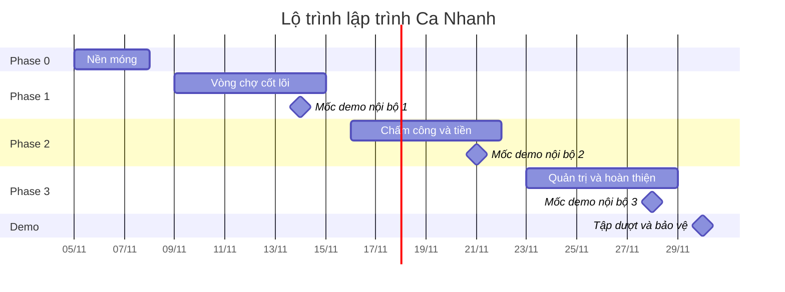

# Kế hoạch lập trình — Ca Nhanh

| Mục | Nội dung |
|---|---|
| Phiên bản | 1.0 · 04/11/2026 |
| Thời lượng | Phase 0 (3 ngày) + 3 phase × 1 tuần → sẵn sàng demo ngày **30/11/2026**. Dời các mốc nếu ngày bảo vệ khác |
| Nhóm (giả định) | 4 người: **FE-A** (màn hình người làm), **FE-B** (màn hình quán và admin), **FS** (API, Supabase, realtime), **QA** (component chung, kiểm thử, CI, công cụ demo). Nhóm 3 người thì QA kiêm FS |
| Đầu vào | [01 SRS](01-SRS.md) · [02 Use Case & Story](02-Use-Cases-User-Stories.md) · [03 HLD](03-System-Architecture-HLD.md) · [04 CSDL](04-ERD-Database-Schema.md) + [`sql/`](sql/) · [05 API](05-API-Specification.md) · [06 Giao diện](06-UI-Design-System.md) + [`design/`](../design/) |
| Đã có sẵn | CSDL và 53 hàm nghiệp vụ đã kiểm thử 92/92; hệ thiết kế (token, CSS component, hàm chuyển động, asset). Chưa có mã ứng dụng |

---

## 1. Lộ trình tổng quan

| Phase | Thời gian | Mục tiêu | Mốc kiểm tra cuối phase | Story |
|---|---|---|---|---|
| **0 · Nền móng** | 05–07/11 | Repo, Next.js, Supabase, hệ thiết kế, đăng nhập, CI, deploy | Mở URL thật, đăng nhập nhanh 3 vai trò, vào đúng khu vực | US-02, US-03, US-46 (một phần) |
| **1 · Vòng chợ** | 09–14/11 | Nạp ví, đăng ca có ký quỹ, tìm ca, nhận ca an toàn khi tranh chỗ, realtime | Chạy đoạn 0:20–1:10 của kịch bản demo trên 2 điện thoại | US-01, 04, 07, 09, 11, 12, 13, 19, 21, 22, 23 (tối thiểu), 39 (một phần) |
| **2 · Chấm công và tiền** | 16–21/11 | Kiosk QR, check-in/out + geofence, duyệt giờ công, quyết toán, ví, rút tiền, hủy và điểm phạt, tác vụ định kỳ | Chạy đoạn 1:40–3:10 (vào ca, QR cũ bị từ chối, duyệt, tiền về, rút) | US-06, 15, 23, 25, 26, 28–34, 36, 39, 46 |
| **3 · Quản trị và hoàn thiện** | 23–28/11 | Bản đồ, đánh giá, KPI, quản trị, công cụ demo, Should, PWA, hiệu năng, trợ năng, E2E | Kịch bản 5 phút chạy **2 lần liên tiếp** không cần can thiệp | US-10, 16, 17, 20, 24, 37, 38, 40, 42, 44, 45 |
| **Demo** | 30/11 | Tập dượt cuối, giữ dự án Supabase hoạt động | Checklist ngày demo ([03 §11](03-System-Architecture-HLD.md)) | |
| **4 · Sau demo** | sau 30/11 | Backlog Should/Could | | US-05, 08, 14, 18, 27, 35, 41, 43, 47 |



**Nguyên tắc chia phase**
- **Lát cắt dọc**: mỗi phase kết thúc bằng một đoạn của kịch bản demo chạy được trên URL thật, không phải "xong backend, chưa có giao diện".
- **CSDL là nền đã vững**: logic tiền, chỗ, điểm phạt nằm trong các hàm `fn_*` đã kiểm thử. API chỉ xác thực, kiểm tra đầu vào, gọi hàm, ánh xạ lỗi ([05 §10](05-API-Specification.md)). Sửa SQL thì phải thêm kiểm thử vào `docs/sql/test/`.
- **Ưu tiên theo kịch bản demo**: thứ gì xuất hiện trong 5 phút trình diễn thì làm trước và làm kỹ.
- **Khớp với [02 §7](02-Use-Cases-User-Stories.md)**: Phase 0–3 tương ứng Sprint 0–3. Khác biệt: Phase 0 dài 3 ngày thay vì 2 và làm luôn US-02, US-03 (đăng nhập nhanh, phân quyền theo vai trò); Phase 1 làm sớm bản tối thiểu của US-23 và US-39 vì kịch bản demo cần chúng.

---

## 2. Cách làm việc

### 2.1 Nhánh, commit, pull request
- `main` luôn chạy được và tự deploy lên Vercel Production. Mỗi pull request có một bản Preview riêng.
- Nhánh: `feat/p1-10-chi-tiet-ca`, `fix/p2-04-geofence`, `chore/p0-11-ci`, ghi mã task ngay đầu tên.
- Commit theo **Conventional Commits**, mô tả bằng tiếng Việt: `feat(worker): nhận ca một chạm`, `fix(api): ánh xạ SHIFT_FULL sang 409`.
- Pull request nhỏ (dưới khoảng 400 dòng), điền checklist trong `.github/pull_request_template.md`, một người review, **squash merge**.

### 2.2 Theo dõi trên GitHub
- **Milestone** = phase (Phase 0 … Phase 3). **Issue** = một task trong tài liệu này, tiêu đề bắt đầu bằng mã task (`[P1-10] …`), dùng mẫu ở §10.
- **Label**: `phase:0`…`phase:3` · `area:worker` `area:shop` `area:admin` `area:api` `area:db` `area:design` `area:infra` · `type:feat` `type:fix` `type:test` `type:chore` `type:docs`.
- **Board** (GitHub Projects): Cần làm → Đang làm → Chờ review → Xong. Standup 15 phút mỗi ngày (hoặc nhắn trong nhóm), retro 15 phút sau mỗi mốc demo nội bộ.

### 2.3 Định nghĩa "Xong" cho mọi task
- [ ] `npm run lint`, `npm run typecheck`, `npm test` đều xanh; không dùng `any`.
- [ ] Màu, chữ, bo góc lấy từ token và lớp `cn-*`; không viết cứng mã màu.
- [ ] Chạy đúng ở 360px và trên desktop, ở cả theme sáng và tối.
- [ ] Có đủ trạng thái đang tải, rỗng, lỗi; thông điệp lỗi lấy từ danh mục [05 §9](05-API-Specification.md).
- [ ] Bàn phím dùng được, focus hiện rõ, ảnh có `alt`; chuyển động có nhánh `prefers-reduced-motion`.
- [ ] Logic có unit test; endpoint mới có ít nhất 1 test thành công và 1 test lỗi chính.
- [ ] Đã xem trên Vercel Preview; tài liệu 04/05 được cập nhật nếu API hoặc CSDL thay đổi.

### 2.4 Môi trường và bí mật

| Môi trường | Ứng dụng | CSDL | Dùng để |
|---|---|---|---|
| Local | `npm run dev` | Supabase local (`npx supabase start`, cần Docker) hoặc dự án *dev* | Lập trình hằng ngày |
| Kiểm thử CSDL | | Docker PostGIS: `bash docs/sql/test/run_tests.sh` | 92 kiểm tra nghiệp vụ, chạy cả trong CI |
| Preview | Vercel Preview cho mỗi pull request | Dự án Supabase *dev* | Review |
| Demo | Vercel Production | Dự án Supabase *demo* | Thuyết trình |

Bí mật (`SUPABASE_SECRET_KEY`, `QR_SIGNING_SECRET`, `PAYMENT_WEBHOOK_SECRET`) chỉ nằm trong `.env.local` và biến môi trường của Vercel, không bao giờ commit. `.env.example` liệt kê tên biến, không chứa giá trị.

---

## 3. Phase 0 — Nền móng (05–07/11)

**Mục tiêu**: mọi người code được ngay từ thứ Hai 09/11, trên cùng một khung đã nối hệ thiết kế, Supabase, đăng nhập, CI và deploy.

| Mã | Việc | Người | Ước lượng | Hoàn thành khi |
|---|---|---|---|---|
| P0-01 | Repo GitHub `phamtuanviet/ca-nhanh` (đã tạo, private, có sẵn mẫu PR và mẫu issue trong `.github/`): mời thành viên, tạo milestone, label, board; bật bảo vệ nhánh `main` nếu gói tài khoản cho phép (repo private ở gói Free không có tính năng này, GitHub Education cấp gói Pro miễn phí cho sinh viên) | QA | 0,5 ngày | Mọi người push nhánh và mở PR được |
| P0-02 | Khởi tạo Next.js tại gốc repo (TypeScript strict, App Router, Tailwind v4, ESLint, Prettier). Thư mục đã có `design/` nên tạo ở thư mục tạm rồi chép vào (§11). Thêm script `lint`, `typecheck`, `test`, `db:types` | FS | 0,5 ngày | `npm run build` thành công |
| P0-03 | Gắn hệ thiết kế: chép `design/assets/*` vào `public/`; `globals.css` nạp `theme.css` + `components.css`; `next/font` (Be Vietnam Pro, Big Shoulders Display, subset `vietnamese` + `latin`); `next-themes`; metadata (icon, OG, manifest) + `viewport.themeColor`; trang `/dev/ui` hiện token và các lớp `cn-*` | FE-B | 1 ngày | `/dev/ui` giống trang hệ thiết kế ở cả hai theme |
| P0-04 | shadcn/ui: khởi tạo (biến CSS đã ánh xạ sẵn trong `theme.css`), thêm button, input, label, form, dialog, sheet, tabs, select, sonner; biến thể `spark`, `ghost`, `danger` cho Button | FE-A | 0,5 ngày | Các component hiện đúng màu thương hiệu |
| P0-05 | Supabase: tạo dự án *dev* và *demo* (Singapore); bật `postgis` (schema `extensions`), `btree_gist`, `pg_cron`; `npx supabase init`; chép `docs/sql/0001`–`0004` thành `supabase/migrations/2026110400000{1..4}_*.sql`; `supabase link` + `supabase db push` lên *dev*; Auth: email + mật khẩu, tắt xác nhận email cho demo, đặt Site URL | FS | 1 ngày | *dev* có 17 bảng, 53 hàm, job `ca-nhanh-tick`; `select fn_cron_tick()` chạy được |
| P0-06 | Client Supabase: `lib/supabase/client.ts` (trình duyệt), `server.ts` (`@supabase/ssr`, cookie), `admin.ts` (secret key, kèm `import 'server-only'`); `npm run db:types` sinh `lib/database.types.ts`; `.env.example` | FE-A | 0,5 ngày | Truy vấn thử `positions` từ server và client đều chạy |
| P0-07 | Nền API: `lib/api.ts` (`handle`, `requireUser` theo vai trò, `request_id`), `lib/errors.ts` (47 mã, ánh xạ `P0001`), `lib/validators/`; endpoint `GET /health`, `GET /config`, `GET /positions`, `GET /me` | FS | 1 ngày | Unit test ánh xạ lỗi xanh; `curl /api/v1/health` trả 200 |
| P0-08 | Đăng nhập (W1): `/login`, `/signup`, đăng xuất; điều hướng theo vai trò (middleware, ở Next.js 16 là `proxy.ts`); nút đăng nhập nhanh 4 tài khoản demo khi `DEMO_MODE=true` | FE-A | 1 ngày | Người làm mở `/shop` bị chuyển về `/worker`; đăng nhập nhanh hoạt động |
| P0-09 | Khung layout: `/worker` (thanh dưới: Khám phá, Ca của tôi, Ví, Hồ sơ), `/shop` (thanh bên: Hôm nay, Ca, Giờ công, Ví, Quán), `/admin` (KPI, Người dùng, Thanh toán, Cấu hình, Demo); trang giữ chỗ dùng EmptyState | FE-B | 1 ngày | Điều hướng đủ các mục, đúng ở 360px |
| P0-10 | Seed `scripts/seed.ts`: tạo 1 admin, 2 chủ quán, 30 người làm qua Admin API (`email_confirm: true`); onboarding; 6 quán ở Cầu Giấy và Hai Bà Trưng có ảnh bìa và tọa độ; gán avatar; gọi `fn_demo_reset(60, 2000000)` | QA | 1 ngày | Có 60 ngày lịch sử; ví mỗi quán 2.000.000đ; đăng nhập được mọi tài khoản demo |
| P0-11 | CI: `.github/workflows/ci.yml` (lint, typecheck, test, build) + job `db-test` chạy `bash docs/sql/test/run_tests.sh`; `keep-alive.yml` gọi `/api/v1/health` 2 lần mỗi tuần | QA | 0,5 ngày | CI xanh trên PR, job `db-test` báo 92/92 |
| P0-12 | Vercel: import repo, khai báo biến môi trường ([03 §9.2](03-System-Architecture-HLD.md)), bật Preview cho PR; thêm URL Vercel vào Redirect URLs của Supabase | QA | 0,5 ngày | `/api/v1/health` trên URL production trả 200 |

**Thứ tự**: P0-02 phải xong trong buổi sáng ngày đầu, vì mọi việc khác cần khung Next.js. Sau đó P0-03, P0-04, P0-05, P0-11 chạy song song. P0-06, P0-07, P0-10 và P0-12 cần dự án Supabase của P0-05. P0-08 cần P0-06.

**Trạng thái (04/11/2026)**: P0-02 → P0-11 đã làm trên nhánh `feat/p0-nen-mong` và kiểm tra trên Supabase cục bộ: 25 kịch bản trên trình duyệt (đăng nhập nhanh 3 vai trò, chặn sai vai trò, `?next=`, đăng ký → onboarding, hai theme), 26 unit test, 92/92 kiểm tra CSDL. Phần còn lại cần tài khoản của nhóm: tạo hai dự án Supabase *dev*/*demo* rồi `db push` và `seed` (phần cloud của P0-05, P0-10), import Vercel (P0-12), mời thành viên và tạo board (P0-01). Lệnh ở §11.

**Tiêu chí kết thúc Phase 0**: URL production chạy; đăng nhập nhanh 3 vai trò, mỗi vai trò vào đúng khu vực; `/dev/ui` khớp hệ thiết kế; CI xanh, gồm 92/92 kiểm tra CSDL.

---

## 4. Phase 1 — Vòng chợ cốt lõi (09–14/11)

### 4.1 Mục tiêu và mốc kiểm tra
Một chủ quán nạp ví bằng VietQR (giả lập), đăng ca có ký quỹ. Ca hiện trên điện thoại người làm trong vòng 2 giây. Hai người tranh chỗ cuối thì đúng một người được, và quán thấy chỗ được lấp ngay lập tức. Đây là đoạn **0:20–1:10** của kịch bản demo ([02 §8](02-Use-Cases-User-Stories.md)).

**Trong phạm vi**: onboarding, hồ sơ quán + ghim bản đồ, ví quán + nạp tiền, ước tính và đăng ca, tìm ca dạng danh sách, chi tiết ca, nhận ca, "Ca của tôi" bản tối thiểu, chuông thông báo, realtime.
**Chưa làm trong phase này**: bản đồ ca (Phase 3), check-in/out (Phase 2), hủy và điểm phạt (Phase 2), đẩy ca gấp, mời người quen, đăng nhập Google (Phase 3).

### 4.2 Task

**API (FS)**

| Mã | Việc | Endpoint → hàm CSDL | Ước lượng | Hoàn thành khi |
|---|---|---|---|---|
| P1-01 | Hồ sơ và onboarding | `POST /me/onboarding` → `fn_complete_onboarding`; `PATCH /me`; `PATCH /me/worker-profile` (kỹ năng phải thuộc `positions`) | 0,5 ngày | Dưới 18 tuổi trả `403 AGE_RESTRICTED`; đổi vai trò sau onboarding trả `409 ROLE_LOCKED`; metadata `role=admin` lúc đăng ký bị bỏ qua |
| P1-02 | Quán | `POST /shops` (lat/lng → `SRID=4326;POINT(lng lat)`), `GET /shops/mine`, `GET /shops/{id}`, `PATCH /shops/{id}` | 0,5 ngày | Tạo quán xong là đăng ca được (demo tự duyệt) |
| P1-03 | Ví và nạp tiền | `GET /wallet`; `POST /wallet/topups` (bắt buộc `Idempotency-Key`, `lib/vietqr.ts`) → `fn_create_topup`; `GET /payment-orders/{id}`; `POST /payment-orders/{id}/simulate-paid` và `POST /webhooks/payments` (HMAC, lệch tối đa 5 phút, tách mã `CN[0-9A-F]{8}`) → `fn_confirm_topup` | 1 ngày | Gửi lại cùng khóa trả đúng lệnh cũ; webhook gửi lặp không ghi có hai lần; chữ ký sai trả 401 |
| P1-04 | Đăng ca | `POST /shifts/estimate` (`lib/money.ts`, công thức giống hệt `fn_publish_shift`); `POST /shifts` → `fn_publish_shift`; `GET /shops/{id}/shifts`; `GET /shifts/{id}` (chủ quán thấy booking, người làm thấy `viewer`) | 1 ngày | Ước tính khớp SQL ở 10 bộ số kiểm thử; thiếu tiền trả `422 INSUFFICIENT_BALANCE` kèm `shortfall` |
| P1-05 | Tìm ca | `GET /shifts` → `search_shifts` (gọi bằng JWT của người dùng); kiểm tra `lat`, `lng`, `radius_km` 1–20, `sort`; phân trang | 0,5 ngày | Ca của quán đã chặn người gọi không xuất hiện |
| P1-06 | Nhận ca | `POST /shifts/{id}/bookings` → `fn_book_shift`; `GET /bookings` (người làm theo `scope`, chủ quán theo `shop_id`); `GET /bookings/{id}` | 0,5 ngày | Mỗi mã lỗi trả đúng HTTP theo [05 §4.5](05-API-Specification.md) |
| P1-07 | Thông báo | `GET /notifications` (kèm `unread_count`), `POST /notifications/read` | 0,25 ngày | Đánh dấu đã đọc thì chuông về 0 |

**Màn hình người làm (FE-A)**

| Mã | Việc | Màn hình | Ước lượng | Hoàn thành khi |
|---|---|---|---|---|
| P1-08 | Onboarding: chọn vai trò → hồ sơ (ngày sinh, kỹ năng chọn từ `/positions`, trường) | W2 | 0,5 ngày | Người làm mới vào thẳng Khám phá ca sau khi xong |
| P1-09 | Khám phá ca dạng danh sách: xin quyền vị trí (từ chối thì chọn quận), bộ lọc (ngày, vị trí, lương tối thiểu, bán kính), sắp xếp, ShiftTicket, Skeleton, EmptyState, LivePulse; realtime `shift-feed` chèn vé mới có nhãn Mới | W3 | 1,5 ngày | Ca mới đăng hiện trong ≤ 2 giây mà không tải lại; đạt tiêu chí của US-19, US-21 ([02 §5](02-Use-Cases-User-Stories.md)) |
| P1-10 | Chi tiết ca và **Nhận ca**: quán, thu nhập, SeatSlots, nút Nhận ca; xử lý từng mã lỗi (`SHIFT_FULL` → con dấu "Đủ người" và 3 ca tương tự; `BOOKING_OVERLAP`, `KYC_REQUIRED`, `FAVORITES_ONLY` …); thành công → con dấu "Đã nhận" và avatar nảy vào chỗ | W4 | 1 ngày | Gherkin [02 §6.3](02-Use-Cases-User-Stories.md) đủ 3 kịch bản |
| P1-11 | Ca của tôi (bản tối thiểu): tab Sắp tới và Lịch sử, Countdown | W5 | 0,5 ngày | Ca vừa nhận hiện ngay ở tab Sắp tới |

**Màn hình quán (FE-B)**

| Mã | Việc | Màn hình | Ước lượng | Hoàn thành khi |
|---|---|---|---|---|
| P1-12 | Hồ sơ quán: form + bản đồ Leaflet (nạp động, tile OpenStreetMap có ghi công), kéo ghim, nút "Đặt vị trí quán tại đây", tìm địa chỉ bằng Nominatim khi bấm Tìm (không gợi ý theo từng phím, tối đa 1 yêu cầu/giây) | S8 | 1 ngày | Tạo quán có tọa độ đúng, đổi bán kính chấm công được |
| P1-13 | Ví và nạp tiền: thẻ khả dụng / tạm giữ; hộp thoại nạp (mệnh giá gợi ý) → ảnh VietQR, mã tham chiếu, đếm ngược 15 phút; nút "Giả lập đã chuyển khoản" khi demo; realtime `payment-order` đóng hộp thoại và cập nhật số dư | S7 | 1 ngày | Gherkin [02 §6.1](02-Use-Cases-User-Stories.md) |
| P1-14 | Đăng ca: form (react-hook-form + Zod), ước tính chi phí cập nhật theo từng thay đổi (debounce 300ms), thiếu tiền thì hiện "Còn thiếu X · Nạp ngay", tùy chọn ưu tiên người quen và điểm tối thiểu | S2 | 1 ngày | Gherkin [02 §6.2](02-Use-Cases-User-Stories.md) |
| P1-15 | Hôm nay và chi tiết ca: ca trong ngày, các chỗ cập nhật realtime (`shop-bookings`) với hiệu ứng lấp chỗ, toast "Minh đã nhận ca" | S1, S3 | 1 ngày | Chỗ được lấp hiện trong ≤ 2 giây ở thiết bị của quán |

**Chung và kiểm thử (QA)**

| Mã | Việc | Ước lượng | Hoàn thành khi |
|---|---|---|---|
| P1-16 | Port component sang React tại `components/cn/`, giữ nguyên lớp `cn-*`: ShiftTicket, SeatSlots, Stamp, Badge, LivePulse, Countdown, EmptyState, Skeleton (props theo [`design/components.d.ts`](../design/components.d.ts), quy tắc dùng ở [`design/COMPONENTS.md`](../design/COMPONENTS.md)) | 1 ngày | Trang `/dev/ui` hiện đủ 8 component với dữ liệu mẫu |
| P1-17 | Hạ tầng realtime: hook `useRealtimeChannel` (đăng ký, hủy, trạng thái kết nối cho LivePulse, làm mới cache TanStack Query) cho các kênh ở [05 §5](05-API-Specification.md): `shift-feed`, `shop-bookings:{shopId}`, `my-bookings:{uid}`, `wallet:{uid}`, `payment-order:{id}`, `notifications:{uid}`; chuông thông báo và toast (sonner) | 1 ngày | Mất mạng thì LivePulse đổi sang "Mất kết nối, đang thử lại" |
| P1-18 | Kiểm thử: unit (`lib/money` khớp SQL, `lib/vietqr`, HMAC webhook, ánh xạ lỗi); script `scripts/race-booking.ts` (20 yêu cầu song song vào chỗ cuối); E2E Playwright "đăng ca → ca hiện realtime → nhận ca" với 2 browser context | 1,5 ngày | Script tranh chỗ ra đúng 1 × 201 và 19 × 409; E2E xanh trong CI |
| P1-19 | Mốc demo nội bộ: chạy đoạn 0:20–1:10 trên production với 2 điện thoại thật, ghi lỗi thành issue | 0,25 ngày (cả nhóm) | Có biên bản kết quả và danh sách lỗi |

### 4.3 Lịch từng ngày

| Ngày | FS | FE-A | FE-B | QA |
|---|---|---|---|---|
| T2 09/11 | P1-01, P1-02 | P1-08 | P1-12 (bản đồ) | P1-16: ShiftTicket, Badge, Skeleton |
| T3 10/11 | P1-03 | P1-09 với dữ liệu mẫu | P1-12, bắt đầu P1-13 | P1-16 còn lại, bắt đầu P1-17 |
| T4 11/11 | P1-04 | P1-09 nối API và realtime | P1-13 | P1-17, unit test của P1-18 |
| T5 12/11 | P1-05, P1-06 | P1-10 | P1-14 | Script tranh chỗ (P1-18) |
| T6 13/11 | P1-07, hỗ trợ realtime | P1-10, P1-11 | P1-15 | E2E (P1-18) |
| T7 14/11 | Sửa lỗi, cập nhật 05 nếu API lệch | Sửa lỗi | Sửa lỗi | P1-19 mốc demo |

Phụ thuộc chính: P1-09 và P1-10 cần P1-05, P1-06 (giao diện làm trước với dữ liệu mẫu, nối API khi xong); P1-13 cần P1-03; P1-14 cần P1-04; P1-15 và P1-09 cần P1-17.

### 4.4 Tiêu chí kết thúc Phase 1
1. Trên URL production, với 2 điện thoại: nạp ví → đăng ca → ca hiện ở điện thoại người làm trong ≤ 2 giây → hai người cùng bấm nhận chỗ cuối → đúng một người được, thiết bị quán thấy chỗ lấp ngay.
2. Gherkin của US-09, US-12, US-22 ([02 §6.1–6.3](02-Use-Cases-User-Stories.md)) đạt.
3. Script tranh chỗ: 20 yêu cầu song song cho ra đúng 1 × 201 và 19 × 409 `SHIFT_FULL`.
4. Lighthouse mobile trang `/worker`: LCP < 2,5 s, CLS < 0,1.
5. CI xanh: unit, E2E, 92/92 kiểm tra CSDL.

---

## 5. Phase 2 — Chấm công và tiền (16–21/11)

**Mục tiêu**: chạy đoạn **1:40–3:10** của kịch bản demo: tua tới giờ vào ca, quét ảnh QR cũ bị từ chối, quét QR thật được nhận, tua tới giờ kết thúc, check-out, quán duyệt, tiền về ví kèm hiệu ứng, rút về ngân hàng.

| Mã | Việc | Người | Ước lượng | Hoàn thành khi |
|---|---|---|---|---|
| P2-01 | `lib/qr-token.ts` (theo [05 §7](05-API-Specification.md)) và `GET /shops/{id}/checkin-token`; unit test 4 trường hợp (cùng cửa sổ, cửa sổ liền trước, hết hạn, sửa shop id) | FS | 0,5 ngày | Test xanh |
| P2-02 | Kiosk (S4) `/shop/kiosk/[shopId]`: QR thật bằng gói `qrcode` (SVG), vòng nghệ, lật mã mỗi 30 giây, Wake Lock, danh sách người đã đến (realtime) | FE-B | 1 ngày | US-28; QR quét được bằng camera điện thoại |
| P2-03 | Quét QR (W6) và deep link `/c/[token]`: BarcodeDetector, không có thì dùng `@zxing/browser`; GPS độ chính xác cao; thông điệp riêng cho từng mã từ chối | FE-A | 1,5 ngày | Gherkin [02 §6.5](02-Use-Cases-User-Stories.md) đủ 4 kịch bản |
| P2-04 | `POST /bookings/{id}/check-in` và `/check-out` → `fn_record_attendance`; từ chối trả 422 kèm `distance_m`, `allowed_m` | FS | 0,5 ngày | Lần quét bị từ chối vẫn có trong `attendance_events` |
| P2-05 | Duyệt giờ công (S5): danh sách chờ duyệt, điều chỉnh phút kèm lý do; `POST /bookings/{id}/approve` → `fn_approve_booking` | FE-B + FS | 1,25 ngày | Gherkin [02 §6.7](02-Use-Cases-User-Stories.md) |
| P2-06 | Ví người làm (W7): WalletOdometer, "+tiền", pháo giấy lần đầu; form tài khoản ngân hàng (danh sách ngân hàng lấy một lần từ `api.vietqr.io/v2/banks`, lưu tĩnh); `POST /wallet/withdrawals` (bắt buộc `Idempotency-Key`, demo tự hoàn tất) | FE-A + FS | 1,5 ngày | Gherkin [02 §6.8](02-Use-Cases-User-Stories.md); US-06, US-34 |
| P2-07 | Hủy: `GET …/cancel-preview` rồi `POST …/cancel`, cho cả `/bookings/{id}` (người làm hoặc quán hủy một người) và `/shifts/{id}` (quán hủy cả ca); hộp xác nhận ghi rõ điểm phạt hoặc bồi thường; banner tạm khóa nhận ca | FS + FE-A + FE-B | 1,5 ngày | Gherkin [02 §6.4](02-Use-Cases-User-Stories.md); US-15, US-25, US-26 |
| P2-08 | Công cụ demo cần cho kiểm thử: `POST /admin/demo/fast-forward`, `/admin/demo/tick`, `/admin/demo/reset`; nút "Tua tới giờ bắt đầu" / "Tua tới giờ kết thúc" trên chi tiết ca khi `DEMO_MODE` | FS | 0,5 ngày | Gherkin [02 §6.11](02-Use-Cases-User-Stories.md) (phần tua) |
| P2-09 | Xác minh pg_cron trên *dev*: nhắc ca, vắng mặt, tự check-out, tự duyệt hiện đúng trên giao diện và thông báo | QA | 0,5 ngày | Gherkin [02 §6.6](02-Use-Cases-User-Stories.md); US-31, US-46 |
| P2-10 | Đủ loại thông báo ([01 §3.13](01-SRS.md)) kèm liên kết mở đúng màn hình; rung 30 ms khi check-in thành công (Android) | FE-A | 0,5 ngày | US-39 |
| P2-11 | Kiểm thử: E2E check-in qua deep link (Playwright `setGeolocation`) → tua → check-out → duyệt → ví; sau E2E chạy câu SQL kiểm bất biến tiền I1–I3 ([04 §6.3](04-ERD-Database-Schema.md)) | QA | 1,5 ngày | E2E xanh; I1–I3 đúng trên *dev* |
| P2-12 | Mốc demo nội bộ: đoạn 1:40–3:10 | Cả nhóm | 0,25 ngày | Có biên bản và danh sách lỗi |

**Tiêu chí kết thúc Phase 2**: Gherkin [02 §6.4–6.8](02-Use-Cases-User-Stories.md) đạt; QR cũ và check-in ngoài vùng bị từ chối với đúng thông điệp; số dư 3 ví khớp sổ cái sau E2E; đoạn 1:40–3:10 chạy trên production.

---

## 6. Phase 3 — Quản trị, hoàn thiện và sẵn sàng demo (23–28/11)

**Mục tiêu**: kịch bản demo 5 phút chạy trọn vẹn **2 lần liên tiếp** mà không cần can thiệp; mọi story Must đã xong; giao diện, hiệu năng và trợ năng đạt yêu cầu.

| Mã | Việc | Người | Ước lượng | Hoàn thành khi |
|---|---|---|---|---|
| P3-01 | Bản đồ ca (W3): react-leaflet, marker theo quán, ca gấp nổi bật, chuyển qua lại giữa danh sách và bản đồ | FE-A | 1 ngày | US-20 |
| P3-02 | Lịch sử ví quán và giao dịch (`GET /wallet/transactions`) | FE-B | 0,5 ngày | US-10 |
| P3-03 | Đánh giá hai chiều: sheet đánh giá sau ca, thẻ nhanh, "Muốn mời lại" → người quen; `POST /bookings/{id}/reviews` | FE-A + FE-B + FS | 1,25 ngày | Gherkin [02 §6.9](02-Use-Cases-User-Stories.md); US-37, US-38 |
| P3-04 | Dashboard KPI (A1): `GET /admin/kpis`, thẻ số và biểu đồ theo ngày (Recharts), chọn khoảng ngày | FE-B + FS | 1,75 ngày | Gherkin [02 §6.10](02-Use-Cases-User-Stories.md) |
| P3-05 | Quản trị: người dùng (khóa, gỡ tạm khóa), duyệt quán, lệnh thanh toán, cấu hình tham số | FE-B + FS | 1,5 ngày | US-42, US-44 |
| P3-06 | Trang công cụ demo: reset (có bước xác nhận), tua thời gian từng ca, chạy tick ngay | FE-A | 0,5 ngày | US-45 |
| P3-07 | Should: đẩy ca gấp (US-16, `POST /shifts/{id}/boost`), ưu tiên và mời người quen (US-17, `POST /shifts/{id}/invites`), hồ sơ năng lực người làm (US-24, `GET /workers/{id}`), đăng nhập Google (FR-AUTH-02: OAuth client trên Google Cloud, bật provider trong Supabase, route `/auth/callback`) | FS + FE-A + FE-B | 2,75 ngày | Đạt tiêu chí chấp nhận ở [02 §5](02-Use-Cases-User-Stories.md) |
| P3-08 | PWA: manifest, icon, hướng dẫn "Thêm vào màn hình chính"; View Transitions từ vé sang chi tiết | FE-A | 0,5 ngày | Cài được trên Android; chuyển trang mượt |
| P3-09 | Hiệu năng: Lighthouse mobile, trace bằng Chrome DevTools MCP, bundle analyzer; sửa 3 vấn đề lớn nhất | FS | 1 ngày | LCP < 2,5 s, INP < 200 ms, CLS < 0,1 ([06 §7](06-UI-Design-System.md)) |
| P3-10 | Giao diện và trợ năng: rà soát bằng skill `web-design-guidelines`, bàn phím, tương phản hai theme, câu chữ tiếng Việt | QA | 1 ngày | Không còn lỗi mức nghiêm trọng |
| P3-11 | E2E cho toàn bộ kịch bản demo 5 phút (2 browser context), chạy trên production | QA | 1 ngày | Xanh 2 lần liên tiếp |
| P3-12 | Sẵn sàng demo: checklist [03 §11](03-System-Architecture-HLD.md), tập dượt 2 lần, quay video dự phòng 1 phút, giữ dự án Supabase hoạt động | Cả nhóm | 0,5 ngày | Checklist đã tích đủ |

**Tiêu chí kết thúc Phase 3**: tiêu chí nghiệm thu demo [01 §9](01-SRS.md) đạt đủ 8 mục; mọi story Must xong; CI xanh.

---

## 7. Phase 4 — Sau demo (backlog)

US-05 (tải ảnh xác minh), US-08 (người quen và chặn), US-14 (đổi số người), US-18 (đăng lại ca), US-27 (lời mời), US-35 (khiếu nại), US-41 (duyệt xác minh), US-43 (xử lý khiếu nại), US-47 (Web Push); các mục Could: email qua Resend, adapter cổng thanh toán thật, chat giữa quán và người làm.

---

## 8. Cắt phạm vi khi trễ tiến độ

Nếu cuối Phase 1 hoặc Phase 2 chậm hơn 1 ngày, cắt theo thứ tự sau, mục trên trước (mục Should trước, rồi tới phần Must không nằm trong lõi demo):

1. Các mục Should của P3-07: đăng nhập Google, đẩy ca gấp, mời người quen, hồ sơ năng lực người làm.
2. PWA và View Transitions (P3-08).
3. Bản đồ ca (P3-01): giữ dạng danh sách; ở bước 0:50 của kịch bản demo chiếu danh sách thay cho bản đồ.
4. Đánh giá hai chiều (P3-03): giữ điểm có sẵn trong dữ liệu seed và bỏ bước 3:30 của kịch bản demo.
5. Biểu đồ của dashboard KPI (P3-04): giữ thẻ số.

**Không cắt** phần lõi của demo: ký quỹ khi đăng ca, nhận ca an toàn khi tranh chỗ, QR xoay vòng + geofence, quyết toán khi duyệt, realtime. Lộ trình rút gọn 2 tuần (khoảng 71 SP) ở [02 §7](02-Use-Cases-User-Stories.md) là phương án cuối.

---

## 9. Rủi ro tiến độ

| Rủi ro | Dấu hiệu sớm | Cách xử lý |
|---|---|---|
| Realtime chậm hoặc rớt kết nối | Ca mới hiện sau hơn 2 giây ở mốc demo 1 | Thu hẹp bộ lọc kênh; khi mất kết nối thì tự gọi lại API mỗi 10 giây; tốc độ lớn mới tính chuyển sang Broadcast |
| Camera hoặc GPS trên iOS Safari | Lỗi ở P2-03 khi thử iPhone | Ưu tiên deep link `/c/[token]` qua camera hệ thống; cờ `skip_geofence` khi demo trong phòng |
| Dự án Supabase Free bị tạm dừng | Health check lỗi | `keep-alive.yml`; mở dashboard trước mỗi mốc demo |
| Một người làm không kịp phần mình | Task trễ quá 1 ngày ở standup | Kéo QA sang hỗ trợ; cắt phạm vi theo §8 |
| Sửa nhầm logic SQL đã kiểm thử | CI `db-test` đỏ | Không merge khi `db-test` đỏ; muốn đổi hàm thì thêm kiểm thử trước |

---

## 10. Mẫu issue cho mỗi task

Viết đủ để một thành viên khác, hoặc một agent như Claude Code, làm được mà không cần hỏi lại. Mẫu trống hiện sẵn khi bấm *New issue* trên GitHub (`.github/ISSUE_TEMPLATE/task.md`). Ví dụ đã điền:

```markdown
[P1-10] Chi tiết ca và nút Nhận ca
Milestone: Phase 1 · Label: area:worker, type:feat

Tài liệu: 02 §4.4 (UC-11), 02 §6.3 (Gherkin), 05 §4.5 (endpoint, mã lỗi), hệ thiết kế: ShiftTicket, SeatSlots, Stamp
Việc:
- Trang app/worker/shifts/[id]/page.tsx: thông tin quán, thu nhập, SeatSlots, nút "Nhận ca"
- Gọi POST /api/v1/shifts/{id}/bookings; thành công → Stamp "Đã nhận" + avatar nảy vào chỗ
- SHIFT_FULL → Stamp "Đủ người" + 3 ca tương tự; các mã lỗi khác hiện thông điệp ở 05 §9
Hoàn thành khi:
- [ ] Gherkin 02 §6.3 đạt cả 3 kịch bản
- [ ] Định nghĩa "Xong" (07 §2.3)
Phụ thuộc: P1-05, P1-06 (API), P1-16 (component)
Không làm: check-in (P2-03), hủy ca (P2-07)
```

---

## 11. Chạy dự án

**Trên máy** (cần Node 22+ và Docker):

```bash
git clone git@github.com:phamtuanviet/ca-nhanh.git && cd ca-nhanh
npm install
npm run db:start     # Supabase cục bộ: API 127.0.0.1:55321, Studio :55323, Mailpit :55324 (cổng 553xx để không trùng dự án Supabase khác)
npm run env:local    # sinh .env.local từ Supabase cục bộ, kèm khóa QR/webhook và DEMO_PASSWORD ngẫu nhiên
npm run seed         # 1 admin, 2 chủ quán, 30 người làm, 6 quán, 60 ngày lịch sử
npm run dev          # http://localhost:3000 → Đăng nhập → Đăng nhập nhanh
```

Trước khi mở pull request: `npm run lint && npm run typecheck && npm test && npm run db:test`. Đổi SQL: tạo migration mới bằng `npx supabase migration new <tên>`, chạy `npm run db:reset` để áp lại, rồi `npm run db:types`.

**Lên Supabase cloud** (dự án *dev*, làm lại với *demo*):

```bash
npx supabase login                                  # mở trình duyệt, đăng nhập tài khoản Supabase của nhóm
npx supabase link --project-ref <dev-project-ref>
npx supabase db push                                # áp 4 migration
SEED_ENV_FILE=.env.dev npm run seed                 # .env.dev: NEXT_PUBLIC_SUPABASE_URL, SUPABASE_SECRET_KEY, DEMO_PASSWORD của dự án dev
```

Sau đó import repo vào Vercel, khai báo biến theo `.env.example` (giá trị của dự án *demo* cho Production, *dev* cho Preview), thêm URL Vercel vào *Authentication → URL Configuration* của Supabase, và đặt secret `APP_URL` cho workflow `keep-alive`.
