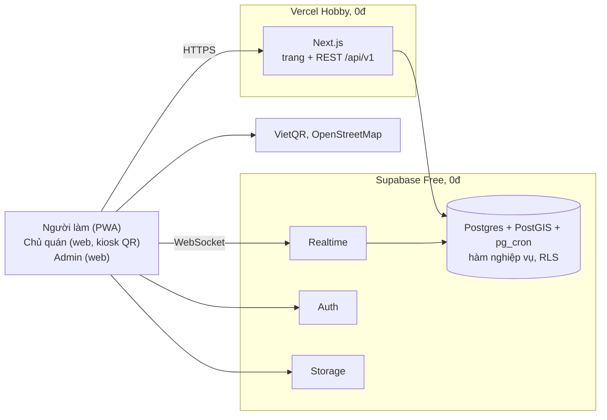

# Ca Nhanh: bộ tài liệu thiết kế

> **Chợ ca làm theo giờ giữa quán và người làm.** Quán đăng ca lúc 2 giờ chiều, 5 giờ có người đến làm, tối người làm nhận lương. Theo mô hình Timee (Nhật Bản): không phỏng vấn, nhận ca một chạm, chấm công bằng QR, tiền được **ký quỹ** trước nên người làm không lo bị quỵt.

Bộ tài liệu này phục vụ việc dựng **bản demo** cho ý tưởng 1 trong slide "3 ý tưởng TMĐT – Business Model Canvas". Ràng buộc: chỉ dùng PaaS miễn phí, làm nhanh trong 2–3 tuần, nhưng vẫn đủ ấn tượng khi thuyết trình.

## Các tài liệu

| # | Tài liệu | Nội dung | Đọc khi |
|---|---|---|---|
| 01 | [SRS: Đặc tả yêu cầu](01-SRS.md) | Phạm vi, persona, 78 yêu cầu chức năng (MoSCoW), 28 quy tắc nghiệp vụ, vòng đời trạng thái, NFR, tiêu chí nghiệm thu, rủi ro, ma trận truy vết | Trước tiên: thống nhất "làm cái gì" |
| 02 | [Use Case & User Stories](02-Use-Cases-User-Stories.md) | 24 use case (10 đặc tả chi tiết), 47 user story kèm story point, tiêu chí Gherkin, kế hoạch 3 sprint, **kịch bản demo 5 phút** | Chia việc, viết test, tập dượt demo |
| 03 | [Kiến trúc hệ thống / HLD](03-System-Architecture-HLD.md) | Chọn công nghệ (so sánh Supabase / Firebase / tự dựng), sơ đồ C4, 5 sơ đồ tuần tự, realtime, bảo mật, đồng thời, triển khai từng bước, checklist ngày demo, 10 ADR | Trước khi code |
| 04 | [ERD & Database Schema](04-ERD-Database-Schema.md) | ERD, từ điển dữ liệu 17 bảng, mô hình sổ cái tiền + bất biến, danh mục 53 hàm, RLS, chỉ mục, kết quả kiểm thử, phụ lục SQL | Làm phần dữ liệu, review logic tiền |
| 05 | [API Specification](05-API-Specification.md) | 66 endpoint REST `/api/v1`, sự kiện Realtime, webhook thanh toán, đặc tả token QR, URL VietQR, 47 mã lỗi, mẫu Route Handler | Làm frontend và API |
| 06 | [Giao diện, hình ảnh và công cụ](06-UI-Design-System.md) | Tham khảo đối thủ, bảng màu Lam Ca / Nghệ / Ngọc (đã kiểm tương phản), chữ, motif vé ca, 10 khoảnh khắc chuyển động, ngân sách hiệu năng, agent skill và MCP nên dùng, hình ảnh đã thu thập | Trước khi dựng giao diện |
| 07 | [Kế hoạch lập trình](07-Implementation-Plan.md) | 4 phase từ 05/11 đến buổi demo 30/11/2026; từng task kèm người làm, ước lượng, tiêu chí xong; lịch từng ngày của Phase 1; quy trình Git/GitHub, Định nghĩa "Xong", cắt phạm vi khi trễ, mẫu issue | Đầu mỗi phase, khi tạo issue |
| | [`sql/`](sql/) | Migration `0001`–`0004` **đã chạy và kiểm thử** + thư mục `test/` (92 kiểm tra) | Dựng CSDL trên Supabase |
| | [`../design/`](../design/) | `theme.css`, `components.css`, hàm chuyển động, đặc tả 12 component (`COMPONENTS.md`, `components.d.ts`), logo, icon PWA, ảnh OG, 8 ảnh, 6 minh họa, 16 avatar. Xem trực tiếp: [Hệ thiết kế Ca Nhanh](https://claude.ai/artifact/4uG7edwcZRAKQcbZptsw62) | Dựng giao diện (Phase 0–1) |

## Kiến trúc trong một hình

- **Không có máy chủ tự quản**, chi phí hạ tầng 0đ.
- Quy tắc khó (giữ chỗ khi nhiều người bấm cùng lúc, chống trùng giờ, ký quỹ, quyết toán, điểm phạt) nằm trong các hàm PostgreSQL, **đã kiểm thử 92/92**, kể cả kiểm thử hai phiên tranh chỗ song song.
- Điểm nhấn khi demo: ca hiện trên điện thoại người làm trong ≤ 2 giây; hai người tranh chỗ cuối thì đúng một người được; QR đổi mỗi 30 giây + geofence; tiền vào ví ngay khi quán duyệt; dashboard KPI có dữ liệu.

## Bắt đầu nhanh cho nhóm phát triển

1. Đọc [SRS §2–§4](01-SRS.md) (mục tiêu, chức năng, quy tắc) và [kịch bản demo](02-Use-Cases-User-Stories.md) để hiểu đích đến.
2. Chạy kiểm thử CSDL trên máy (cần Docker): `bash docs/sql/test/run_tests.sh`. Kết quả mong đợi: 92 dòng bắt đầu bằng `ok`, không có `CHECK FAILED`.
3. Chạy ứng dụng trên máy theo [07 §11](07-Implementation-Plan.md) (`npm run db:start`, `env:local`, `seed`, `dev`), rồi nhận task theo [kế hoạch lập trình](07-Implementation-Plan.md); mỗi task là một issue trên GitHub.
4. Sinh kiểu TypeScript từ CSDL, rồi làm từng endpoint theo [API §3](05-API-Specification.md) với khuôn mẫu ở [API §10](05-API-Specification.md).
5. Thiếu thời gian thì cắt phạm vi theo [07 §8](07-Implementation-Plan.md); phương án cuối là lộ trình rút gọn 2 tuần ở [02 §7](02-Use-Cases-User-Stories.md) (≈ 71 SP).

## Quy ước mã định danh

| Tiền tố | Ý nghĩa | Định nghĩa ở |
|---|---|---|
| `FR-<NHÓM>-nn` | Yêu cầu chức năng (AUTH, PRF, SHP, SFT, SRC, BKG, ATT, PAY, RAT, NTF, ADM, SYS) | 01 §3 |
| `BR-nn` | Quy tắc nghiệp vụ (giá trị mặc định nằm trong `platform_settings`) | 01 §4 |
| `NFR-<NHÓM>-nn` | Yêu cầu phi chức năng | 01 §8 |
| `UC-nn` · `US-nn` · `EP-nn` | Use case · user story · epic | 02 |
| `ADR-nn` | Quyết định kiến trúc | 03 §13 |
| `I1`–`I5` | Bất biến tiền | 04 §6.3 |
| `fn_*` | Hàm nghiệp vụ trong CSDL | 04 §7 |
| Mã lỗi `SCREAMING_CASE` | Lỗi API, khớp với `RAISE EXCEPTION` trong SQL | 05 §9 |

Ma trận truy vết từ yêu cầu → use case → story → API → bảng nằm ở [SRS Phụ lục A](01-SRS.md).

## Xem sơ đồ

Các sơ đồ viết bằng **Mermaid**. GitHub hiển thị trực tiếp. Trong VS Code, cài extension *Markdown Preview Mermaid Support* (`bierner.markdown-mermaid`) rồi mở bản xem trước bằng `Ctrl+Shift+V`.

## Trạng thái

| Hạng mục | Trạng thái |
|---|---|
| Tài liệu 01–07 | Bản 1.0 để nhóm review |
| Lược đồ CSDL + hàm nghiệp vụ | Đã viết, đã kiểm thử trên PostgreSQL 17 + PostGIS 3.5 (92/92) |
| Hệ thiết kế | Xong: token, CSS component, hàm chuyển động, đặc tả component, asset trong `design/` |
| Mã nguồn ứng dụng Next.js | Phase 0 và Phase 1 xong trên máy (Supabase cục bộ); chưa có dự án Supabase cloud và Vercel. Xem [07 §3–§4](07-Implementation-Plan.md) |
| Cần nhóm điền | `[Tên nhóm]`, tài khoản ngân hàng demo cho VietQR, khu vực/quận demo |
| Cần kiểm chứng | Phí 20%, mức phạt, giả định thị trường: phỏng vấn 10–15 người ở cả hai phía (tuần 1 trong slide) |
